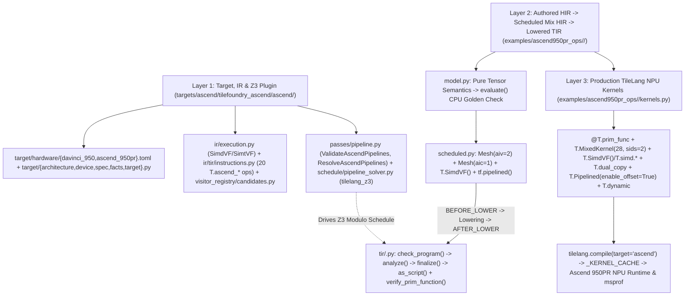
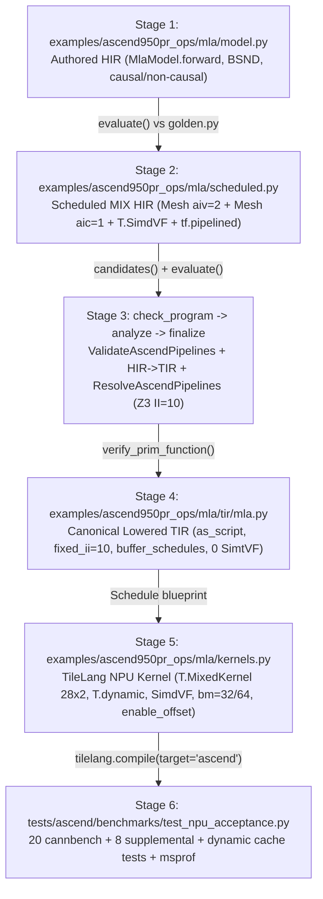

# TileFoundry Ascend 950PR Adaptation Architecture and MLA End-to-End Guide

## 1. Three-Layer Adaptation Architecture

TileFoundry adapts to Ascend 950PR (`ascend.950pr` / `DaVinci950`, compiler arch `dav_3510`) through a three-layer architecture that separates hardware modeling and Z3 scheduling, target-aware HIR/TIR lowering and CPU verification, and high-performance TileLang NPU Mix/SimdVF kernel execution:

### 1.1 Layer 1: Target, IR & Z3 Scheduling Plugin (`targets/ascend/tilefoundry_ascend/ascend/`)

- **Document-Backed Hardware Model (`target/`)**:
  - `DaVinci950` (`target/architecture.py`, `target/hardware/davinci_950.toml`, ID `ascend.davinci_950`, identity `dav_3510`): models 1 AIC and 2 AIV coupled per logical block, 64 `f32` SIMD lanes (256 B vector unit width), up to 1024 virtual threads per AIV inside `T.SimtVF`, `16x16x16` Cube MMAD fractal geometry, supported compute dtypes `(f16, bf16, f32)`, ISA capabilities `("ascend.dma", "ascend.mmad", "ascend.vector", "ascend.dual_copy")`, buffer alignments (`UB`: 32 B, `L1`: 32 B, `L0A`/`L0B`/`L0C`: 512 B), and explicit memory ownership (`tmem -> aic`, `smem -> aiv`, `rmem -> lane`).
  - `Ascend950PR` (`target/device.py`, `target/hardware/ascend_950pr.toml`, ID `ascend.950pr`): models 28 coupled blocks (`sm_count=28`, `aic_count=28`, `aiv_count=56`), 128 GiB `target`-owned HBM (`137,438,953,472 B`, 1.6 TB/s nominal bandwidth), per-AIC matrix scratchpads (`L1`: 512 KiB, `L0A`: 64 KiB, `L0B`: 64 KiB, `L0C`: 256 KiB), per-AIV Unified Buffer (`256 KiB` nominal / `216 KiB` = `221,184 B` usable), `256 B` `rmem` per lane, and 400 TFLOPS nominal AIC `f16`/`bf16` peak.
  - `AscendTarget` (`target/target.py`, registered as `"ascend"`, `torch_device_type() -> "npu"`) and `target/facts.py`: compose `DaVinci950` and `Ascend950PR` via `build_davinci_950` / `build_ascend_950pr` (`target/spec.py`) and project `TopologyFacts` (`block -> aic -> aiv -> lane`, parallel level `"block"`), `MemoryExecutionFacts`, `MemoryHierarchyFacts` (`host`, `gmem`, `tmem`, `smem`, `rmem`), `AscendSpaceFacts`, `ThroughputFacts`, and `PerformanceServiceFacts`.
- **Execution Modes (`ir/execution.py`)**:
  - Declares and registers both `SIMDVF_KIND` (`name="ascend.simdvf"`, surface `T.SimdVF`) and `SIMTVF_KIND` (`name="ascend.simtvf"`, surface `T.SimtVF`). Both require topology `("aiv",)` and operate over `(StorageKind.RMEM, StorageKind.CARRIER)` with `mask_width_bits=32`, `conversion_mask_width_bits=16`, and `element_dtypes=(DType.f32,)`. `T.SimdVF` is the primary high-performance vector mode.
- **Ascend TIR Instruction Set (`ir/tir/instructions.py`) & Candidate Lowering (`visitor_registry/candidates.py`)**:
  - Defines 20 `T.ascend_*` TIR operations across four hardware engines:
    - *DMA & Register Copies (`ascend.dma`)*: `AscendGmToUb`, `AscendUbToGm`, `AscendGmToL1`, `AscendL1ToL0A`, `AscendL1ToL0B`, `AscendL0cToGm` (outside `SimdVF`), plus `AscendUbToReg` and `AscendRegToUb` (inside `SimdVF`).
    - *Cube Matrix Engine (`ascend.mmad`)*: `AscendMmad` on `aic` mesh (`a_layout`, `b_layout`, `init_zero`) accumulating into `f32` `tmem` (`L0C`).
    - *Cross-Core Bridge (`ascend.dual_copy`)*: `AscendDualCopy` between `tmem` (`L0C`/`L1`) and `smem` (`UB`) without round-tripping through HBM.
    - *AIV Vector Engine (`ascend.vector`, inside `T.SimdVF` on `aiv` mesh)*: `AscendVadd`, `AscendVsub`, `AscendVmul`, `AscendVdiv`, `AscendVmax`, `AscendVexp`, `AscendVrsqrt`, `AscendVcast`, `AscendVreduceSum`, `AscendVreduceMax`.
  - Every instruction registers `typeinfer`, ISL `access_relation`, CPU `schedule_eval`, and `verify_stmt`.
  - `register_target_candidates("ascend", ...)` binds `MatMul -> (AscendMmad,)`, `Cast -> (AscendVcast,)`, and `Reshard -> (AscendGmToUb, AscendUbToGm, AscendGmToL1, AscendL1ToL0A, AscendL1ToL0B, AscendL0cToGm, AscendUbToReg, AscendRegToUb)`.
- **Pipeline Validation & Z3 Modulo Scheduling (`passes/pipeline.py`, `schedule/pipeline_solver.py`)**:
  - `ValidateAscendPipelines` (`PassPoint.BEFORE_LOWER`): validates `PipelineSpec` bounds (`fixed_ii >= 1`, `max_buffer_versions >= 1`, `stage <= max_stage`) and buffer spaces against `AscendSpaceFacts`.
  - `ResolveAscendPipelines` (`PassPoint.AFTER_LOWER`): runs `extract_tir_loop_problem` -> `solve_ascend_pipeline` (`tilelang_z3`) -> `verify_assignment` -> `build_resolved_spec`, rewriting each pipelined TIR `For` with solved `fixed_ii`, per-task stages/latencies, and per-buffer version counts while publishing summaries under `module.metadata["ascend.pipelines"]`.

### 1.2 Layer 2: Authored HIR, Scheduled Mix HIR & Lowered TIR (`examples/ascend950pr_ops/<op>/`)

- Separates the pure tensor formulation (`model.py`), explicit Ascend 950PR Mix + `SimdVF` + `tf.pipelined` schedule (`scheduled.py`), and lowered TIR artifact (`tir/<op>.py`).
- Both `model.py` and `scheduled.py` execute on CPU via `tilefoundry.evaluator.evaluate` for numerical equivalence checks against PyTorch golden references, and lowered TIR modules are verified structurally by `verify_prim_function`.

### 1.3 Layer 3: Production TileLang NPU Kernels (`examples/ascend950pr_ops/<op>/kernels.py`)

- Implements the verified Mix/SIMD schedule directly in `tilelang.ascend.language` (`@T.prim_func` compiled via `tilelang.compile(..., target="ascend")`) for CANN 9.3.0 / `dav_3510` execution using `T.MixedKernel`, `T.SimdVF()` + `T.simd.*`, `T.dual_copy`, `T.gemm`, `T.Pipelined(..., annotations={"enable_offset": True})`, `T.annotate_buffer_versions`, and `T.dynamic` kernel cache reuse.

---

## 2. Core Design Decisions and Adaptation Steps

1. **Coupled 1-AIC : 2-AIV Mix Execution and On-Chip `dual_copy` Bridge**
   - Ascend 950PR pairs 1 AIC core (`tmem`: `L1`/`L0A`/`L0B`/`L0C`) with 2 AIV cores (`smem`: private `UB`). TileFoundry keeps AIC and AIV transfers in disjoint spaces bridged on-chip by `AscendDualCopy` / `T.dual_copy`, avoiding HBM spills for `S = Q @ K^T`, quantized probabilities `P`, and `O_tile = P @ V`.
   - Row tiles (`bm`) are partitioned symmetrically across `sids=2` (`rows_per_sid = bm // 2`), halving per-AIV `UB` pressure; the Z3 solver models this via `aiv_factor = 2` in `_tensor_byte_size`.

2. **Migration from `SimtVF` to `SimdVF` (64-Lane `f32` SIMD Vectorization)**
   - Replacing `T.SimtVF` scalar thread emulation with `T.SimdVF()` and hardware-native 256 B vector intrinsics (`pset`, `vld` with `NORM_B32`/`BRC_B32`, `vsts` with `ONEPT_B32`/`PK_B32`, `vcmax`, `vcadd`, `vexp`, `vmul`/`vadd`/`vsub`/`vdiv`, `vcvt`) unlocks vector-unit throughput across AIV cores.
   - Across benchmarked shapes, migrating `tuned` kernels from `SimtVF` to `SimdVF` achieved **1.61x to 7.77x** speedups on MLA and **1.18x to 3.34x** speedups on Attention Residual.

3. **Single-Pass Online Flash Softmax Without HBM Score/Probability Materialization**
   - Both Layer 2 (`scheduled.py`) and Layer 3 (`kernels.py`) maintain loop-carried `f32` accumulators `(m_ub, l_ub, O_ub)` / `(m_ub, l_ub, o_acc_ub)` inside `UB`, updating running row-max, rescale factor `alpha = exp(m_old - m_safe)`, running sum, and rescaled `O` inside a single KV-block loop.
   - Clamping `m_safe = max(m_new, -1e30)` plus validity predicates protects fully masked causal rows against `exp(-inf - (-inf))` `NaN` propagation.

4. **Loop-Carried Z3 Modulo Pipeline Solver & Selective Multi-Buffering**
   - In `targets/ascend/tilefoundry_ascend/ascend/schedule/pipeline_solver.py`, `extract_tir_loop_problem` tracks outer buffers read before being written inside a pipelined loop (`first_readers_before_write`), emits `Edge(distance=1)` recurrence dependencies back from the writer, collapses recurrence cycles in `_assign_dag_stages`, and pins loop-carried accumulators to `fixed=1` while assigning `auto_min=1, auto_max=max_buffer_versions` to intra-iteration reused buffers.
   - `_estimate_task_latency` computes normalized cycle quanta (`1..8`) from DMA bytes, Cube MMAD FLOPs, or `SimdVF` element counts so Z3 balances cross-engine stages cleanly.
   - In production `mla/kernels.py`, `T.annotate_buffer_versions` pins on-chip accumulators and scratch buffers (`q_nope_l1`, `q_rope_l1`, `p_l1`, `s_l0c`, `o0_l0c`, `o1_l0c`, `S_ub`, `P_ub`, `O_tmp0_ub`, `O_tmp1_ub`, `O_ub`, `m_ub`, `l_ub`, `alpha_ub`, etc.) to `1` so HBM-to-L1 streaming KV buffers (`k_nope_l1`, `k_rope_l1`, `v0_l1`, `v1_l1`) can double-buffer within the `512 KiB` L1 and `216 KiB` usable UB budgets under `num_stages=2` and `enable_offset=True`.

5. **Split-`D_nope` Value GEMM, Adaptive `bm=32/64` Tiling, Causal Block Pruning & `T.dynamic` Cache Reuse**
   - When `d_nope = 512`, `d0 = min(d_nope, 256)` and `d1 = d_nope - d0` split `P @ V` into two Cube+`dual_copy` phases so `O_tmp` fits inside `L0C` and `UB`.
   - `mla()` selects `use_bm64 = (schedule_mode == "tuned" and q_rows >= 64 and (b_dim * n_kv * m_tiles_64) >= 14)` to increase tile reuse on large prefill/batch workloads without starving the 28-block grid on small workloads.
   - Causal `kv_limit` prunes upper-triangular KV blocks whose column indices strictly exceed `max_s + s_kv - s_dim`.
   - Symbolic extents `T.dynamic("b_dim")`, `T.dynamic("q_total_rows")`, and `T.dynamic("s_kv")` allow `_KERNEL_CACHE` to reuse compiled binaries across batch sizes and sequence lengths (**13** compilations across **20** MLA cannbench shapes; **19** across **20** Attention Residual shapes).

---

## 3. End-to-End Flow Walkthrough: MLA (`Multi-Head Latent Attention`)

### Stage 1: Authored Mathematical HIR (`examples/ascend950pr_ops/mla/model.py`)
- `build()` defines `MlaModel.forward` over `q_nope: (B, S, N_q, D_nope)`, `q_rope: (B, S, N_q, D_rope)`, `k_nope`, `k_rope`, and `v` with grouped-query factor `G = N_q // N_kv`.
- Expresses `concat([q_nope, q_rope])`, `concat([k_nope, k_rope])`, head-group reshapes into `(B * N_kv, G * S, D_qk)`, `tf.matmul(..., out_dtype="f32")`, `scale`, causal `kj > qi + (S_kv - S)` masking (`-1e9`), `tf.softmax`, and `probs @ v_h` output projection.
- Verified directly on CPU via `tilefoundry.evaluator.evaluate` against `tests/ascend/benchmarks/mla/golden.py` in `tests/ascend/operators/test_hir_tir_workflow.py`.

### Stage 2: Candidate Discovery & Scheduled Mix HIR (`examples/ascend950pr_ops/mla/scheduled.py`)
- `tilefoundry.schedule.candidates` resolves target-scoped Ascend TIR instructions (`AscendMmad`, `AscendVcast`, DMA copy ops) against `AscendTarget("ascend.950pr")`.
- `MlaScheduled.forward` authors the single-loop Mix schedule over `Mesh(("aiv",), (2,), names=("v",))`:
  - Initializes persistent on-chip UB state: `m_ub = -1e30`, `l_ub = 0.0`, `o_acc_ub = 0.0`, `scale_tile_ub`.
  - Iterates `for kt in tf.pipelined(kv_tiles, max_stage=2, max_buffer_versions=2, enable_offset=True)`:
    1. **Mask DMA**: `T.ascend_gm_to_ub` loads the `(M, kv_tile)` causal mask tile into UB.
    2. **AIC Block #1 (QK GEMM)**: `T.ascend_gm_to_l1` + `T.ascend_l1_to_l0a`/`l0b` load `q_nope`/`k_nope` and `q_rope`/`k_rope`; two `T.ascend_mmad` calls (`init_zero=True` then `init_zero=False`) accumulate `S` in `tmem` (`L0C`); `T.ascend_dual_copy` moves `S` to `s_ub`.
    3. **SimdVF #1 (Online Softmax)**: Computes `scaled = s * scale`, `masked = scaled + mask`, row-max `m_tile`, updates `m_next = max(m_prev, m_tile)`, rescale factor `alpha = exp(m_prev - m_next)`, local probabilities `p_f32 = exp(masked - m_next)`, updates `l_next = l_prev * alpha + sum(p_f32)`, casts `p_cast = vcast(p_f32, dtype)`, and stores `m_ub`, `l_ub`, `alpha_ub`, and `p_ub`.
    4. **AIC Block #2 (PV GEMM)**: `T.ascend_dual_copy` bridges `p_ub` (`smem`) back to `p_l1` (`tmem`), `T.ascend_gm_to_l1` loads `v_tile`, `T.ascend_mmad` computes `o1 = P @ V`, and `T.ascend_dual_copy` transfers `o_tile_ub` back to `smem`.
    5. **SimdVF #2 (Output Accumulation)**: Rescales loop-carried `o_acc_ub` by `alpha_ub` and adds `o_tile_ub`.
  - **Epilogue SimdVF & Store**: Divides `o_acc_ub` by `l_ub`, casts to output dtype, and writes to HBM via `T.ascend_ub_to_gm`.

### Stage 3: Lowering, Memory Analysis & Z3 Pipeline Solving
- `check_program -> analyze(analysis="memory") -> finalize` executes:
  1. `ValidateAscendPipelines` (`PassPoint.BEFORE_LOWER`) checks `PipelineSpec` limits against `AscendSpaceFacts`.
  2. Core lowering converts HIR ops and regions into TIR `For`, `MeshScope`, `ExecutionScope(SIMDVF_KIND)`, `T.tensor_view` with static UB/L1/L0A/L0B/L0C byte offsets (for example `o_acc_ub` at `0`, `value` at `16384`, `scale_tile_ub` at `32768`, `m_ub` at `34816`, `l_ub` at `35072` in the reference lowered config).
  3. `ResolveAscendPipelines` (`PassPoint.AFTER_LOWER`) invokes `extract_tir_loop_problem` + `solve_ascend_pipeline`: for `MlaScheduled.forward`, the loop `kt` extracts 22 tasks (`t0_ascend_gm_to_ub` through `t21_simdvf`) across stages `0..2`, solves to `fixed_ii=10`, pins loop-carried accumulators `('m_ub', 'fixed', 1)`, `('l_ub', 'fixed', 1)`, `('o_acc_ub', 'fixed', 1)`, and double-buffers loop-internal tile buffers (`'value_1'`, `'s0'`, `'o0'`, etc. at `('fixed', 2)`).
  4. `verify_prim_function` validates IR integrity, scopes, and types.

### Stage 4: Canonical Lowered TIR Artifact (`examples/ascend950pr_ops/mla/tir/mla.py`)
- Emitted by `as_script(lowered)` as a self-contained runnable TIR module with explicit `tf.pipelined(..., fixed_ii=10, task_intents=..., buffer_schedules=...)` metadata and zero `SimtVF` occurrences (`test_zero_simtvf_in_scheduled_tir_and_kernels`).

### Stage 5: Production TileLang NPU Mix Kernel (`examples/ascend950pr_ops/mla/kernels.py`)
- `_build_mla_prim_func` constructs `@T.prim_func main` under `with T.MixedKernel(28, sids=2) as (bx, sid)` with symbolic shapes `b_dim = T.dynamic("b_dim")`, `q_total_rows = T.dynamic("q_total_rows")`, `s_kv = T.dynamic("s_kv")`.
- Evenly distributes `total_m_tiles = b_dim * n_kv * ceil(q_rows / bm)` across the 28 blocks; loads `Q_nope`/`Q_rope` per AIV (`rows_per_sid = bm // 2`) via `T.copy` + `T.dual_copy` into `q_nope_l1`/`q_rope_l1` (with prior `SimdVF` zero-init).
- Runs `for kv in T.Pipelined(kv_limit, num_stages=2, annotations={"enable_offset": True})` (when `schedule_mode == "tuned"`) using `kv_limit` causal pruning:
  - Streams `K_nope`, `K_rope`, and split `V` (`d0` / `d1`) into L1 via `T.copy(..., transpose=True)`.
  - Computes QK^T via `T.gemm` (`q_nope_l1 @ k_nope_l1^T` + `q_rope_l1 @ k_rope_l1^T`) into `s_l0c`, bridges via `T.dual_copy(s_l0c, S_ub)`.
  - Runs `T.SimdVF()` online softmax using `T.simd.vci`, `vcmps`, `vsel`, `vcmax`, `vmax`, `vmaxs`, `vsub`, `vexp`, `vcadd`, `vadd`, `vmul`, `vcvt(..., part=0)`, and `vsts(dist="PK_B32", extent=64)` to update `m_ub`, `l_ub`, `alpha_ub`, and `P_ub`.
  - Bridges `T.dual_copy(P_ub, p_l1)` to AIC, runs split-`D_nope` `T.gemm` (`o0_l0c` and optional `o1_l0c`) + `T.dual_copy` to `O_tmp0_ub`/`O_tmp1_ub`, rescales and accumulates `O_ub` in a second `T.SimdVF()` block.
- Divides `O_ub` by `l_ub` (`vdiv` + `vcvt`) in the epilogue `T.SimdVF()`, writes `Out` via `T.copy`, and caches the compiled binary per `(n_q, n_kv, d_nope, d_rope, tl_dtype, input_layout, is_causal, use_bm64, schedule_mode)` in `_KERNEL_CACHE`.

### Stage 6: NPU Acceptance, Benchmark & `msprof` Verification (`tests/ascend/benchmarks/test_npu_acceptance.py`)
- Validated on NPU 0 across all 20 MLA cannbench shapes (`BSND` and `BNSD`, causal and non-causal, `float16` and `bfloat16`), 8 supplemental GQA/head-tail shapes, and dynamic shape cache reuse (`5 passed` in `test_npu_acceptance.py`, 0 skipped, 0 failed).
- Representative `msprof` & benchmark highlight (`level4/mla_11`, `q=[128,1,128,512]`, `k=[128,1024,1,512]`, BSND non-causal `float16`): **0.4302 ms** median (**84.87 TFLOPS**, **745.9 GB/s**), a **1.50x** speedup over `baseline` (`0.6459 ms`) and **7.77x** speedup over prior `SimtVF` (`3.3410 ms`), with `mad=31.6%`, `aic_mte2=57.8%`, `aiv_vec=37.6%`.
