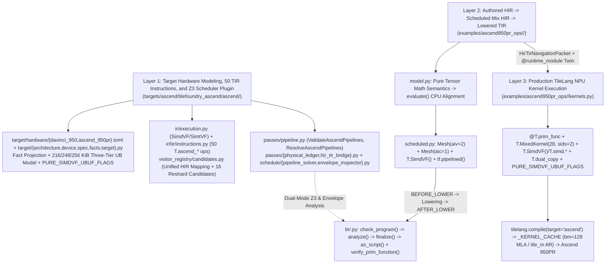
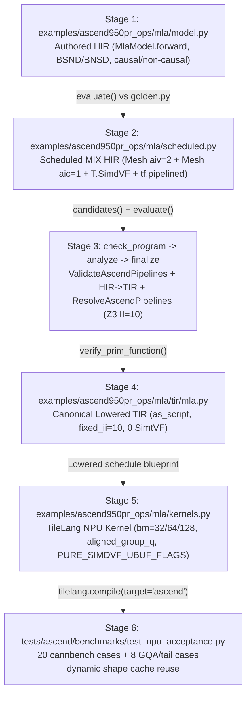
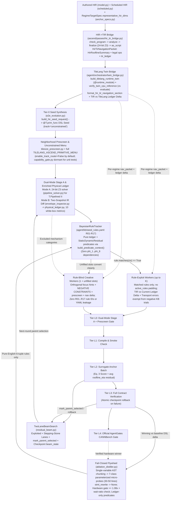

# TileFoundry Ascend 950PR Architecture, Core Mechanisms, and E2E Evolution Guide

## 1. Three-Layer Backend & Compilation Architecture

TileFoundry targets Ascend 950PR (`ascend.950pr` / `DaVinci950`, compiler architecture `dav_3510`) through a three-layer architecture that decouples hardware-document modeling, target-aware HIR/TIR lowering with dual-channel CPU checks (`evaluate` + `verify_prim_function`), Z3 Modulo pipeline scheduling, and production TileLang NPU Mix/`SimdVF` kernel execution:

---

## 2. Layer 1 Core Mechanisms and Design

### 2.1 Fact Projection: Cross-Backend Decoupling and Least Privilege

Within `targets/ascend/tilefoundry_ascend/ascend/target/{facts.py,target.py,spec.py}`, `target.get_facts(FactType)` enforces both horizontal decoupling and vertical isolation:

1. **Decoupling Across Backends**: Core compiler components (memory `analyze`, candidate filtering `candidates`, lowering `finalize`, schedule verification) never bind to backend-private TOML or device fields across NVIDIA CUDA, Apple Metal, or Ascend NPU. Instead, they query canonical protocol facades (`TopologyFacts`, `MemoryHierarchyFacts`, `MemoryExecutionFacts`, `ThroughputFacts`, `PerformanceServiceFacts`). Hardware differences remain confined inside each target's `facts.py` projection.
2. **Least Privilege and Evidence Isolation**: Each hardware facade exposes only the minimum fields required for its decision scope (for example, `AscendSpaceFacts` exposes only on-chip capacities and alignment constraints). `check_document_evidence` rejects policy or topology override injections inside hardware TOML specifications so optimization policy never pollutes physical device tables.

### 2.2 216 / 248 / 256 KiB Mode-Aware Three-Tier AIV UB Model

Under Ascend `dav-3510` hardware rules and default CCE compiler behavior, each AIV owns 256 KiB (262,144 B) of physical Unified Buffer SRAM, yielding three distinct usable capacities by execution mode:

| Mode / Compiler Flags | Usable UB | Byte Limit | Hardware & Compiler Reservation Notes |
| :--- | ---: | ---: | :--- |
| **Hybrid / `SimtVF` Mode** | **216 KiB** | `221,184 B` | Subtracts 32 KiB SIMT Data Cache (`SHARES_CAPACITY_WITH` physical SRAM) plus 8 KiB default compiler VF stack / ASC reserve |
| **Pure `SimdVF` Default** | **248 KiB** | `253,952 B` | No SIMT memory accesses; skips 32 KiB SIMT Data Cache partition and keeps 8 KiB default VF stack / ASC reserve |
| **Pure `SimdVF` Unreserved** | **256 KiB** | `262,144 B` | Releases the full 256 KiB when `PURE_SIMDVF_UBUF_FLAGS = ("--cce-disable-vf-stack-reserved-ubuf", "--cce-disable-asc-reserved-ubuf")` is active without register spill |

- **Data Model Grounding**: `ascend_950pr.toml` declares `simdvf_usable_per_aiv = 253952`; `facts.py` models the implicit `simt_dcache` (32 KiB) `SHARES_CAPACITY_WITH` constraint inside `MemoryHierarchyFacts` and provides `AscendSpaceFacts.ub_limit_bytes(mode, unreserved_ubuf=...)`.
- **Mode-Aware Z3 Constraints**: `_contains_simtvf(fn_stmt)` in `pipeline_solver.py` detects `ExecutionScope("ascend.simtvf")`, relaxing multi-buffer capacity limits for pure `SimdVF` loops to `248 KiB` (or `256 KiB` when `unreserved_ubuf=True`) while keeping `SimtVF`-containing loops strictly at `216 KiB`.

### 2.3 50 Generalized `SimdVF` TIR Instructions and Unified HIR Lowering

`targets/ascend/tilefoundry_ascend/ascend/ir/tir/instructions.py` provides **50 `T.ascend_*` instructions** (each with `typeinfer`, ISL `access_relation`, CPU `schedule_eval`, and `verify_stmt`):

1. **Cube MMAD (1 op)**: `AscendMmad` (`aic` mesh, `f32` `L0C` accumulation).
2. **Unified Semantic HIR Target Family (5 ops)**: `AscendVbinary` (`kind: BinaryKind` covering `ADD`, `SUB`, `MUL`, `DIV`, `MAX`, `MIN`, `LT`, `LE`, `GT`, `GE`, `EQ`, `NE`), `AscendVunary` (`kind: UnaryKind` covering `NEG`, `ABS`, `EXP`, `LOG`, `SQRT`, `RSQRT`, `SIGMOID`, `TANH`), `AscendVreduce` (`kind: ReduceKind` + `keepdim` covering `SUM`, `MAX`, `MIN`, `PROD`), `AscendVwhere`, and `AscendVclamp`.
3. **Explicit Predicate, Scalar-Vector, Index, and FMA Ops (27 ops)**:
   - Arithmetic, reduction, and cast ops: `AscendVadd`, `AscendVsub`, `AscendVmul`, `AscendVdiv`, `AscendVmax`, `AscendVexp`, `AscendVrsqrt`, `AscendVcast`, `AscendVreduceSum`, `AscendVreduceMax`, `AscendVsel`;
   - Predicate synthesis and logic: `AscendPset`, `AscendUpdateMask`, `AscendPand`, `AscendPor`, `AscendPxor`, `AscendPnot`, `AscendVcmp`, `AscendVcmps` (enforcing 32-bit `elem_width=32` `SIMDVF_KIND` predicate granularity);
   - Scalar-vector, broadcast, index, and fused multiply-add: `AscendVadds`, `AscendVmuls`, `AscendVmaxs`, `AscendVmins`, `AscendVdup`, `AscendVdupv`, `AscendVci` (`INC_ORDER`/`DEC_ORDER`), `AscendVmula`.
4. **Core & 4 Extended `Reshard` / DMA / `dual_copy` Ops (17 ops)**: Detailed in Section 2.4.

> **Why Unified `HirBinary` Avoids `ScheduleRefusal` Ambiguity**:
> - NVGPU and core `common.py` bind `HirBinary` to a single candidate `(TirBinary,)` carrying `kind = ParamDef(attribute, BinaryKind)`, so `select_instruction` sees `len(fitting) == 1`.
> - Registering five separate classes `(AscendVadd, AscendVsub, AscendVmul, AscendVdiv, AscendVmax)` without a `BinaryKind` discriminant shares identical `(RMEM, RMEM) -> RMEM` placement and hits `len(fitting) == 5`, raising `ScheduleRefusal`.
> - Ascend maps `HirBinary -> (AscendVbinary,)`, `HirUnary -> (AscendVunary,)`, `HirReduce -> (AscendVreduce,)`, `HirWhere -> (AscendVwhere,)`, and `HirClamp -> (AscendVclamp,)`, propagating `kind` through `candidate_operands` for zero-annotation HIR lowering to `SimdVF` TIR.

### 2.4 NVGPU vs Ascend `Reshard` Multi-Candidate Design and 4 Redistribution Extensions

On NVGPU (`targets/nvidia`), `Reshard` binds `(CopyAsync, CopyAsyncTensor, CopyReduceAsyncTensor, LdMatrix, StMatrix)` plus core `Copy` into a 6-candidate list (covering async gather, TMA 5D box swizzle, L2 atomic reduction writeback, and warp matrix layout instructions), requiring explicit `tf.schedule(..., op=...)` selection when `len(fitting) != 1`.

Without altering core `src/tilefoundry/`, Ascend preserves unambiguous 1-to-1 automatic defaults across storage transfer directions while registering **16 `Reshard` candidates** across **4 redistribution families** using exact `ParamDef.pattern.storage` checks and constrained predicates:

| Extension Class | Added TIR Instructions | Engine / Scope | Redistribution Capabilities |
| :--- | :--- | :--- | :--- |
| **1. Cross-Core On-Chip `dual_copy`** | `AscendDualCopyL0cToUb`, `AscendDualCopyUbToL1` | `dual_copy_engine` / `ascend.dual_copy` (`_OUTSIDE_VF`) | Symmetric M/N `tmem <-> smem` split transfer with optional ND-to-NZ conversion and automatic default `tmem<->smem` selection |
| **2. Format Conversion & Padding DMA** | `AscendGmToL1Nz`, `AscendGmToUbPad` | `mte2_engine` / `ascend.dma` (`_OUTSIDE_VF`) | Hardware `nd2nz`/`dn2nz` fractal conversion, 2D tail transpose (`transpose=True`), and `pad_value` right-padding for unaligned trailing axes |
| **3. Structured `SimdVF` Register Dist** | `AscendVldDist`, `AscendVstsDist` | `vector_engine` / `ascend.vector` (`_INSIDE_VF`) | `NORM_B32`/`US_B16`/`BRC_B32` `(M,1)->(M,N)` broadcast load and `NORM_B32`/`PK_B32`/`ONEPT_B32` `(M,N)->(M,1)` lane-0 scalar store |
| **4. Writeback Hardware Atomics** | `AscendUbToGmAtomic`, `AscendL0cToGmAtomic` | `mte3_engine` / `fixpipe_engine` (`ascend.dma`) | Marks `dst` `READ \| WRITE` for store-mode DMA in-place `add`/`max`/`min` reductions; models `L0C->GM` FixPipe `quant_pre` `f32->f16/bf16` |

### 2.5 `dav-3510` Writeback Hardware Accumulation Model (`T.copy` & `T.dual_copy`)

Across TileLang Ascend IR (`T.copy`, `T.dual_copy`, `T.set_atomic`, `RewriteDualCopy`, `CodeGenAscend`) and CANN primitives (`asc_copy_l0c2gm`, `asc_copy_ub2gm_align`, `asc_copy_l0c2ub`, `ST_L2CacheType`), hardware writeback accumulation follows three strict architectural boundaries:

1. **Stateful Store-Mode DMA Atomic Register (`SpecialRegister::kAtomicMode`)**: Tile writebacks use per-core stateful control registers configured via `T.set_atomic(op="add"|"max"|"min", dtype=...)` (`PIPE_S`) and reset via `T.set_atomic_none()`. AutoSchedule inserts `PIPE_S -> PIPE_MTE3` and `PIPE_S -> PIPE_FIX` barriers for all GM-writing `T.copy` and `T.dual_copy` ops with `ReadsAtomicRegister() = true`, enabling L2/memory-controller read-modify-write across `fp32`/`fp16`/`bf16`/`int8`/`int16`/`int32`.
2. **Two GM Atomic Writeback Paths and `l2_cache_ctrl`**:
   - **AIC FixPipe Path (`T.copy(l0c, gm)` -> `asc_copy_l0c2gm`)**: Fuses `L0C` readout, `NZ2ND` conversion, optional `quant_pre` (`f32 -> f16/bf16`), and GM atomic reduction in one hardware pass.
   - **AIV MTE3 Path (`T.copy(ub, gm)` / `T.dual_copy(ub, gm)` -> `asc_copy_ub2gm_align`)**: `RewriteDualCopy` (`kSoftwareUBToGM`) splits M/N work per `sid` across dual AIVs with L2 reduction hints (`NORMAL_RED=3`, `NOTALLOC_RED=7`, `WBH_RED=11`, `WTS_RED=15`).
3. **On-Chip `L0C -> UB` Bridge (`T.dual_copy(l0c, ub)`) Boundary**: `kHardwareL0CToUB` (`asc_copy_l0c2ub`) overwrites dual-AIV UBs on `PIPE_FIX` (`eltwise_op = DEFAULT`) and **does not** support hardware atomic accumulation or `quant_pre` (both `src` and `dst` must remain `float32`). Same-block QK accumulation stays in `L0C` (`clear_accum=False`), whereas cross-KV online-softmax rescaling lands in temporary UB slots via `T.dual_copy(o_l0c, O_tmp_ub)` for `T.SimdVF()` vector accumulation.

---

## 3. Key Ascend 950PR Performance Optimizations

1. **1-AIC : 2-AIV Coupled Mix Execution**: `T.MixedKernel(28, sids=2)` partitions `bm` evenly into `rows_per_sid = bm // 2`, halving single-AIV UB footprint; `pipeline_solver.py` models this via `aiv_factor = 2`.
2. **Pure `SimdVF` 248 / 256 KiB UB Unlocking & Expanded `TileSize`**:
   - **MLA**: BSND GQA (`n_kv == 1` folded into contiguous M) enables `bm = 128` (`rows_per_sid = 64`) and direct `GM -> L1` `aligned_group_q` loads without `UB -> L1` detours, using split `O_tmp0_ub`/`O_tmp1_ub` (`8 x d_nope`) dual writebacks and `PURE_SIMDVF_UBUF_FLAGS` to reach **0.3129 ms (109+ TFLOPS)** on `mla_11`.
   - **AttentionResidual**: Computes `_choose_ar_tile_m` against the `256 KiB` pure-`SimdVF` budget (`D=2048..2560` -> `tile_m=8`, `D=3072` -> `7`, `D=4096` -> `5`, `D=5120/6144` -> `3`, `D=7168` -> `2`) with an isolated `v_tail_ub` tail block preserving `num_stages=2` multi-buffering in the main loop.
3. **Single-Pass Online Flash Softmax with Predicate Protection**: Maintains `f32` `(m_ub, l_ub, O_ub)` in UB with `m_safe = max(m_new, -1e30)` and `vcmps`/`vsel` valid-column masking to prevent `NaN` on fully masked causal rows.
4. **Cross-Iteration (`distance=1`) Z3 Modulo Solving**: `pipeline_solver.py` detects read-before-write loop-carried state and fixes `fixed=1` while solving optimal intra-iteration stage assignment and multi-buffer versions.

---

## 4. Six-Stage MLA End-to-End (E2E) Lowering Flow

1. **Stage 1 (`model.py`)**: Expresses pure tensor math (`concat([q_nope, q_rope])`, KV-head repeat, `tf.matmul`, scaling, causal mask, `tf.softmax`, `probs @ v_h`), validated against `golden.py` via CPU `evaluate`.
2. **Stage 2 (`scheduled.py`)**: Binds hardware primitives via `candidates()` (`T.ascend_mmad`, `T.ascend_dual_copy`, `T.ascend_vcast`, `T.SimdVF()`, `tf.pipelined(kv_tiles, max_stage=2, max_buffer_versions=2, enable_offset=True)`) and verifies numerical equivalence on CPU.
3. **Stage 3 (`check_program -> analyze -> finalize`)**: Executes `ValidateAscendPipelines`, `ConvertHIRToTIR`, `ResolveAscendPipelines` (Z3 `fixed_ii=10` within 248 KiB pure `SimdVF` UB), and `verify_prim_function`.
4. **Stage 4 (`tir/mla.py`)**: Emits standardized TIR (`as_script`) carrying resolved pipeline decisions and zero `SimtVF` scopes.
5. **Stage 5 (`kernels.py`)**: Builds the `@T.prim_func` (`T.MixedKernel(28, sids=2)`, `T.dynamic`, `_choose_mla_bm`, `PURE_SIMDVF_UBUF_FLAGS`, split-`D_nope` writeback) cached in `_KERNEL_CACHE`.
6. **Stage 6 (NPU Hardware Acceptance)**: Runs 20 `cannbench` cases, 8 GQA/tail cases, and dynamic cache reuse checks on Ascend 950PR (latest latency records in [ascend950pr_adaptation.md](./ascend950pr_adaptation.md)).

---

## 5. Autonomous Causal Evolution and 5-Tier Campaign Architecture

Beyond static lowering, `targets/ascend/tilefoundry_ascend/agent/` closes the loop from Layer 2 HIR/TIR navigation to verified knowledge distillation while preserving strict compiler rule-blindness (`targets/ascend/tilefoundry_ascend/ascend/` never imports `tilefoundry_ascend.agent` or operator names):

### 5.1 Layer 2 -> Layer 3 HIR/TIR Navigation, Twin Bridge & Dual-Mode Stage A

- **Layer 2 -> Layer 3 `HirTirNavigationPacket` Bridge (`ascend/passes/hir_tir_bridge.py`)**: `compile_hir_navigation_packet()` ingests `Authored HIR (model.py)`, optional `Scheduled HIR (scheduled.py)`, and `anchor_dims` (from `RegimeTargetSpec.representative_hir_dims` in `agent/campaign/anchor_specs.py`), executes `check_program` -> `analyze` -> `finalize` (24-bit Z3 pipeline solver) -> `verify_prim_function` -> `as_script`, and emits a `HirTirNavigationPacket` containing:
  - `HirRooflineSummary` (`compute_flops`, `min_gm_bytes`, `arithmetic_intensity`, `compute_floor_us`, `memory_floor_us`, `ideal_roofline_us`, `dominant_bound`),
  - Legal `HirCandidateOpEntry` mappings from `report_candidates()`,
  - Lowered `tir_script` (`as_script` TIR blueprint) and `z3_pipeline_summary`,
  - `tir_ledger` (`ObjectivePhysicalLedger` via `inspect_tir_envelope()`), providing the Layer 2 reference target for Tier-0 seed synthesis (`e2e_evolution.py`), inner/outer loop prompts (`portfolio_runner.py`, `e2e_evolution.py`), and auto-discovered per-regime campaigns (`PerfTargetCampaignRunner._compile_regime_nav_packets()` in `campaign_runner.py`).
- **`@runtime_module` TileLang Twin Bridge (`agent/orchestrator/twin_bridge.py`)**:
  - `build_tilelang_runtime_twin()` wraps a candidate TileLang kernel runner in a `@runtime_module` class matching the authored HIR module's `@runtime_func` signature and coercing outputs to CPU tensors.
  - `verify_twin_cpu_reference()` generates deterministic seeded CPU inputs and verifies the `@runtime_module` twin directly against HIR CPU `evaluate()`.
  - `format_hir_tir_navigation_section()` formats the analytical roofline, legal TIR candidates, lowered TIR blueprint, and the **TIR Blueprint vs Current TileLang Ledger Delta** (`steady_state_ii`, `dominant_pipe`, `ub_peak_bytes`, `gm_roundtrip_bytes`) whenever `current_tl_ledger` and `packet.tir_ledger` are both available.
- **Unconstrained Track Default (`enable_track_router=False`)**: The 8-dimensional track router (`agent/router/capability_gate.py`) is disabled by default (`enable_track_router=False`) across `gate_funnel.py`, `portfolio_runner.py`, `e2e_evolution.py`, and `campaign_runner.py`, keeping `capability_gate.py` dormant for standalone unit tests only. Evolution and campaign candidates operate on `track="unconstrained"` with unrestricted access to the full `TILELANG_ASCEND_PRIMITIVE_MENU`.
- **Dual-Mode Stage A & Enriched Physical Ledger (`envelope_inspector.py`, `physical_ledger.py`, `gate_funnel.py`)**:
  - **Mode A (Static `T.Pipelined` Modulo Solver)**: Runs 24-bit Z3 scheduling (`pipeline_solver.py`) for explicit `T.Pipelined` stages to resolve `steady_state_ii` and buffer versions.
  - **Mode B (Two-Snapshot IR Diff Envelope Inspector)**: Captures `BEFORE_LOWER` and `AFTER_LOWER` lowered snapshots in `envelope_inspector.py` to quantify real on-chip waterlines, implicit compiler bloat (`peak_allocated_bytes - explicit_bytes`), and `degraded_single_buffers`.
  - **10 Enriched White-Box Metrics**: `ObjectivePhysicalLedger` (`build_objective_physical_ledger()`) tracks `grid_blocks`, `wave_occupancy`, `gm_roundtrip_bytes`, `dominant_contig_bytes`, `effective_cube_m`, `has_indirect_gather`, `has_lowbit_quant`, `has_online_rescale_loop`, `in_loop_ub_reload_stores`, and `uses_unreserved_ubuf`.
- **Tile-Size Neighborhood Prescreening (`tilesize_prescreen.py`)**: Evaluates candidate `tile_kwargs` grids against static memory limits inside `agent/orchestrator/` before dispatching workers, passing legal neighborhoods and cliff warnings into worker prompts.

### 5.2 Ledger-Driven Causal Rules, Portfolio Allocation & 5-Tier Campaign

- **17 Pure Ledger-Driven Causal Rules (`agent/kb/seed_rules.yaml`, `R01`-`R17`)**: `R01_DUAL_COPY_1C2V_SPLIT` through `R17_RMEM_ACCUM_AND_256KB_UB_UNLOCK` evaluate `regime_guard`, `precondition`, and `expected_postcondition` strictly over enriched `ObjectivePhysicalLedger` fields and `StaticDynamicResidual` telemetry via `build_predicate_context()` (`agent/kb/schema.py`). All `phi_1..phi_8` feature predicates are removed from `seed_rules.yaml` and from `ablation_distiller.py` generated predicates.
- **Unbiased Slot Allocation (`portfolio_runner.py`, `campaign_runner.py`)**: Workers evaluate `rule.matches(ctx)` against the current ledger and residual, dispatch `rule_exploit` workers strictly for matched rules, and convert unfilled rule slots into orthogonal `creative_explore` workers with dedicated `CREATIVE_FOCUS_HINTS` and `HirTirNavigationPacket` ledger deltas. LLM transport/watchdog failures (`503`, timeouts, sandbox tool aborts) never trigger `record_outcome(..., postcondition_realized=False)`.
- **Rule-Blind Negative Constraints**: Creative workers receive generic `NEGATIVE CONSTRAINTS` mechanism summaries and prescreen reports without any `R01..R17` rule identifiers or YAML snippets.
- **5-Tier Auto-Discovered Campaign Pyramid (`agent/campaign/campaign_runner.py`)**: `PerfTargetCampaignRunner` automatically discovers sibling `model.py` and `scheduled.py` HIR files alongside the target kernel module, compiles per-regime `HirTirNavigationPacket` guidance using `RegimeTargetSpec.representative_hir_dims`, and advances candidates through `L0 (Stage A Z3/Envelope & Prescreen) -> L1 (Compile & Smoke) -> L2 (Surrogate Anchor Batch scoring Eq. 3 + roofline_eta residual) -> L3 (Full Contract Verification with atomic state rollback) -> L4 (Official AgentGates CANNBench)`. `TwoLaneBeamSearch` persists `"beam_state"` (exploited + stepping-stone lanes and selection decay counts via `mark_parent_selected`) inside atomic checkpoints for lossless `--resume`.

### 5.3 Fail-Closed Counterfactual Micro-Probe Flywheel

- **7 Parameterized Mechanism Classes (`ablation_distiller.py`)**: `_classify_edit` and `_extract_probe_params` decompose winning AST chunks (`core_parallelism`, `coalesced_copy`, `pipeline_versions`, `ssbuf_handoff`, `barrier_prune`, `dual_copy_1c2v`, `pad_alignment`) and synthesize standalone 30-50 line isolated `(baseline_probe_source, optimized_probe_source)` pairs with concrete AST-derived dimensions, core counts, stage depths, and dtypes.
- **Fail-Closed Hardware Gate & Ledger-Only Rule Distillation**: Unmapped arbitrary edits (`stmt_rewrite`) return `synthesize_micro_probe(chunk) -> None` and are rejected as `unverifiable_edit_kind:stmt_rewrite` with zero KB writes. Mapped probes must achieve numerical accuracy, `>= 1.08x` default hardware speedup, and non-regressing `msprof_detail` MTE2 wait ratios (`aiv_mte2`, `aiv_vec`, `aic_fixpipe`) before `distill_causal_rule()` admits pure-English 6-tuple `AscendCausalRule` entries (with ledger-only `ObjectivePhysicalLedger` + `StaticDynamicResidual` predicates) into `BayesianRuleTracker`.
