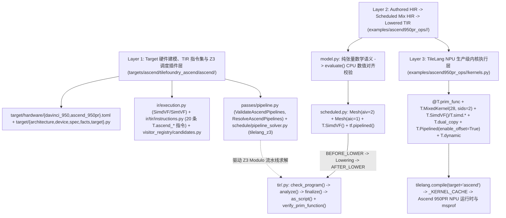
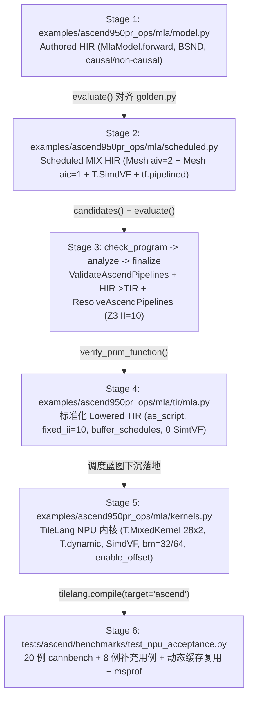

# TileFoundry 适配 Ascend 950PR 总体架构与 MLA 端到端流程指南

## 1. 三层适配总体架构

TileFoundry 通过三层架构适配 Ascend 950PR（`ascend.950pr` / `DaVinci950`，编译器架构 `dav_3510`），将硬件建模与 Z3 调度、目标感知的 HIR/TIR 下沉与 CPU 验证、以及高性能 TileLang NPU Mix/SimdVF 内核执行清晰解耦：

### 1.1 Layer 1：Target 硬件建模、TIR 指令集与 Z3 调度插件层（`targets/ascend/tilefoundry_ascend/ascend/`）

- **文档驱动的硬件建模（`target/`）**：
  - `DaVinci950`（`target/architecture.py`、`target/hardware/davinci_950.toml`，ID 为 `ascend.davinci_950`，编译器标识 `dav_3510`）：建模每个逻辑 block 耦合 1 个 AIC 与 2 个 AIV、64 条 `f32` SIMD lane（256 B 向量宽度）、`T.SimtVF` 模式下每 AIV 最多 1024 个虚拟线程、`16x16x16` Cube MMAD 分形计算原子、支持计算数据类型 `(f16, bf16, f32)`、ISA 能力集 `("ascend.dma", "ascend.mmad", "ascend.vector", "ascend.dual_copy")`、片上缓存对齐约束（`UB`: 32 B，`L1`: 32 B，`L0A`/`L0B`/`L0C`: 512 B）以及显式内存归属（`tmem -> aic`、`smem -> aiv`、`rmem -> lane`）。
  - `Ascend950PR`（`target/device.py`、`target/hardware/ascend_950pr.toml`，ID 为 `ascend.950pr`）：建模 28 个耦合 block（`sm_count=28`、`aic_count=28`、`aiv_count=56`）、128 GiB `target` 所属 HBM（`137,438,953,472 B`，名义带宽 1.6 TB/s）、每 AIC 矩阵片上缓存（`L1`: 512 KiB、`L0A`: 64 KiB、`L0B`: 64 KiB、`L0C`: 256 KiB）、每 AIV 统一缓冲 UB（256 KiB 名义 / 216 KiB = `221,184 B` 可用）、每 lane `256 B` `rmem` 预算以及 400 TFLOPS 名义 AIC `f16`/`bf16` 算力上限。
  - `AscendTarget`（`target/target.py`，注册名为 `"ascend"`，`torch_device_type() -> "npu"`）与 `target/facts.py`：通过 `build_davinci_950` / `build_ascend_950pr`（`target/spec.py`）组合 `DaVinci950` 与 `Ascend950PR`，向编译器上层投影 `TopologyFacts`（`block -> aic -> aiv -> lane`，并行层级 `"block"`）、`MemoryExecutionFacts`、`MemoryHierarchyFacts`（`host`、`gmem`、`tmem`、`smem`、`rmem`）、`AscendSpaceFacts`、`ThroughputFacts` 与 `PerformanceServiceFacts`。
- **执行模式声明（`ir/execution.py`）**：
  - 声明并注册 `SIMDVF_KIND`（`name="ascend.simdvf"`，DSL 接口 `T.SimdVF`）与 `SIMTVF_KIND`（`name="ascend.simtvf"`，DSL 接口 `T.SimtVF`）。二者均要求 `("aiv",)` 拓扑，作用于 `(StorageKind.RMEM, StorageKind.CARRIER)`，配备 32-bit 谓词掩码（`conversion_mask_width_bits=16`）与 `element_dtypes=(DType.f32,)`。其中 `T.SimdVF` 为高性能 SIMD 向量化主路径。
- **Ascend TIR 指令集（`ir/tir/instructions.py`）与候选下沉绑定（`visitor_registry/candidates.py`）**：
  - 围绕四大硬件执行引擎注册共 20 条 `T.ascend_*` TIR 指令：
    - *DMA 与寄存器搬运（`ascend.dma`）*：`AscendGmToUb`、`AscendUbToGm`、`AscendGmToL1`、`AscendL1ToL0A`、`AscendL1ToL0B`、`AscendL0cToGm`（位于 `SimdVF` 作用域外），以及 `AscendUbToReg`、`AscendRegToUb`（位于 `SimdVF` 作用域内）。
    - *Cube 矩阵引擎（`ascend.mmad`）*：`AscendMmad` 运行于 `aic` mesh（支持 `a_layout`、`b_layout`、`init_zero`），在 `tmem`（`L0C`）中以 `f32` 累加。
    - *跨核片上桥接（`ascend.dual_copy`）*：`AscendDualCopy` 直接在 `tmem`（`L0C`/`L1`）与 `smem`（`UB`）之间传输，避免经 HBM 中转。
    - *AIV 向量引擎（`ascend.vector`，位于 `aiv` mesh 的 `T.SimdVF` 内）*：`AscendVadd`、`AscendVsub`、`AscendVmul`、`AscendVdiv`、`AscendVmax`、`AscendVexp`、`AscendVrsqrt`、`AscendVcast`、`AscendVreduceSum`、`AscendVreduceMax`。
  - 每条指令均完整注册 `typeinfer`、ISL `access_relation`、CPU 模拟 `schedule_eval` 以及 `verify_stmt` 校验规则。
  - `register_target_candidates("ascend", ...)` 为 `ascend` 目标绑定 `MatMul -> (AscendMmad,)`、`Cast -> (AscendVcast,)` 以及 `Reshard -> (AscendGmToUb, AscendUbToGm, AscendGmToL1, AscendL1ToL0A, AscendL1ToL0B, AscendL0cToGm, AscendUbToReg, AscendRegToUb)`。
- **流水验证与 Z3 Modulo 调度 Pass（`passes/pipeline.py`、`schedule/pipeline_solver.py`）**：
  - `ValidateAscendPipelines`（`PassPoint.BEFORE_LOWER`）：依据 `AscendSpaceFacts` 校验 HIR 阶段 `PipelineSpec` 约束（`fixed_ii >= 1`、`max_buffer_versions >= 1`、`stage <= max_stage` 及存储空间合法性）。
  - `ResolveAscendPipelines`（`PassPoint.AFTER_LOWER`）：串联 `extract_tir_loop_problem` -> `solve_ascend_pipeline`（基于 `tilelang_z3`） -> `verify_assignment` -> `build_resolved_spec`，将求得的 `fixed_ii`、各任务所属阶段与延迟、以及各 buffer 版本数写回 TIR `For.pipeline`，并将求解摘要记录到 `module.metadata["ascend.pipelines"]`。

### 1.2 Layer 2：Authored HIR、Scheduled Mix HIR 与 Lowered TIR 层（`examples/ascend950pr_ops/<op>/`）

- 将纯张量数学表达（`model.py`）、显式 Ascend 950PR Mix + `SimdVF` + `tf.pipelined` 调度表达（`scheduled.py`）以及下沉后的 TIR 产物（`tir/<op>.py`）三态解耦。
- `model.py` 与 `scheduled.py` 均可在纯 CPU 环境下通过 `tilefoundry.evaluator.evaluate` 与 PyTorch golden 参考实现进行数值对齐验证；下沉后的 TIR 模块由 `verify_prim_function` 完成结构、作用域与类型检查。

### 1.3 Layer 3：TileLang NPU 生产级内核执行层（`examples/ascend950pr_ops/<op>/kernels.py`）

- 将经过验证的 Mix/SIMD 调度方案直接落为 `tilelang.ascend.language` 的 `@T.prim_func` 内核，通过 `tilelang.compile(..., target="ascend")` 编译并运行于 CANN 9.3.0 / `dav_3510` 硬件平台，综合使用 `T.MixedKernel`、`T.SimdVF()` + `T.simd.*`、`T.dual_copy`、`T.gemm`、`T.Pipelined(..., annotations={"enable_offset": True})`、`T.annotate_buffer_versions` 与 `T.dynamic` 动态 shape 编译缓存复用。

---

## 2. 适配 Ascend 950PR 的五大核心设计与关键步骤

1. **1-AIC : 2-AIV 耦合 Mix 执行与片上 `dual_copy` 跨核桥接**
   - Ascend 950PR 每个物理计算单元簇将 1 个 AIC 核心（`tmem`：`L1`/`L0A`/`L0B`/`L0C`）与 2 个 AIV 核心（`smem`：各自独立的 `UB`）耦合。TileFoundry 将 Cube 与 Vector 的存储空间严格隔离，并通过 `AscendDualCopy` / `T.dual_copy` 在片上直接传递 `S = Q @ K^T`、量化概率 `P` 以及 `O_tile = P @ V`，消除中间张量向 HBM 溢出的开销。
   - 行分块 `bm` 在 `sids=2` 个 AIV 间对称切分（`rows_per_sid = bm // 2`），使单 AIV 的 `UB` 占用减半；Z3 求解器通过 `_tensor_byte_size` 中的 `aiv_factor = 2` 对该内存折半特性进行精确建模。

2. **从 `SimtVF` 迁移至 `SimdVF`（64-Lane `f32` 硬件原生向量化）**
   - 将原先基于虚拟线程模拟的 `T.SimtVF` 全面替换为 `T.SimdVF()` 与硬件原生 256 B 宽向量指令（`pset`、采用 `NORM_B32`/`BRC_B32` 分布模式的 `vld`、采用 `ONEPT_B32`/`PK_B32` 分布模式的 `vsts`、`vcmax`、`vcadd`、`vexp`、`vmul`/`vadd`/`vsub`/`vdiv`、`vcvt`），充分释放 AIV 向量单元流水吞吐。
   - 在实测用例中，从 `SimtVF` 迁移至 `SimdVF` 后，`tuned` 模式在 MLA 上取得 **1.61x ~ 7.77x** 加速，在 Attention Residual 上取得 **1.18x ~ 3.34x** 加速。

3. **单遍 Online Flash Softmax 消除中间 HBM 落盘**
   - Layer 2（`scheduled.py`）与 Layer 3（`kernels.py`）均在单个 KV 块循环内使用片上 `UB`（`f32`）维护循环携带累加器 `(m_ub, l_ub, O_ub)` / `(m_ub, l_ub, o_acc_ub)`，实时完成当前行最大值更新、缩放因子 `alpha = exp(m_old - m_safe)` 计算、归一化指数求和与历史输出缩放累加。
   - 通过 `m_safe = max(m_new, -1e30)` 钳位与有效列掩码谓词保护，避免全屏蔽因果行在归约阶段出现 `exp(-inf - (-inf))` 导致的 `NaN`。

4. **跨迭代（`distance=1`）Z3 Modulo 流水求解与选择性多缓冲**
   - 在 `targets/ascend/tilefoundry_ascend/ascend/schedule/pipeline_solver.py` 中，`extract_tir_loop_problem` 识别循环内“先读后写”的外部缓冲（`first_readers_before_write`），由写回任务向首读任务添加 `Edge(distance=1)` 循环携带依赖边；`_assign_dag_stages` 自动折叠递推强连通环以保障阶段划分合法，同时将循环携带累加器锁定为 `fixed=1`，而将迭代内复用的 tile 缓冲配置为 `auto_min=1, auto_max=max_buffer_versions`。
   - `_estimate_task_latency` 依据 DMA 字节数、Cube MMAD FLOPs 或 `SimdVF` 处理元素数估算归一化硬件周期量子（`1..8`），指导 Z3 均衡 AIC、AIV 与 DMA 阶段。
   - 在生产级 `mla/kernels.py` 中，通过 `T.annotate_buffer_versions` 将片上累加器与临时缓冲（`q_nope_l1`、`q_rope_l1`、`p_l1`、`s_l0c`、`o0_l0c`、`o1_l0c`、`S_ub`、`P_ub`、`O_tmp0_ub`、`O_tmp1_ub`、`O_ub`、`m_ub`、`l_ub`、`alpha_ub` 等）版本固定为 `1`，从而释放 `512 KiB` L1 与 `216 KiB` 可用 UB 空间，使 HBM-to-L1 流式 KV 缓冲（`k_nope_l1`、`k_rope_l1`、`v0_l1`、`v1_l1`）在 `num_stages=2` 与 `enable_offset=True` 下顺利启用双缓冲。

5. **Split-`D_nope` 分块、自适应 `bm=32/64`、因果块剪枝与 `T.dynamic` 缓存复用**
   - 当 `d_nope = 512` 时，按 `d0 = min(d_nope, 256)` 与 `d1 = d_nope - d0` 将 `P @ V` 拆分为两个 Cube + `dual_copy` 阶段，确保 `O_tmp` 严格落在 `L0C` 与 `UB` 容量之内。
   - 宿主侧入口 `mla()` 通过 `use_bm64 = (schedule_mode == "tuned" and q_rows >= 64 and (b_dim * n_kv * m_tiles_64) >= 14)` 自适应切换 `bm=64`，在预填充/大批量场景提高复用率，并在小工作负载场景保持 28 个 block 的并行度。
   - 因果注意力通过 `kv_limit` 直接跳过索引严格超过 `max_s + s_kv - s_dim` 的上三角无效 KV 块。
   - 通过符号维度 `T.dynamic("b_dim")`、`T.dynamic("q_total_rows")` 与 `T.dynamic("s_kv")`，使 `_KERNEL_CACHE` 跨 batch 与序列长度复用已编译二进制（20 个 MLA cannbench 用例仅编译 **13** 次；20 个 Attention Residual 用例编译 **19** 次）。

---

## 3. 以 MLA 为例的 6 阶段端到端（E2E）流程拆解

### Stage 1：Authored 数学语义 HIR（`examples/ascend950pr_ops/mla/model.py`）
- `build()` 在 `AscendTarget("ascend.950pr")` 上构建 `MlaModel.forward`，接收 `q_nope: (B, S, N_q, D_nope)`、`q_rope: (B, S, N_q, D_rope)`、`k_nope`、`k_rope` 与 `v`（分组因子 `G = N_q // N_kv`）。
- 显式表达 `concat([q_nope, q_rope])`、`concat([k_nope, k_rope])`、按 KV 头重排为 `(B * N_kv, G * S, D_qk)`、`tf.matmul(..., out_dtype="f32")`、`scale` 缩放、因果 `kj > qi + (S_kv - S)` 掩码（`-1e9`）、`tf.softmax` 以及 `probs @ v_h`。
- 在 `tests/ascend/operators/test_hir_tir_workflow.py` 中直接通过 CPU `tilefoundry.evaluator.evaluate` 对齐 `tests/ascend/benchmarks/mla/golden.py`。

### Stage 2：候选指令发现与 Scheduled Mix HIR（`examples/ascend950pr_ops/mla/scheduled.py`）
- `tilefoundry.schedule.candidates` 根据 `AscendTarget` 将 `MatMul`、`Cast` 与 `Reshard` 解析为 `T.ascend_mmad`、`T.ascend_vcast` 及 DMA 搬运指令集合。
- `MlaScheduled.forward` 在 `Mesh(("aiv",), (2,), names=("v",))` 下初始化持久 `UB` 累加状态 `m_ub = -1e30`、`l_ub = 0.0`、`o_acc_ub = 0.0` 与 `scale_tile_ub`，并在单层流水循环 `for kt in tf.pipelined(kv_tiles, max_stage=2, max_buffer_versions=2, enable_offset=True)` 内完成：
  1. **Mask DMA**：通过 `T.ascend_gm_to_ub` 将 `(M, kv_tile)` 因果掩码块载入 `UB`。
  2. **AIC 子块 #1（QK GEMM）**：通过 `T.ascend_gm_to_l1` 与 `T.ascend_l1_to_l0a`/`l0b` 载入 `q_nope`/`k_nope` 与 `q_rope`/`k_rope`，连续两次 `T.ascend_mmad`（`init_zero=True` 后接 `init_zero=False`）在 `L0C` 累加打分矩阵 `S`，再经 `T.ascend_dual_copy` 传回 `s_ub`。
  3. **SimdVF #1（Online Softmax）**：完成 `s * scale + mask`、行最大值 `m_tile`、`m_next = max(m_prev, m_tile)`、缩放因子 `alpha = exp(m_prev - m_next)`、概率 `p_f32 = exp(masked - m_next)`、`l_next = l_prev * alpha + sum(p_f32)` 及 `p_cast = vcast(p_f32, dtype)`，更新 `m_ub`、`l_ub`、`alpha_ub` 与 `p_ub`。
  4. **AIC 子块 #2（PV GEMM）**：`T.ascend_dual_copy` 将 `p_ub` 桥接至 `p_l1`，`T.ascend_gm_to_l1` 加载 `v_tile`，`T.ascend_mmad` 计算 `o1 = P @ V`，随后通过 `T.ascend_dual_copy` 将 `o_tile_ub` 传回 `UB`。
  5. **SimdVF #2（输出累积）**：按 `alpha_ub` 缩放旧 `o_acc_ub` 并累加 `o_tile_ub`。
- **尾声 SimdVF 与写回**：循环结束后在 `T.SimdVF()` 中计算 `o_acc_ub / l_ub` 并转换为输出精度，由 `T.ascend_ub_to_gm` 写回 HBM。

### Stage 3：程序检查、内存分析、下沉与 Z3 流水求解
- 调用 `check_program -> analyze(analysis="memory") -> finalize` 依次触发：
  1. `ValidateAscendPipelines`（`PassPoint.BEFORE_LOWER`）：验证 `PipelineSpec` 参数边界与片上空间容量。
  2. 核心 Lowering：将 HIR 区域下沉为 TIR `For`、`MeshScope`、`ExecutionScope(SIMDVF_KIND)` 与静态偏移 `T.tensor_view`（例如参考配置下 `o_acc_ub` 位于偏移 `0`、`value` 位于 `16384`、`scale_tile_ub` 位于 `32768`、`m_ub` 位于 `34816`、`l_ub` 位于 `35072`）。
  3. `ResolveAscendPipelines`（`PassPoint.AFTER_LOWER`）：调用 `extract_tir_loop_problem` + `solve_ascend_pipeline`，为 `forward:kt` 抽取 Stages `0..2` 共 22 个任务（`t0_ascend_gm_to_ub` 至 `t21_simdvf`），求得 `fixed_ii=10`，并将跨迭代累加状态 `('m_ub', 'fixed', 1)`、`('l_ub', 'fixed', 1)`、`('o_acc_ub', 'fixed', 1)` 锁定为单版本，同时为迭代内 tile 缓冲（如 `'value_1'`、`'s0'`、`'o0'`）分配 `('fixed', 2)` 双缓冲。
  4. `verify_prim_function` 验证下沉后 TIR 的类型与作用域合法性。

### Stage 4：标准化 Lowered TIR 产物（`examples/ascend950pr_ops/mla/tir/mla.py`）
- 由 `as_script(lowered)` 导出可独立加载的 TIR 脚本，完整携带 `tf.pipelined(..., fixed_ii=10, task_intents=..., buffer_schedules=...)` 标注且零 `SimtVF` 残留（由 `test_zero_simtvf_in_scheduled_tir_and_kernels` 门禁守护）。

### Stage 5：TileLang NPU Mix 生产内核（`examples/ascend950pr_ops/mla/kernels.py`）
- `_build_mla_prim_func` 在 `with T.MixedKernel(28, sids=2) as (bx, sid)` 下使用动态符号维度 `b_dim = T.dynamic("b_dim")`、`q_total_rows = T.dynamic("q_total_rows")`、`s_kv = T.dynamic("s_kv")` 构建 `@T.prim_func main`。
- 将 `total_m_tiles = b_dim * n_kv * ceil(q_rows / bm)` 均衡分配给 28 个 block；每个 AIV 子核负责 `rows_per_sid = bm // 2` 行，通过 `T.copy` + `T.dual_copy` 将 `Q_nope`/`Q_rope` 载入 `L1`。
- 在 `for kv in T.Pipelined(kv_limit, num_stages=2, annotations={"enable_offset": True})`（`tuned` 模式）中执行因果块剪枝、Split-`D_nope` KV 加载与计算、`T.SimdVF()` Online Softmax（`vci`、`vcmps`、`vsel`、`vcmax`、`vmax`、`vmaxs`、`vsub`、`vexp`、`vcadd`、`vadd`、`vmul`、`vcvt`、`vsts`）、分块 `P @ V` 及 `O_ub` 更新；尾声完成 `1 / l_ub` 归一化后 `T.copy` 写回 `Out`，并按 `(n_q, n_kv, d_nope, d_rope, tl_dtype, input_layout, is_causal, use_bm64, schedule_mode)` 存入 `_KERNEL_CACHE` 复用。

### Stage 6：NPU 实机验收、基准测试与 `msprof` 验证（`tests/ascend/benchmarks/test_npu_acceptance.py`）
- 在 NPU 0 上通过全部 20 个 MLA cannbench 用例（覆盖 `BSND`/`BNSD`、因果/非因果、`float16`/`bfloat16`）、8 个补充 GQA/尾块用例与动态 shape 缓存复用测试（`test_npu_acceptance.py` 5 项测试全部通过，0 跳过、0 失败）。
- 代表性算例 `level4/mla_11`（`q=[128,1,128,512]`、`k=[128,1024,1,512]`，BSND 非因果 `float16`）实测中位耗时 **0.4302 ms**（**84.87 TFLOPS**、**745.9 GB/s**），较 `baseline`（`0.6459 ms`）加速 **1.50x**，较原 `SimtVF` 版本（`3.3410 ms`）加速 **7.77x**；`msprof` 硬件指标为 `mad=31.6%`、`aic_mte2=57.8%`、`aiv_vec=37.6%`。
