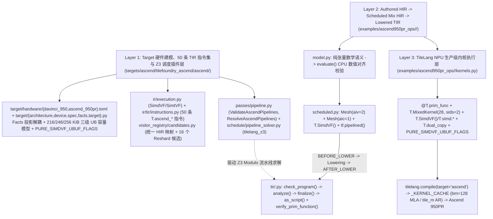
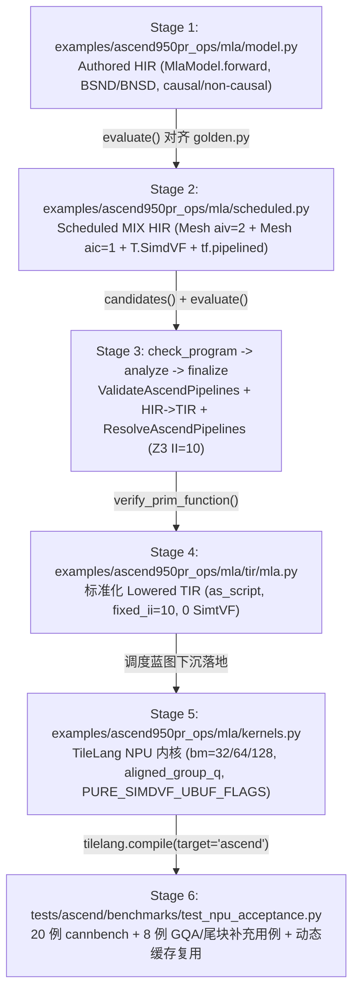

# TileFoundry 适配 Ascend 950PR 总体架构、核心机制与 MLA 端到端流程指南

## 1. 三层适配总体架构

TileFoundry 通过三层架构适配 Ascend 950PR（`ascend.950pr` / `DaVinci950`，编译器架构 `dav_3510`），将文档驱动硬件建模、目标感知的 HIR/TIR 下沉与双通道 CPU 校验（`evaluate` + `verify_prim_function`）、Z3 Modulo 流水线自动求解以及高性能 TileLang NPU Mix/`SimdVF` 内核执行清晰解耦：

---

## 2. Layer 1 核心机制与设计详解

### 2.1 Fact 投影（Projection）跨后端解耦与最小权限隔离

在 `targets/ascend/tilefoundry_ascend/ascend/target/{facts.py,target.py,spec.py}` 中，`target.get_facts(FactType)` 承担了**横向解耦**与**纵向隔离**双重职责：

1. **横向多后端统一抽象（Decoupling Across Backends）**：核心编译器（内存分析 `analyze`、候选指令筛选 `candidates`、代码下沉 `finalize`、调度验证）不直接耦合 NVIDIA CUDA、Apple Metal 或 Ascend NPU 的私有 TOML/设备字段，而是统一通过核心协议 Facade（`TopologyFacts`、`MemoryHierarchyFacts`、`MemoryExecutionFacts`、`ThroughputFacts`、`PerformanceServiceFacts`）查询拓扑层级、存储属性与带宽/算力上限。硬件差异被局部收敛在各 Target 插件的 `facts.py` 投影函数内。
2. **纵向最小权限与证据审计（Least Privilege & Evidence Isolation）**：各硬件 Facade 仅向消费者暴露其决策所需的最小字段集（例如 `AscendSpaceFacts` 仅暴露片上空间容量与对齐参数；`check_document_evidence` 禁止硬件 TOML 出现 `"policy"`/`"topology"` 策略注入字段，确保编译器优化策略不混入物理硬件规格表）。

### 2.2 216 / 248 / 256 KiB 模式感知三级 AIV UB 模型

根据 Ascend `dav-3510` 架构规格与 CCE 编译器默认行为，每个 AIV 物理 Unified Buffer 容量为 **256 KiB（262,144 B）**，不同执行模式下的实际可用上限呈现严格的三级结构：

| 模式 / 编译条件 | 可用 UB 容量 | 字节数 | 硬件/编译器预留说明 |
| :--- | ---: | ---: | :--- |
| **混合 / `SimtVF` 模式** | **216 KiB** | `221,184 B` | 扣除 32 KiB SIMT Data Cache（与 UB 共用物理 SRAM，`SHARES_CAPACITY_WITH`）及 8 KiB 默认编译器栈/ASC 预留 |
| **纯 `SimdVF` 默认选项** | **248 KiB** | `253,952 B` | 无 SIMT 访存，不切分 32 KiB SIMT Data Cache，仅保留 8 KiB 默认 VF Stack / ASC 预留 |
| **纯 `SimdVF` 无预留模式** | **256 KiB** | `262,144 B` | 开启 `PURE_SIMDVF_UBUF_FLAGS = ("--cce-disable-vf-stack-reserved-ubuf", "--cce-disable-asc-reserved-ubuf")` 且无寄存器溢出时释放全部 256 KiB |

- **数据模型落地**：`ascend_950pr.toml` 声明 `simdvf_usable_per_aiv = 253952`；`facts.py` 在 `MemoryHierarchyFacts` 中建模隐式 `simt_dcache`（32 KiB）与 `smem`（UB）的 `SHARES_CAPACITY_WITH` 物理约束关系，并在 `AscendSpaceFacts` 提供 `ub_limit_bytes(mode, unreserved_ubuf=...)` 查询接口。
- **Z3 求解器感知**：`pipeline_solver.py` 中的 `_contains_simtvf(fn_stmt)` 自动识别算子是否含 `ExecutionScope("ascend.simtvf")`，为纯 `SimdVF` 循环按 `248 KiB`（启用 `unreserved_ubuf=True` 时按 `256 KiB`）放宽片上多缓冲容量约束，而含 `SimtVF` 的循环严格约束在 `216 KiB`。

### 2.3 50 条泛化 `SimdVF` TIR 指令集与统一 HIR Lowering 原理

`targets/ascend/tilefoundry_ascend/ascend/ir/tir/instructions.py` 将指令集由初期 20 条扩展至 **50 条 `T.ascend_*` 指令**（均含完整 `typeinfer`、ISL `access_relation`、CPU 模拟 `schedule_eval` 与 `verify_stmt`），涵盖：
1. **Cube MMAD（1 条）**：`AscendMmad`（`aic` mesh，`f32` `L0C` 累加）。
2. **统一语义 HIR 对应 指令族（5 条）**：`AscendVbinary`（`kind: BinaryKind` 覆盖 `ADD`/`SUB`/`MUL`/`DIV`/`MAX`/`MIN`/`LT`/`LE`/`GT`/`GE`/`EQ`/`NE` 等 12 种二元与比较运算）、`AscendVunary`（`kind: UnaryKind` 覆盖 `NEG`/`ABS`/`EXP`/`LOG`/`SQRT`/`RSQRT`/`SIGMOID`/`TANH` 等）、`AscendVreduce`（`kind: ReduceKind` + `keepdim` 覆盖 `SUM`/`MAX`/`MIN`/`PROD`）、`AscendVwhere`、`AscendVclamp`。
3. **显式谓词、标量-向量、索引与 FMA 指令（27 条）**：
   - 算术/规约与转换直调指令：`AscendVadd`、`AscendVsub`、`AscendVmul`、`AscendVdiv`、`AscendVmax`、`AscendVexp`、`AscendVrsqrt`、`AscendVcast`、`AscendVreduceSum`、`AscendVreduceMax`、`AscendVsel`；
   - 谓词生成与逻辑操作：`AscendPset`、`AscendUpdateMask`、`AscendPand`、`AscendPor`、`AscendPxor`、`AscendPnot`、`AscendVcmp`、`AscendVcmps`（强约束 `SIMDVF_KIND` 32-bit `elem_width=32` 谓词粒度规则）；
   - 标量-向量、广播、索引与融合乘加：`AscendVadds`、`AscendVmuls`、`AscendVmaxs`、`AscendVmins`、`AscendVdup`、`AscendVdupv`、`AscendVci`（`INC_ORDER`/`DEC_ORDER`）、`AscendVmula`。
4. **基础及 4 类扩展 `Reshard` / DMA / `dual_copy` 指令（17 条）**：见第 2.4 节。

> **为何 NVGPU 使用统一 `HirBinary` 不报 `ScheduleRefusal`，而早期 5 个独立类注册给 `HirBinary` 会冲突？**
> - NVGPU（`targets/nvidia`）与 core `common.py` 将 `HirBinary` 绑定给**唯一候选类** `(TirBinary,)`，该 TIR 类自身携带 `kind = ParamDef(attribute, BinaryKind)` 属性来区分 `ADD`/`SUB`/`MUL`/`DIV`；因此 `select_instruction` 匹配时仅存在 **1** 个 `TirBinary` 候选（`len(fitting) == 1`），不会触发歧义。
> - 若在 Ascend 中将 5 个互相独立且不带 `BinaryKind` 属性的类 `(AscendVadd, AscendVsub, AscendVmul, AscendVdiv, AscendVmax)` 同时注册到 `HirBinary`，由于它们具有完全相同的 `(RMEM, RMEM) -> RMEM` 存储与布局模式，`select_instruction` 仅凭存储与 placement 会命中全部 5 个候选（`len(fitting) == 5`），从而抛出 `ScheduleRefusal` 歧义错误。
> - 现在 Ascend 采用 `HirBinary -> (AscendVbinary,)`、`HirUnary -> (AscendVunary,)`、`HirReduce -> (AscendVreduce,)`、`HirWhere -> (AscendVwhere,)`、`HirClamp -> (AscendVclamp,)` 的**单候选带语义枚举**映射，`candidate_operands` 自动透传 `kind` 属性，标准 HIR 代码无需手写 `tf.schedule` 即可直接下沉为高性能 `SimdVF` TIR 并通过 CPU 数值对比验证。

### 2.4 NVGPU vs Ascend `Reshard` 多候选设计与 Ascend 4 类数据重分布扩展

在 NVGPU 后端（`targets/nvidia/.../candidates.py`）中，`Reshard` 绑定的 `(CopyAsync, CopyAsyncTensor, CopyReduceAsyncTensor, LdMatrix, StMatrix)` 与公共 `Copy` 构成 6 候选列表，分别承载：异步全局-共享 Stage 与硬件 Gather（`CopyAsync`）、TMA 5D 多维盒式搬运与实时 Swizzle 变换（`CopyAsyncTensor`）、L2 硬件归约写回（`CopyReduceAsyncTensor`，`dst` 具 `READ | WRITE` 语义）及 Warp 级 Shared/Register 矩阵分形布局重组（`LdMatrix`/`StMatrix`）。由于 NVGPU 上 `target_candidate_ops("cuda", Reshard)` 为空且全局候选 `len == 6 != 1`，未调度 `tf.reshard` 在 NVGPU 上需通过 `tf.schedule(..., op=...)` 显式选定重分布指令。

为了在不修改核心 `src/tilefoundry/` 的前提下同时保留 Ascend 上 8 个（现扩展为 10 个）存储方向对的**无歧义 1 对 1 自动下沉默认值**，并将 Ascend `Reshard` 扩展到完整的数据重分布原语体系，设计利用了 `select_instruction`（检查精确 `ParamDef.pattern.storage is actual_storage`）与 `PatternMatcher`（支持约束通配 predicate）的正交机制，在 `targets/ascend` 内实现并向 `Reshard` 注册 **16 个候选指令**（覆盖 **4 类**新增能力）：

| 扩展类别 | 新增 TIR 指令 | 引擎 / 作用域 | 扩展的数据重分布能力 |
| :--- | :--- | :--- | :--- |
| **1. 跨核片上 `dual_copy` 重分布** | `AscendDualCopyL0cToUb` `AscendDualCopyUbToL1` | `dual_copy_engine` `ascend.dual_copy` / `_OUTSIDE_VF` | `tmem <-> smem` 片上对称 M/N 切分直传与可选 ND->NZ；作为 `tmem->smem` 与 `smem->tmem` 自动默认选型，补齐 8 条默认路径 |
| **2. 格式转换与硬件填充 DMA** | `AscendGmToL1Nz` `AscendGmToUbPad` | `mte2_engine` `ascend.dma` / `_OUTSIDE_VF` | `nd2nz`/`dn2nz` 实时分形转换与 2D 尾轴硬件转置（`transpose=True`）；非对齐内轴读取并按 `pad_value` 硬件右填充至对齐 UB tile |
| **3. `SimdVF` 结构化寄存器分布** | `AscendVldDist` `AscendVstsDist` | `vector_engine` `ascend.vector` / `_INSIDE_VF` | 支持 `NORM_B32`/`US_B16`/`BRC_B32`（硬件 `(M,1)->(M,N)` 广播加载）及 `NORM_B32`/`PK_B32`/`ONEPT_B32`（`(M,N)->(M,1)` lane-0 标量摘要写回） |
| **4. 写回阶段硬件原子累加** | `AscendUbToGmAtomic` `AscendL0cToGmAtomic` | `mte3_engine` / `fixpipe_engine` `ascend.dma` / `_OUTSIDE_VF` | `dst` 标注 `READ | WRITE`，建模 Store-mode DMA 硬件原地 `add`/`max`/`min` 归约写回；`L0C->GM` 同步建模 FixPipe `quant_pre` `f32 -> f16/bf16` 精度转换 |

### 2.5 `dav-3510` 写回阶段硬件累加模型（`T.copy` & `T.dual_copy`）

结合 TileLang Ascend IR（`T.copy`、`T.dual_copy`、`T.set_atomic`、`RewriteDualCopy`、`CodeGenAscend`）与 CANN 底层原语（`asc_copy_l0c2gm`、`asc_copy_ub2gm_align`、`asc_copy_l0c2ub`、`ST_L2CacheType`），`dav-3510` 的写回硬件累加遵循三条清晰边界：

1. **状态化 Store-Mode DMA 原子控制寄存器（`SpecialRegister::kAtomicMode`）**：
   - 与 `SimtVF` 内逐元素 `atomic_add` 不同，Tile 级写回使用每核状态化硬件寄存器：由 `T.set_atomic(op="add"|"max"|"min", dtype=...)` 映射至 `asc_set_atomic_*`（在 `PIPE_S` 写入 `kAtomicMode`），再由 `T.set_atomic_none()` 复位。
   - 所有写出 GM 的 `T.copy` / `T.dual_copy` 指令均声明 `ReadsAtomicRegister() = true`，AutoSchedule 自动插入 `PIPE_S -> PIPE_MTE3` 与 `PIPE_S -> PIPE_FIX` 同步屏障，保证写回引擎稳定读取原子模式并由 L2/内存控制器原地完成 read-modify-write（支持 `fp32`/`fp16`/`bf16`/`int8`/`int16`/`int32`）。
2. **两条 GM 原子累加写回通路与 L2 归约缓存策略（`l2_cache_ctrl`）**：
   - **AIC FixPipe 通路（`T.copy(l0c, gm)` -> `asc_copy_l0c2gm`）**：单次硬件 pass 内依次完成 `L0C` 累加结果读出、`NZ2ND` 分形转线性、可选 `quant_pre` 类型转换（如 `f32 -> f16/bf16`），以及开启 `set_atomic` 时的 GM 硬件原地累加。
   - **AIV MTE3 通路（`T.copy(ub, gm)` / `T.dual_copy(ub, gm)` -> `asc_copy_ub2gm_align`）**：`RewriteDualCopy`（`kSoftwareUBToGM`）根据 `sid` 将逻辑 tile 沿 M 或 N 轴一分为二并行发射，配合 `l2_cache_ctrl` 的 L2 归约提示（`NORMAL_RED=3`、`NOTALLOC_RED=7`、`WBH_RED=11`、`WTS_RED=15`）实现多核/双 AIV 高吞吐原子写回。
3. **片上 `L0C -> UB` 桥接（`T.dual_copy(l0c, ub)`）的硬件边界**：
   - `T.dual_copy(l0c, ub)`（`kHardwareL0CToUB` -> `asc_copy_l0c2ub`）在 `PIPE_FIX` 上以双目的广播/切分方式覆盖写入双 AIV 的 UB（`eltwise_op = DEFAULT`），**不支持**在 `L0C -> UB` 路径上执行硬件累加或 `quant_pre`（要求 `src`/`dst` 均为 `float32`）。
   - 因此，同一内积累加（如 FlashMLA `S = Q_nope @ K_nope^T + Q_rope @ K_rope^T`）在 `L0C` 内通过 `clear_accum=False` 完成；而跨 KV 分块的 Online-Softmax Rescale 累加则通过 `T.dual_copy(o_l0c, O_tmp_ub)` 落入 UB 暂存槽位，再由 `T.SimdVF()` 执行向量乘加完成。

---

## 3. 适配 Ascend 950PR 的关键优化设计

1. **1-AIC : 2-AIV 耦合 Mix 执行与双 AIV 分摊**：`T.MixedKernel(28, sids=2)` 将 `bm` 均匀切分为 `rows_per_sid = bm // 2`，使单 AIV `UB` 占用折半；`pipeline_solver.py` 经 `aiv_factor = 2` 精确刻画该收益。
2. **纯 `SimdVF` 248 / 256 KiB UB 释放与增大 `TileSize`**：
   - **MLA**：针对 BSND GQA（`n_kv == 1` 且多头聚合到连续 M 轴）启用 `bm = 128`（`rows_per_sid = 64`）以及 `aligned_group_q` 直通 `GM -> L1` 加载 `Q_nope`/`Q_rope`，消除了高开销的 `Q` `UB -> L1` 往返中转，并借助 `O_tmp0_ub`/`O_tmp1_ub`（`8 x d_nope` 分片双路写回）控制 UB 峰值，结合 `PURE_SIMDVF_UBUF_FLAGS` 在 `mla_11` 上达 **0.3129 ms（109+ TFLOPS）**。
   - **AttentionResidual**：基于 `256 KiB` 纯 `SimdVF` 预算动态计算每核行分块 `_choose_ar_tile_m`（`D=2048..2560` 取 `tile_m=8`，`D=3072` 取 `7`，`D=4096` 取 `5`，`D=5120/6144` 取 `3`，`D=7168` 取 `2`），并用独立的 `v_tail_ub` 为尾块维护单一归属循环以支持 `num_stages=2` 流水多缓冲。
3. **单遍 Online Flash Softmax + 谓词保护**：单个 KV 循环内以 `f32` UB 维护 `(m_ub, l_ub, O_ub)`，并配合 `m_safe = max(m_new, -1e30)` 与有效列 `vcmps`/`vsel` 掩码消除全因果掩码行导致的 `NaN`。
4. **跨迭代（`distance=1`）Z3 Modulo 求解**：`pipeline_solver.py` 抽取先读后写外部缓冲并锁定循环携带状态为 `fixed=1`，为迭代内传输缓冲自动搜索最优阶段划分与双缓冲配置。

---

## 4. 以 MLA 为例的 6 阶段端到端（E2E）流程

1. **Stage 1（`model.py`）**：定义纯张量数学语义（`concat([q_nope, q_rope])`、按 KV 头重排、`tf.matmul`、`scale`、因果掩码、`tf.softmax`、`probs @ v_h`），通过 `evaluate` 在 CPU 上对齐 `golden.py`。
2. **Stage 2（`scheduled.py`）**：基于 `candidates()` 将算子显式映射到 `T.ascend_mmad`、`T.ascend_dual_copy`、`T.ascend_vcast`、`T.SimdVF()` 与 `tf.pipelined(kv_tiles, max_stage=2, max_buffer_versions=2, enable_offset=True)`，同样在 CPU 通过 `evaluate` 数值校验。
3. **Stage 3（`check_program -> analyze -> finalize`）**：运行 `ValidateAscendPipelines`、`ConvertHIRToTIR`（展开 `MeshScope` / `ExecutionScope("ascend.simdvf")`）与 `ResolveAscendPipelines`（248 KiB 纯 `SimdVF` UB 预算下 Z3 求得 `fixed_ii=10`），最后由 `verify_prim_function` 验证结构、作用域、网格与类型。
4. **Stage 4（`tir/mla.py`）**：导出带 `tf.pipelined` 调度决策的标准 TIR 脚本，零 `SimtVF` 残留。
5. **Stage 5（`kernels.py`）**：生成包含 `T.MixedKernel(28, sids=2)`、`T.dynamic`、自适应 `_choose_mla_bm`（BSND GQA `bm=128` + `aligned_group_q`、BNSD `bm=64`、`PURE_SIMDVF_UBUF_FLAGS` 编译标志）及 Split-`D_nope` PV 双路写回的 `@T.prim_func` 并存入 `_KERNEL_CACHE`。
6. **Stage 6（NPU 实机验收）**：在 Ascend 950PR NPU 上完成 20 个 `cannbench`、8 个补充 GQA/尾块与动态 shape 缓存复用验收测试（具体最新实机时延与通过记录见 [ascend950pr_adaptation.md](./ascend950pr_adaptation.md)）。
