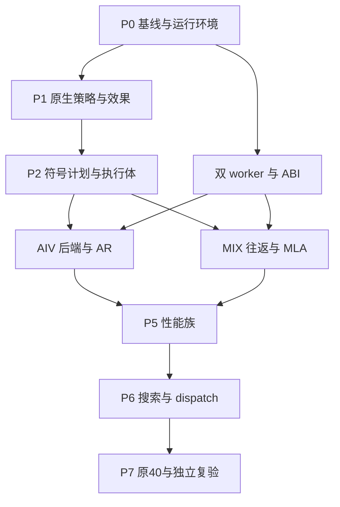

# TileFoundry Ascend950PR 完整架构与实施规格 v3

日期：2026-11-12。审查基线：`f4d6fe11769974bb31396acf890acc710749de5c`。

本文是完整工作包的合并阅读版。它包含八章规格、分阶段计划、34 个任务的实施与验收要求、核心实现移植说明、完整启动提示词和验证边界。可执行的四个框架实现、55 项 CPU 测试、原始数值文件、任务 JSON 和复现脚本在随附 ZIP 中。请将整个工作包交给本地团队；只发送本文会缺少代码和输入文件。

本轮目标是：原生 Scheduled HIR 声明四个维度的策略；编译器补齐依赖、发射相位、版本、完成协议与物理存储；实际入口执行符号 TIR；显式 TileLang 实现同一计划；attention_residual 与 MLA 各以一个逻辑 kernel 完成原始测试并搜索设备性能。MIX 的 AIC/AIV 配对可以属于一次逻辑调用。多 kernel 调度留待后续。

当前仓库是未完成审阅快照。本包提供下一轮的完整方案和可移植核心，没有声称框架已接入 TF 或已经通过 NPU 验收。各项结果的范围见文末“验证范围与实际状态”。

## 阅读导航

| 部分 | 内容 | 主要读者 |
|---|---|---|
| 00 | 当前状态、整体架构、关键决定 | 用户、Lead、所有成员 |
| 01 | 原生 Scheduled HIR 作者合同 | HIR、算子成员 |
| 02 | 真实分析、SSA、符号流水与入口安装 | Compiler 成员 |
| 03 | 固定 II 约束、唯一计划与独立检查 | Scheduler 成员 |
| 04 | 完成、存储、后端与正式分进程运行 | Target、Backend、Runtime 成员 |
| 05 | AR 与融合 MLA 的核心实现 | 两个算子成员 |
| 06 | 原始验证、设备性能与最终验收 | Validation、Performance 成员 |
| 07 | 现有模块接线、接口与产物 | Lead、所有成员 |
| 附录 A–D | 8 阶段、34 任务、8 个阶段门、核心代码移植 | Lead、各任务 owner |
| 附录 E–G | 启动提示词、实际验证范围、固定来源 | Lead、审阅者 |

阶段推进依赖实际产物和验收结果，不按测试总数或历史状态推断完成。包内 `templates/progress.json` 的生产任务初态保持 `NOT_STARTED`。

---
## 00 总体方案：让唯一计划成为实际执行程序

版本：v3，2026-11-12。审计基线：`jingchangshi/TileFoundry@f4d6fe11769974bb31396acf890acc710749de5c`。本包替代 v1/v2 的实施顺序和完成判定，保留原算子语义与单 kernel 目标。旧工作包不必另行取得；原始数值文件、必要数学模型、关键实现和启动提示均包含在本包。

### 0.1 结论

现有工程已经具备不少可复用组件，也打通了一个真实的静态 AIV 微例。下一轮的主要工作是修复生产编译链的表达和连接方式。当前正常入口没有完整消费作者策略、真实依赖和符号循环；独立的符号流水、协议模型和算子 TL 实现不能拼成已经验收的编译器。

本轮以一条主路径交付：**真实 Scheduled HIR → 原生分析与共享求解器 → 唯一 ResolvedPlan → 安装为实际入口的符号 TIR → 有限模板的显式 TileLang → 单逻辑 kernel → 原 20+20 例与设备性能搜索。**

v2 的三层设计方向保留，但应纠正实施组织上的不足：阶段门曾允许模块模型、文本检查和直接 TL 候选积累大量局部结果，而正常入口仍未消费这些能力。v3 把“实际入口改变了什么、实际执行了什么”写入每个集成门。框架代码和测试应直接迁入现有模块，不在项目旁再安装一个编译器。

### 0.2 已核实的进度

| 能力 | 当前真实状态 | v3 如何处理 |
|---|---|---|
| native TF Target、HIR/TIR、正常 analyze/finalize | 已存在；target 正规执行域主要为 AIV | 保留，增加 AIC/AIV 与目标存储事实 |
| PipelineSpec 从 HIR 传到 TIR | 声明能存活；不是完整策略兑现 | 增加版本化策略与 whole-task 来源映射 |
| shared vendor Z3、bridge、resolver | 真正调用；存在 fixed V、stage origin、partial stage、no-offset 不一致 | 原路径修复，不新增第二权威 solver |
| 符号 pipeline | 有公式和独立实现；正常入口未安装它，内部仍有 binder/shape/结构缺口 | 保留可用公式，重写 whole-task materializer |
| completion/storage | 有模型、反例和放置结构；仍按 N 展开，物理事实与发射不完全一致 | 迁为有限符号模板，版本确定后做正式分配 |
| native AIV emitter | 可输出实际 copy、算术与事件；受限于 4×64、f32、V1、串行微例 | 扩成有限、可组合的 native lowering registry |
| CANN 9.2 数值 | 用户仓库证据：product 与 square 两静态微例误差 0，禁缓存重编译复验通过 | 作为工具链起点，不外推完整算子/动态流水 |
| 完整 AR | 自建图和文本 TL 路线；存在 score/参数兑现缺口 | 从真实 native 构造器重接，保留正确指令经验 |
| 完整 MLA | 有直接 TL MixedKernel 候选；没有执行 TF 唯一计划 | 迁到同一正常入口，先 canonical，再高性能变体 |
| G61 | PARTIAL：CPU 数学/epoch 协议 | native state effects、MIX 真实实现仍需完成 |
| G69 | INCOMPLETE：生成/过滤/模拟计时，worker 边界已有价值 | 接实际编译、原比较器和设备计时 |
| G70–G72 | 未完成最终搜索、dispatch 和原 40 例验收 | v3 最终阶段明确交付 |

用户提供的 872 passed / 1 skipped 是集成前 CPU 回归记录。本次审阅没有复跑完整 TF 环境，也没有运行 NPU。本包另附实际执行的纯源码反例和框架算法测试，二者证明范围分别记录在 `evidence/VALIDATION_STATUS.md`。

来源：[当前交接](https://github.com/jingchangshi/TileFoundry/blob/f4d6fe11769974bb31396acf890acc710749de5c/targets/ascend/REVIEW_HANDOFF.md)、[正常链](https://github.com/jingchangshi/TileFoundry/blob/f4d6fe11769974bb31396acf890acc710749de5c/targets/ascend/tilefoundry_ascend/passes/p3_chain.py)、[CANN92 复验](https://github.com/jingchangshi/TileFoundry/blob/f4d6fe11769974bb31396acf890acc710749de5c/targets/ascend/evidence/cann92_runtime_recheck_20261112/split_result.json)。

### 0.3 三层分别负责什么

| 层 | 给谁使用 | 应表达或完成 |
|---|---|---|
| Scheduled HIR | 写策略的 Agent | 算法、tile、task、stage、执行域、布局/版本约束、指令与精度；保持数学语义 |
| Compiler 分析与转换 | 所有候选共用 | SSA/依赖、phase/II/自由版本、资源冲突、真实完成、物理存储、符号流水、来源核对 |
| 命令式 TIR | backend 与参考实现 Agent | 实际 For/If/Let、GM/片上视图、slot/generation、核心、指令、Set/Wait/barrier |

TileLang 位于 TIR 之后。它负责目标指令的后续 lowering 与 codegen。TF 已确定的调度不能再次交给 TL AutoSchedule 改写后仍声称执行同一计划。

Agent 可阅读 TIR 手写专家 DSL，但正式提交的手写实现应属于支持的模板表达域，并通过实际 TL PrimFunc 读取核对。先提供可用的 canonical emitter，使“Agent 手写任意程序的一般等价证明”不成为整个项目的前置任务。

### 0.4 四个调度维度

| 维度 | 作者声明 | 编译器补齐 | TIR 中的结果 |
|---|---|---|---|
| 时间 | pipeline region、stage、issue_after、II 约束、预取与递推边界 | 真依赖、phase、可行 II、重叠与完成协议 | `p/k/i` 循环、发射顺序、guard、等待与退出 |
| 空间 | AIC/AIV、group/sid、program grid、tile 与行列分片 | ownership、参与域、transfer 端点、无重叠输出 | 实际 core scopes、program/sid 索引、写入域 |
| 存储 | GM/UB/L1/L0/SS、layout、fixed/auto versions、驻留/复用意图 | 最后消费者、版本需求、padding/scratch、地址与容量 | 实际分配、版本 stride、slot 视图、FREE |
| 指令 | DMA、SimdVF/SimtVF、Cube、cast、reduce、FP32 状态及 P 精度 | 指令合法性、资源与状态效果、模板展开 | 真实目标操作及属性、精度和布局转换 |

四个维度相互约束。例如把一个 V buffer 从 V1 改成 V3，会改变预取空间、FREE、片上容量和可能的最佳 II。不能只改 JSON 字段，而保持 allocation 和 kernel 原样。

### 0.5 软流水，用一个例子解释

设三个任务分别是 `load(k)`、`compute(k)`、`store(k)`，作者给 stage 0、1、2。某个物理步 p 中，可以同时推进 `load(p)`、`compute(p−1)`、`store(p−2)`。编译器仍须确定同一步中各 pipe 的发射位置和顺序，并防止旧槽被过早覆盖。

模型时间为：

\[
t_u=s_u II+\phi_u,\quad 0\le\phi_u<II.
\]

`stage` 是跨逻辑迭代的偏移，`phase` 是同一模型周期内的位置。`II` 是成本模型的间隔，不能把它当作实测纳秒，也不应在 kernel 中生成“等待 II 周期”的代码。硬件正确性依赖真实事件、FIFO 和 barrier。

实际循环保留符号 N：

```python
N = max(0, ceildiv(stop - lower, step))
for p in range(N + max_shift):
    for task in resolved_physical_issue_order:   # 编译时有限task列表
        k = p - task.shift
        if 0 <= k < N:
            i = lower + k * step
            execute_whole_task(task, i, generation=k)
```

编译器只构造一次各 task 的 body。N=1、N=17、N=一百万均使用这个结构。N 变化可以影响运行时间，不应按 N 复制编译 IR。原 guard 和 SSA/state 仍在有效域内，具体实现见 02/03。

### 0.6 架构决定

1. **一个 native 源程序。** 算子参数配置只选择策略，不能代替 HIR。生产中不再使用 `attnres/hir.py` 的自建任务图作为另一套算子 IR。
2. **一个正式计划。** 演进 `plan/resolved_plan.py`；旧诊断结构从它派生。
3. **一个共享 solver 路径。** 新固定 II 约束核迁入现有 vendor/adapter。保留 CPU 独立数学检查，不保留两个生产求解答案。
4. **一种正常流水物化。** stage0/V1 也经过符号路径；static materialize 只作有上限的 debug oracle。
5. **两个正式进程。** CPU compiler worker 处理 TF/ORTools；runtime worker 处理 TileLang/torch_npu。利用现有成功证据隔离库交互；单进程 ABI 段错根因不是两算子的前置门。
6. **有限模板后端。** 先实现两个算子需要的 copy/VF/Cube/transfer/control，不追求任意 TF 或 TL 程序通用翻译。
7. **真实数据驱动性能。** 手算资源模型可排优先级；只有真实 native plan、物理 layout 或明确硬件合同可作硬淘汰依据。

### 0.7 保留、改造、退出生产资格

| 动作 | 模块 |
|---|---|
| 保留并扩展 | TF 原生类型/layout/SSA/visitor、PassManager、analysis、StoragePlan、指令注册、runtime 边界；共享 Z3；现有 worker deadline；原始数值合同 |
| 重点改造 | `p3_chain.py`、`unit_tree.py`、`ledger.py`、`resolved_plan.py`、`plan/pipeline.py`、completion/storage、native emitter、正规 Target facts |
| 保留作数学/协议参考 | `mla/rescale.py`、现有小 N trace、包内 reference_core |
| 退出正式验收路径 | 缺依赖的 production projection、按真实 N 展开、T.no_op text twin、子串 conformance、直接 TL 自动调度旁路、模拟计时的设备排名 |

历史证据应保持原样。新增明确的当前状态索引即可，不应把过去 NOT_RUN 改成曾经 PASS，也不应删除旧反例以获得测试绿灯。

### 0.8 单 kernel 和性能范围

两个算子都须通过原 20 例。MLA 的 AIC/AIV 配对可以是一次逻辑调用；profiler 的多硬件条目不能机械算成多 kernel。host 不做数学或布局补丁。不在 GM 物化完整 scores/P。

AR 应实现并比较 online、blocked_online、真正 resident_n；两遍重读可另列 blocked_reread。MLA 应交付 canonical，继续实现并测试 deferred rescale 与独立输出列分片。BQ/BC、列片、精度和驻留适用域由目标与原数值实验决定；某模板没写完不等于硬件不可能。

多 kernel 调度、跨 kernel workspace、依靠全 grid barrier 的 split-KV 主路线留待后续。输出列分片重复部分 QK/softmax，但各 program 写不同输出列，可以保持一个 kernel。是否更快由真实形状测量决定。

“极致性能”在本包中落实为：完成有意义的算法族与参数邻域，处理资源/尾部/递推瓶颈，在同一环境选择最快已测合法单 kernel，公开未探索项和停止原因。没有测量依据时不承诺绝对最优或固定倍数。

### 0.9 版本和复现

TF 审计基线固定为 f4d6fe1。此次核对的 TL main 为 `558d53b491925364a9b95a26cb5af66a7e7462fe`；用户运行证据中安装的 TL 为 `0e687c17bb3bd8a92bfeaa2bc8a5bdb37f6b3ca4`。它们不是同一版本。最新参考不能代替本机能力验证，也不要求盲目升级驱动或工具链。

新 TL main 相对旧参考 d0a76166，在所核调度主流程文件中主要增加 Z3 的必要 II 下界估计；这不会自动修复 TF 的投影、binder 或生产路由问题。P0 应锁定可用本机组合，再决定最小必要移植。

来源：[TL 调度流程](https://github.com/tile-ai/tilelang/blob/558d53b491925364a9b95a26cb5af66a7e7462fe/tilelang/ascend/pipeline.py)、[Task/Stage 语义](https://github.com/tile-ai/tilelang/blob/558d53b491925364a9b95a26cb5af66a7e7462fe/tilelang/ascend/language/schedule_hint.py)、[Z3 参考](https://github.com/tile-ai/tilelang/blob/558d53b491925364a9b95a26cb5af66a7e7462fe/tilelang/ascend/transform/z3_scheduler.py)。

### 0.10 最终交付

完整交付包括：可复现环境、正常入口源码、唯一计划、正式 HIR/TIR、实际 TL/后端代码、正确性/对应/单调用/资源结果、真实性能候选与最终 dispatch、原 40 例重跑、独立复验命令及已知限制。详细阶段门与文件所有权在 `plan/PHASES.md`、`plan/TASKS.json`；本地团队启动入口是 `prompts/START_TEAM.md`。

---
## 01 原生 Scheduled HIR 与作者接口

本节是待实现接口合同。下文 `asc.*` 语法为 v3 目标写法，不表示 f4d6fe1 已有这些 API。P1 应把目标写法转成能被本项目 parser、evaluator、printer 和 lowering 接受的真实样例，并提交接口说明。

### 1.1 先保留现有基础

`LoopRegion` 已有 `induction_var/params/args/body/yield_values/start/extent/step`。`ExecutionRegion` 表达完整 VF。`tf.schedule` 选择已注册目标指令，其 `repeat/order` 表示指令重复维度遍历。本轮不改变这一含义。

源程序中的类型、shape、layout、storage、SSA 和 mesh 继续使用 TF 对象。不能在 JSON 中重新定义算子，再让 compiler 从 JSON 重建业务程序。

### 1.2 最小扩展

| 原生对象 | 扩展 | 说明 |
|---|---|---|
| LoopRegion / PipelineSpec | schema v2、enable_offset、max_stage、II 约束、auto 版本默认上界 | bounds 仍仅存原 LoopRegion，不重复一份 stop |
| 完整 ExecutionRegion 或单一 DMA/Cube Call | `TaskIntent` typed metadata | id、stage、issue_after、合法 cost override；不改执行域 |
| 多语句显式 Task 组 | 原生 `TaskRegion`，复用 region 的 params/args/body SSA 模式 | 仅当应把多个同 pipe 语句作为一个 task；透明数值语义，不伪造执行 mesh |
| buffer allocation | `BufferSchedule` typed metadata | fixed/auto 版本、min/max、owner/layout/驻留意图 |
| Target facts | AIC/AIV group、owner、空间、transfer、指令与 completion | 同一个正规 Target 查询路径 |

优先直接标注既有节点；只有多语句 task 分组需要新增 TaskRegion。新增原生节点应同时实现 parser、visitor、evaluator、printer、lowering 与验证。不能用一段字符串或只在 parser 之外可见的对象伪装原生节点。

#### 策略数据的精确含义

```python
PipelineIntentV2(
    enable_offset=True,
    max_stage=8,              # 有限求解域的最大stage，非版本数
    ii=AutoII(lower=1, upper=explicit_budget),  # 或 FixedII(value)
    max_buffer_versions=4,   # 只作为未单独声明buffer的auto上界
)
TaskIntent(id="score", stage=2, issue_after=("load_next",))
BufferSchedule(versions=Fixed(2))
BufferSchedule(versions=Auto(minimum=1, maximum=4))
```

这些示例数值只是接口演示，不是 950PR 硬件默认能力。每个 target/cost profile 应给出实际编译搜索界。`max_stage`、`max_buffer_versions` 和 target flag 数相互独立。

#### 手工 stage 规则

对一个 region 的 direct-child list，只要有一个 task/子 loop 带 stage，该列表进入 manual 模式；未标注 sibling 默认 stage0。嵌套列表独立选择 manual/auto。显式 stage 的绝对值不能被求解器减去最小值后丢失。物化时另计算 `shift=stage−min(stage)`。

`enable_offset=False` 表示所有 start 位于一个 II 窗口、所有 stage0。显式非零 stage 与它冲突，应在规范化阶段报错。不能让 solver 返回非零 stage，再在 resolver 才以另一合同拒绝。

相同 owner、core、pipe 的 manual tasks 保持源发射顺序。`issue_after` 是同物理步中有效实例的发射偏序，**不是** RAW、不是固定 distance，也不保证完成。真正 producer/consumer 完成关系由数据和状态效果分析产生。

#### 旧接口迁移

现有 `PipelineSpec/1.num_stages` 不能静默改成新版的另一种含义。保留 legacy parser/roundtrip；Ascend normalizer 显式输出版本化的兼容映射和诊断。新生产样例全部使用 v2 字段。GPU 的既有 `tf.schedule(order=...)` 和已有 pipeline 行为应保持，通过小型目标回归核查。

### 1.3 时间之外的接口

空间策略应能指定 program grid、AIC/AIV 角色、sid、query/token/列片映射和 ownership。任务可能是动态 program_id 选择的一次实例，不要求作者指定物理核心编号。AIC 和 AIV 是同组的异构执行者，不应被描述成 AIV 下面嵌套 AIC 的线性层级。

存储策略应能表达 UB/L1/L0A/L0B/L0C/SS/GM、layout、alignment 要求、版本约束与驻留范围。GM ABI tensor 不应变成 UB ring。VREG/PREG 不能跨 VF 自由逃逸；合法跨 task 值要有显式 UB/SS 等传输表示及相应成本。

指令策略保留 `tf.schedule` 的具体目标操作选择。新增 RMS/reduce/exp/Cube/transfer 所需操作，应注册 memory effects、shape/layout 规则、execution scope、precision、状态效果与代价。精度不是只供报告的字符串：FP32 accumulation、P cast/hi-lo、HF32 模式、clear_accum 等应改变实际操作。

### 1.4 作者样例的要求

P1 应提交两份能正常 parse/print/evaluate 的原生样例：一个动态 AIV pipeline，一个带 AIC/AIV transfer 的有限 MIX region。样例不要求此时达到性能目标，但字段应能一路到 unit/plan，不得被投影为固定 f32/V1。

预期写法示意：

```python
# 提议的表面语法；P1产出真实可执行版本。
for k in tf.pipelined(stop_expr, policy=policy_v2):
    with asc.Stage(0), asc.Task("load", core="aiv", pipe="mte2"):
        tile = scheduled_copy(source_view(k), buffer_with_versions)
    with asc.Stage(1), T.SimdVF():
        result = complete_vector_body(tile, carried_state)
    with asc.Stage(2), asc.Task("store", core="aiv", pipe="mte3"):
        scheduled_store(result, destination_view(k))
```

Stage 应包住整个 task/VF；在 VF 内部给单条向量指令标 stage 应拒绝。用户仍可通过拆分 VF 并显式保存跨 VF 值表达不同策略。跨多个 pipe 的 composite 只允许具有已验证内部资源/effects 合同的模板，否则先展开为多个合法 tasks。

### 1.5 SSA 和来源信息

ConvertHIRToTIR 之前保留 `RegionBindingSummary`：原 region、captures、carried params、initial values、yields、原 guard 和值定义。summary 持真实对象引用。lowering 时补上它们对应的实际 TIR statement/Var/allocation。

原生符号身份使用对象/定义 identity。`Var.name` 仅供可读输出。两个叫 `tmp` 的 binder、两个同 shape buffer，不应因此被当作同一个值。序列化需要稳定编号时，以词法作用域和定义顺序建立编号；进程内不能从这个名字反查语义。

应区分三类跨 task 值：

| 值 | 处理 |
|---|---|
| 纯索引与不变 metadata | 允许在有效 task 域内重物化，按 binder identity 替换 |
| 含 load/随机/状态读取等效果的 Let | 保留唯一实际执行；不能当纯表达式复制或移到 guard 外 |
| 流水跨 task/跨代 tensor 或 scalar 状态 | 形成明确 value stream，版本/生成代次/初始化/最后 consumer 可分析 |

carried `S[k]→S[k+1]` 应保留 distance1。alpha、P、rescale predicate 等并非“最新值”全局变量；它们属于某个 KV generation 或 epoch。最初可将紧密相连的更新放在一个 whole VF 中，减少跨 task 状态；优化拆分时再增加真正的 stream。

### 1.6 支持域

本轮应支持：符号/动态正向 loop bounds、非零 lower、正整常量 step、外层 program/group loop、嵌套有限 region、原始 tail/causal guard、LoopRegion carries/captures、完整 VF 与合法 MIX transfers。

动态 step、一般 while、任意跨 region 非仿射依赖不是本轮硬性要求。遇到这些域，应保持可验证的原 serial 控制作为原生 composite，或明确拒绝该优化。不得填写 step1/distance1 或丢掉访问来假装支持。

来源：[LoopRegion](https://github.com/jingchangshi/TileFoundry/blob/f4d6fe11769974bb31396acf890acc710749de5c/src/tilefoundry/ir/hir/loop_region.py)、[现有 PipelineSpec](https://github.com/jingchangshi/TileFoundry/blob/f4d6fe11769974bb31396acf890acc710749de5c/src/tilefoundry/ir/hir/pipeline.py)、[tf.schedule](https://github.com/jingchangshi/TileFoundry/blob/f4d6fe11769974bb31396acf890acc710749de5c/src/tilefoundry/ir/hir/schedule.py)。

---
## 02 原生分析、依赖与符号流水

### 2.1 正常入口的次序

保持 `checked_program → analyze → finalize → emit` 及现有 PassManager。将 target passes 改为下面的职责顺序。名称是职责，不要求每项都新增一个文件或 Pass 类。

| 步骤 | 输入→输出 | 应检查 |
|---|---|---|
| NormalizeIntent / PreserveRegionBindings | Scheduled HIR→规范策略、原 SSA 摘要 | stage/II/V/精度/域合法；bounds 不复制 |
| 原 ConvertHIRToTIR 与目标合法化 | 原生 HIR、逻辑 memory 分析→目标合法 TIR 及 source map | whole-VF、carried/capture 来源不丢 |
| FormUnits / AnalyzeSchedule | native TIR→typed UnitTree、region problem | 每条效果有归属，真实依赖完整，未知不丢 |
| Solve / Resolve | 有限问题→assignment→唯一计划 | 原策略硬约束、coverage、II/V/start 全部消费 |
| Completion / PhysicalStorage | 计划→符号通道、owner/layout/offset | 真实最后读完成、namespace/容量合法 |
| ApplyPipeline | 原 native 入口+完整计划→新 native 入口 | 符号 loop、whole-task/binder、真实 slot 与 guard |
| Verify / Install / Emit | 实际新入口→冻结产物 | 源到 TIR、TIR 到 TL 结构对应、实际 PassConfig |

初始 memory analyze 负责逻辑对象、alias、可选指令与初始布局；它的旧物理偏移不能在 versions/packing 改变后直接复用。最终 StoragePlan 需更新到实际版本和 completion。

### 2.2 UnitTree 的必要字段

改造 `plan/unit_tree.py`，不要再在 production project 中按所有底层指令形成 task。

```python
SourceUnit(
    unit_id, node_ref, region_ref, source_order,
    whole_body, execution_owner, resources,
    original_guard, captured_values, carried_values,
    effects, intent,
)
Region(
    region_id, node_ref, direct_children,
    induction_var_ref, lower_expr, stop_expr, step_expr,
    binding_summary, activation_guard,
)
```

这些是 native 分析对象，`node_ref/Expr/Var` 使用项目现有类型。序列化视图可记录 path/IDs，不能反过来成为编译执行依据。

调度 unit 是完整 VF、DMA、Cube 或已注册内部合同的 composite。一个 VF 中的 vld/vmul/reduce/vst 仍供 effects/cost/ISA 合法性分析，但不被外层 Z3 拆成几十个独立任务。无 buffer 效果但有硬件配置、累加器状态、控制通知的操作也应归属 task。

嵌套 region 先独立分析。外层 serial program 分配不按 program 数复制 body。内层 D-panel 的小常量结构可以形成有内部合同的 Cube 模板；不把动态 KV loop 变成巨大 flatten graph。

### 2.3 依赖应从哪里来

每个 Access 至少持：实际逻辑 root、native view/offset、读写区域、owner、mode、原谓词、对应 value generation，以及 async 读/写完成语义。优先复用 TF `ParamDef.MemoryEffect`、access relation、buffer alias 与 SSA 设施。

| 来源关系 | 生成的方向 | 注意 |
|---|---|---|
| 写定义→读取同一值 | RAW，writer(k)→reader(k+d) | d 来自代次/地址关系 |
| 旧值读取→覆盖该物理对象 | WAR，reader→writer | 不能反转为 writer→reader |
| 前次写→后次覆盖 | WAW | 初值/clear_accum 也算写 |
| read/read | 无数据完成边 | 共用 pipe 的资源边仍可存在 |
| ring slot 重用 | last_reader(k)→next_writer(k+V) | 与 logical RAW 分开，V 可为求解变量 |
| scalar/config/accumulator | STATE | 包含 HF32、MMAD 方向、clear、epoch 等 |
| 外层初始化/输出 | region 边界关系 | 不能为适配 loop solver 随便填 distance1 |

地址关系先在相同 root/可能 alias 对象内判断。真实读取 `A[k]` 与 `A[k+1]` 不等于“同 root 就冲突”。未知区域可保守保序，必要时把它留在不重排 composite 中；若会影响优化安全且无法表达，应明确报不支持。当前生产投影“未知 offset 就省略”应删除。

依赖验证分两层：先检查所有 source task/effect/依赖均被问题覆盖或由明确 composite 合同承接；再检查求解赋值满足这些关系。单纯对已经漏掉依赖的字典做 postcheck 没有充分性。

### 2.4 Loop-carried 状态

原 `LoopRegion` carries 应在 lowering 前保留。对于状态 S，定义 `S(0)=init`，任务第 k 次产生 `S(k+1)`；consumer 的 value generation 不一定等于 task ordinal。

首次实现可以将 m/l/U 更新保持在同一个 VF task，并显式保留 distance1 及 state 读写效果。以后拆分时，对 alpha/P/U 等建立 stream：producer 的 generation、consumer 所读 generation、slot 表达式、初值和最后消费者应一致。不能将所有标量做成一个跨 step 共享的“当前值”。

寄存器只能在合法 VF 作用域内使用。跨 VF 状态使用目标允许的 UB/SS 等表示，新增 copy 和临时空间应进入 task/effects/cost/placement。不得通过隐式寄存器逃逸使 IR 看起来更快。

### 2.5 符号物化算法

对正整常量步长 h：

\[
N=\max(0,\lfloor(b-a+h-1)/h\rfloor),\quad
o=\min_u s_u,\quad shift_u=s_u-o,\quad H=\max_u shift_u.
\]

构造 `p∈[0,N+H)`。每个 task 仅创建一次：`k_u=p−shift_u`，`i_u=a+k_u*h`，外层 valid guard 为 `0≤k_u<N`。原 task 控制逻辑完整克隆到这个 guard 内。

`implementation/symbolic_template.py` 已给出这个构造算法，使用 Builder 协议直接构造原生节点，不定义另一种生产 IR。测试使用 Python 标准 AST 解释有限 trace；本地应接入 TF 原生表达式与 stmt 工厂。

不能复用当前 `plan/pipeline._bin` 的错误类型假设：索引使用本项目纯 dimension 算子；bool guard 需使用合法的纯 scalar 表达式。`tir.arith.Binary` 是带 destination 的 effect 指令，不应被冒充成两个参数的标量表达式。若现有 TIR 缺少 bool 纯表达式，应补最小注册算子及 typeinfer/evaluator/printer/backend 支持。

#### whole-task 克隆

`implementation/native_bindings.py` 给出按 binder identity 克隆完整 Sequential/For/If/ExecutionScope/MeshScope/Evaluate 的实现框架。它保留词法作用域；不按 name 替换，不按 shape 找 ring。该文件在本次包内只做语法和源码 API 审查，真实 TF 集成测试是 P2 必做项。

`instantiate_whole_task` 应完成以下工作：

1. 按真实 allocation/root identity 绑定已分配的 ring 视图。
2. 将源 loop IV 替换为该 task 的 i，跨 taskstream 替换为该 generation 的 slot。
3. 在新作用域内 freshen 局部 binder，重写 type/layout 中的维度和视图。
4. 保留所有 arith/config/SSA 与嵌套控制，不从 access 列表重建 body。
5. 把 effectful Let 留在有效 guard 内；仅纯索引可在外构造。
6. 加入同一 plan 生成的 pre-wait/post-set 及 state 操作。

stream allocations 应先提升到其 owner region，再从 task 局部 body 移除。不能把 GM 参数、L0 寄存器或所有内存一律变为 SMEM ring。

### 2.6 安装和事务性编译

`implementation/compile_transaction.py` 给出现有链 Pass 的编排内核：正常分析→solve→resolve→completion→place→apply→verify→emit。它不产生第二计划。`implementation/native_bindings.install_entry` 实际替换 `module.functions` 中的入口，并核对 `module.entry_function()` 身份。

pass 不得修改原输入后再尝试 replan。每次失败保持原模块可用；只有完整验证的实际新入口才允许导出。缺资源时反馈具体约束，重复相同 cut 或超出有限次数应停止，不能把最后一次失败的部分计划导出。

analysis、solver、completion、allocation 与 TL 编译使用共同 deadline；每步只能取得剩余预算。原生 C++库无法合作中断时，由现有 fresh-process supervisor 执行硬超时。不要给每个子 region 重置一份完整超时。

### 2.7 独立检查与反例

必要测试包括：两个同名 Var、两个同 shape 不同 dtype/root、原谓词依赖合法输入、effectful Let、多个 nested loop、region init/exit、N=0/1/V−1/V/V+1、nonzero lower、step>1、符号 stop、stage 间距大于 N、buffer 固定 V、内存/配置无访问表项仍不丢。

将运行时 N 改到百万时，unit 数、solver 变量数、completion 模板数和 TIR 结构节点数应保持不变（除常数字面量外）；实际执行 trace 只对小 N 枚举。编译规模检查读取真实 IR 统计，不能只统计 metadata。

源码与详细位置见 `evidence/v3_schedule_audit.md`。关键依据：[UnitTree](https://github.com/jingchangshi/TileFoundry/blob/f4d6fe11769974bb31396acf890acc710749de5c/targets/ascend/tilefoundry_ascend/plan/unit_tree.py)、[当前符号 pipeline](https://github.com/jingchangshi/TileFoundry/blob/f4d6fe11769974bb31396acf890acc710749de5c/targets/ascend/tilefoundry_ascend/plan/pipeline.py)、[TF visitor](https://github.com/jingchangshi/TileFoundry/blob/f4d6fe11769974bb31396acf890acc710749de5c/src/tilefoundry/ir/visitor.py)。

---
## 03 共享求解器、phase 与唯一计划

### 3.1 先修已经复现的合同错误

| 反例 | f4d6fe1 实际行为 | v3 结果 |
|---|---|---|
| fixed V2 | core SAT 后重算为 V1，bridge 报 FIXED_VERSION_DRIFT | 返回 model 中的 V2 |
| stages 2/3 | core 减去最小 stage，返回 0/1 | 保留 2/3，lowering 单独计算 shift |
| 只标一个 stage | bridge 拒绝 partial，resolver 却定义缺省 0 | normalizer 统一 manual-default0 |
| no-offset、RAW 延迟 2 | bridge 可 SAT 于 start0/2、II1 | 求解时 stage 全 0，允许更大 II 或 UNSAT |
| fixed II | 正常接口没有直接固定该 II | 指定 II 只检查该值，不偷偷另搜 |
| production 投影遗漏 dependencies | SAT 仅证明漏项问题 | source 覆盖检查先拒绝遗漏 |

这些结果来自实际 CPU 纯源码探针，完整输入输出在 `evidence/v3_schedule_counterexamples.json`。它们不是 NPU 失败日志。

### 3.2 固定 II 的约束

本包 `implementation/modulo_kernel.py` 提供可执行 Z3 约束核与独立整数 postcheck，CPU 测试已运行。它应迁入现有 `src/tilefoundry/vendor/tilelang_z3` 的单一路径，由 TF/TL adapter 共用；不能让工程生产同时使用旧、新两个求解器。更新 vendor provenance 与共享入口测试。

对于一个有限 region，先选择候选整数 II，再求每 task 的 stage/phase 和 buffer 版本。固定 II 使主要时间关系成为整数线性表达式；显式有限边界和共同 deadline 限制搜索规模。

\[
t_u=s_u II+\phi_u,\ 0\le\phi_u<II,\ 0\le s_u\le max\_stage.
\]

作者 stage、fixed II、fixed V、owner、precision 和 issue_after 是硬约束。自动模式可固定 `min(stage)=0` 去掉平移自由度；manual 模式不能改写作者绝对值。

#### 数据与状态依赖

\[
t_v+d\,II\ge t_u+L_{u\to v}.
\]

d 是同 region 的真实逻辑 distance；L 为相应写可见/读完成/状态完成的成本估计。实际硬件正确性仍由 completion 保证。循环 recurrence 与配置状态应参与这个模型。

#### 版本复用

对 buffer b 的每个最大末读者 r、下一写者 w：

\[
t_w+(V_b+\delta)II\ge t_r+L_{read\_complete},\quad V_b+\delta\ge1.
\]

δ来自 task ordinal 与 value generation 的偏差。普通每迭代写一次的 ring 是δ=0；carried S[k+1]不能强行按 k 处理。fixed V 用等式；auto V 在每个 buffer 的合法[min,max]内求解。

#### 资源占用

资源 key 应含 owner/core/pipe。两个不同 AIV 的 vector 任务不应因字符串都叫 vector 而互斥。同一资源上的周期占用使用环形区间约束，包含跨 II 边界的重叠。

对偏移 ou/ov、占用 qu/qv：

\[
\Delta=(t_v+o_v-t_u-o_u)\bmod II,\quad q_u\le\Delta,\ q_v\le II-\Delta.
\]

上述为 capacity1 模型。composite 可提供多个资源 reservation，但应有已验证内部时序合同。未知容量、多 lane 资源不能直接套单资源公式；先用真实资源映射或明确受限支持。

#### 物理发射偏序

phase 排序后，对同 phase 的 hard issue edges 做拓扑线性扩展。manual 同 owner/pipe 源顺序也进入这个图。`issue_after` 只约束发射；不会产生读写完成关系。phase 相同且 stage 较大优先只是无硬边时的确定性选择，不能覆盖作者顺序。

#### 容量

只对已明确 owner/space 的物理 slot 估算建约束：

\[
\sum_b V_b\,aligned\_slot\_bytes_b + reserved \le usable\_capacity.
\]

owner 不同的私有空间分开计费；未知容量不能填当前需求大小。正式 padding/layout/scratch 由后续 physical placement 复核。未经证明的跨 root 不相交不能据此取 max；同一底层内存也不能同时按两个别名重复计费。

### 3.3 搜索与状态

先计算必要下界，如资源发射需求与自递推边；它只是缩小搜索，不是性能预测。固定 II 直接求该 II。auto II 按有限候选递增检查；可用更好的已证明安全搜索算法，但不能依赖未经证明的单调性跳过手工 stage 的可行域。

首个可行 II 之后，可在同一约束内继续减少物理版本字节数；每次改善仍是一次求解。**禁止在 SAT 之后根据局部 reuse 边重算 V 并替换 model。** 保留已验证可行解，超时不丢掉它。

| 字段 | 含义 |
|---|---|
| feasibility=SAT | 存在通过全部约束与 source postcheck 的赋值 |
| feasibility=UNSAT | 声明的有限域内无解；不是硬件永远不可行 |
| feasibility=UNKNOWN | 超时或 solver 未决定；不能当 UNSAT |
| ii_optimal_within_bounds | 所有更小候选已被证明不可行且边界完整 |
| memory_optimal_for_ii | 在当前 II 内的版本目标已求到最优 |
| schedule_source | shared_solver / 经同约束验证的 fallback |

“模型内最优”不能写成设备最优。串行 fallback 也须保持作者 hard constraints；原 stage/II 不允许串行时，应明确无可用 fallback。初始 v3 可以不提供 fallback，只正确报告三态。

### 3.4 source postcheck

两种检查都要保留：一是 solver 输出的独立整数不等式检查；二是从真实 native unit/effects/intent 重核 coverage 和约束。前者不能发现投影漏边，后者不能替代求解值检查。

检查应发现：缺 task、缺 buffer、固定 V 变化、时间单位错误、stage/phase/start 不一致、错误 owner、原依赖方向变化、未知访问被丢、资源 pair 缺失、手工顺序被改、版本/容量/原精度不符。

### 3.5 ResolvedPlan 的增量结构

扩展现有 `plan/resolved_plan.py`，不要平行定义一个“v3 计划编译器”。正式字段如下：

```python
ResolvedPlan(
    source_identity, target_profile, normalized_intent,
    regions: tuple[RegionPlan, ...],
    task_to_native_source, logical_buffers, access_and_state_effects,
    completion_templates, physical_storage_plan,
    semantic_source_map,
    feasibility, optimality, model_version,
)
RegionPlan(
    native_region_ref, lower_expr, stop_expr, step_expr,
    ii, origin, max_shift, tasks,
    # task: authored_stage, resolved_stage, phase, start, issue_rank
    # buffer: fixed/auto domain, resolved_versions
)
```

进程内保留 native 引用；JSON 只导出可审阅视图。全 kernel 可有多个 region，各自 II/loop domain，不强迫所有 tasks 塞进一个全局循环模型。

完成/放置之前 plan 是未完成的中间结果。不要以 `VERIFIED` 字符串默认取得可运行资格。最终出口读取当前 entry 及其完整 plan 的语义 identity，确认使用了同一套 II/versions/completion/layout。

### 3.6 核心代码的范围

本包 modulo kernel 已实现：partial manual 默认 0、绝对 stage、no-offset、固定/自动 V、RAW/STATE/复用、owner 分域资源、环形冲突、issue 偏序、容量、共同 deadline、SAT/UNSAT/UNKNOWN 和独立整数校验。测试含与小域穷举的对照。

它没有实现：原生 effect/alias 抽取、目标成本校准、任意动态控制的关系推导、物理 event coloring、TL codegen 和 NPU 执行。这些明确由本包其余阶段完成。Task/Buffer dataclass 只是 solver 输入视图，不得用它们重新表示整个算子。

源码依据：[bridge](https://github.com/jingchangshi/TileFoundry/blob/f4d6fe11769974bb31396acf890acc710749de5c/targets/ascend/tilefoundry_ascend/solver/bridge.py)、[共享 core](https://github.com/jingchangshi/TileFoundry/blob/f4d6fe11769974bb31396acf890acc710749de5c/src/tilefoundry/vendor/tilelang_z3/core.py)、[resolver](https://github.com/jingchangshi/TileFoundry/blob/f4d6fe11769974bb31396acf890acc710749de5c/targets/ascend/tilefoundry_ascend/plan/resolved_plan.py)。

---
## Ascend950PR v3：后端、完成、存储与运行规格

状态：实施规格，供本地 Agent Team 在真实环境实现。基线为 TileFoundry `f4d6fe11769974bb31396acf890acc710749de5c`，TileLang 参考固定到 `558d53b491925364a9b95a26cb5af66a7e7462fe`。本次已核对该版本的 pipeline、InsertSync、copy 路径相对前次 d0a76166 无改动；部署证据的 TL 0e687c17 仍是另一个版本。本文中的新函数签名是实现目标，不表示当前仓库已有可用 API。当前实际缺口见工作包审计文档。

### 1. 目标与生产边界

本阶段将同一份 native Scheduled HIR 的解析计划安装为真实 TF TIR，并用该 TIR 产生或核对有限表达域的 TileLang expert 实现。编译和运行应复用正常 TF 入口、唯一 `plan/resolved_plan.py`、现有 target/ISA 注册、`search/process.py` 和 runtime 边界。

每个目标算子一次调用应执行一个逻辑计算 kernel。AIC 与两路 AIV 可组成一次 MIX 调用。host 应只做元数据校验、输出分配、specialization 选择和该调用。完整 scores/P 不应在 GM 物化；不得通过 host Torch 预处理补全 concat、transpose、cast、softmax 或 residual。

本阶段不要求一般程序等价证明，也不要求支持任意 TileLang 文本。先支持完成 AR 和 fused MLA 所需的有限 lowering templates。未知 op/control/layout 应明确返回 unsupported。模板应能继续注册扩充，不能将“整个 AR/MLA 手写 kernel 字符串”作为 compiler 的黑盒。

### 2. 正常编译流程

```python
def finish_ascend(module, analysis, target):
    units = analysis.unit_tree(module)            # 真正 TF IR 引用，含词法作用域
    problem = analysis.schedule_problem(units)   # 有限任务，不按 N 展开
    assignment = solve_and_verify(problem)
    plan = resolve_assignment_into_plan(problem, assignment)

    for attempt in range(MAX_REPLANS):
        completion = build_symbolic_completion(plan, units, target)
        placement = place_resolved_versions(plan, completion, target)
        if placement.needs_replan:
            plan = replan_with_constraints(problem, placement.constraints)
            continue
        entry = apply_symbolic_pipeline(module.entry_function(), plan)
        entry = insert_symbolic_completion(entry, completion, plan)
        entry = materialize_resolved_storage(entry, placement, plan)
        verify_actual_program(entry, units, plan, completion, placement)
        module = replace_actual_entry(module, entry)
        return freeze_export_input(module, plan, completion, placement)
    raise CompileError("REPLAN_BUDGET_EXHAUSTED")
```

此处各 helper 应接入已存在 pass，而非新增并行 pipeline driver。actual entry 替换应让 `module.entry_function()`、正式 printer、后续 emit 和 cache 都读取同一对象。metadata 只保留分析结果与诊断，不可成为实际循环体的替身。MAX_REPLANS 是有限编译预算，超限应明确失败，不能在最后一次失败后仍导出。

### 3. 一个 target completion 与 layout 合同

#### 3.1 区分依据和未知能力

新增或归并 `TargetCompletionModel`、`PhysicalLayoutModel` 进入现有 Target facts 接口。每项硬件事实应有 `value/source/status`，status 可取 `REFERENCE_IMPLEMENTATION`、`DEVICE_VALIDATED`、`UNRESOLVED`。只需小型 typed record，无需另建审计平台。

| 事实 | 已读依据 | 实施要求 |
|---|---|---|
| 同核 flag namespace 与上限 | 固定 TL 558d53b `insert_sync.cc` 按 core+hard-event 分域、limit8 | 核对本机固定 TL/CANN；actual emitter 和 allocator 应同源 |
| AIC/AIV cross-core flags | 同文件 limit16，Cube 端按 sid×16 寻址，mode4 | 需 MIX 往返小例；不能把 READY/FREE 误作独立物理池 |
| 同 pipe S/V/M 顺序 | 同文件 `HasImplicitSamePipeOrder` | 只在同 core、同 pipe、相应效果合同成立时消解同步 |
| UB/L1/L0 大小、alignment | TF 现有 local3510 record 为声明值 | 纳入本机目标配置并核编译资源；未核实值不得伪装测量值 |
| UB→L1 格式转换 | TL `copy_op.py` 支持，InsertNd2Nz 执行 | layout 和 scratch 在 placement 前公开 |
| L0C→UB dual copy | TL 558d53b 要求源/目标同 dtype | f32 搬运后在 VF 转换，不能假定 FIX 自带任意 cast |
| SS 容量、可见性、可用指令 | 需要锁定本机 TL/CANN 对应实现 | 未确认时不启用依赖它的候选，保留具体缺失 capability |

不能把本地 runtime 使用的 TL `0e687c17` 当成 558d53b。P0 应记录并选定一个兼容版本；支持项不一致时要明确移植差异。

#### 3.2 Owner 语义

本地存储的 owner 表示逻辑程序实例，不要求预知硬件调度到哪个物理 core。

```python
OwnerKey = (program_group, core_kind, sid)  # AIC 的 sid 为 None
StorageKey = (space, OwnerKey)
```

GM 为 device-visible。每个 AIV 的 UB 独立；AIC 的 L1/L0 属于该 program group 的 Cube。UB→L1 transfer 具有两个明确端点 owner；允许 transfer 写到关联 AIC L1，不等于允许 AIV 任意直接读写该空间。SS 若使用，应明确为关联 AIC/AIV group 的 scalar 共享资源，不能当成全 grid barrier。

#### 3.3 物理事件 namespace

```python
LocalEventKey = (owner, producer_pipe, consumer_pipe)
CrossEventKey = (program_group, physical_bank)
```

逻辑 obligation kind 不进入物理资源 key。跨核 channel 若占用两个 bank，应同时在两个底层 bank 预留同一 id 范围；不能用 bank-mask=3 和 bank-mask=1 的两个独立字典掩盖交叠。flag ID 可按 `base + (generation % versions)` 发射，边界应由静态 V 和 base 证明。

### 4. 符号 completion 合同

#### 4.1 输入

使用 `ResolvedPlan` 的真实 task、buffer、access、stage、phase、II、versions 与分析层的精确依赖。不得再次从“同 root 的所有 writers×readers”猜依赖。

每个 access 应关联真实 view/alias、读写区域、owner、logical generation Expr 和任务执行 guard。alias analysis 对无法证明不交叠的区域应保守建立边，不可猜测互不影响。第一版支持 affine 常数 distance；无法分析的动态依赖应报出具体 region/access，而非按 distance0 或 1 兜底。

#### 4.2 有限模板数据

以下对象保存在现有 CompletionPlan 中，它们是计划的派生数据，不是新 IR：

```python
@dataclass(frozen=True)
class CompletionSite:
    task_ref: object               # 实际 unit/IR 引用
    anchor: str                    # before_task / after_task / region_exit
    task_ordinal: Expr             # 实际任务的逻辑代次
    generation: Expr               # 该通道保护的数据完整代次
    guard: Expr
    owner: OwnerKey
    pipe: str

@dataclass(frozen=True)
class CompletionChannel:
    buffer_ref: object
    reason: str                    # READY/FREE/STATE，仅逻辑原因
    producer: CompletionSite
    consumers: tuple[CompletionSite, ...]
    versions: int
    physical_mechanism: object      # local event / cross event / FIFO / barrier
```

编译中的 channel/site 数由有限 tasks 和消费者数量决定，不随 trip N 增长。小 N `CompletionTrace` 由模板解释器生成，只用于测试与 debug。

#### 4.3 READY 与 FREE

对于写第 k 代的任务，guard 为 `valid(k)`；producer set READY 应在正确 pipe 的写完成点之后，consumer wait 应在读之前。多个消费者不能默认重复消费一个普通 flag；为不同消费 pipe/domain 分别建立通道，或使用有明确 capability 的组通知机制。

覆盖同 slot 的下一代是 k+V。FREE 集合应覆盖所有最大末读者：同 pipe、同 domain 且已证明完成偏序的读者可合并；不同 pipe 或不同 AIV 的末读不能按源代码最后一个元素代替。

v3 统一采用“前 V 代免等旧 FREE、每代末读者都发布 FREE、尾部消费剩余 FREE”的协议，与 `implementation/symbolic_template.py` 的 `free_wait_generation`、`final_free_generations` 保持一致：

```python
# 每个域内 generation 均执行控制 envelope；原语义 predicate 只保护计算。
if in_domain(k):
    if k >= V:
        for terminal in maximal_readers:
            wait(terminal.free_channel, generation=k-V, slot=k%V)
    if original_write_guard(k):
        issue_write(k)
    publish_ready_after_completion(k)

# 第 j 代的末读者。
if in_domain(j):
    wait_ready(j)
    if original_read_guard(j):
        issue_read(j)
    publish_free_after_read_completion(j)

# 尾部：每个末读者通道都消费尚未被下一代写者消费的 FREE。
# 这是保留为原生符号 For 的有界循环，最多 V 代，不按 N 展开。
for g in symbolic_range(max(0, N - V), N):
    for terminal in maximal_readers:
        wait(terminal.free_channel, generation=g, slot=g%V)

if N > 0:
    drain_other_outstanding_work_at_exit()
```

`generation=k-V` 与 writer 的 `task_ordinal=k` 不应混为同一字段。`slot` 可相等，generation 不同。N=0 时本 loop 不执行任务、Set/Wait 或 drain；尾部区间也为空。N<V 时尾部恰好消费 N 代，N>=V 时恰好消费 V 代。最终输出写和未由 FREE 覆盖的异步效果仍要 exit drain。尾部 Wait 应落在该 FREE 通道原有的接收 owner/pipe，不能随意放到 host 或其他 core。

“末 V 代不发布 FREE”和“每代发布、尾部消费”在各自完整配对时都可以合法；v3 只实现后者，代码、spec、测试与 emitter 不得混用。这里 g 是 producer 域的归一化代次；值若写为 S[k+1]，记录应通过明确 generation delta 映射到真实值代次和 slot，不能漏掉初始化的 S[0] 或直接套 k%V。

上例采用保守的 balanced control envelope：即使某次原 If 不执行计算，各端仍对该域内 generation 完成一次空通知，并在末读位置发布 FREE。编译器先证明 `original_read_guard => original_write_guard`；不能用空 READY 掩盖真实缺写。Set/Wait 数不因不同分支失配；尾部统一消费最后的通知。后续只在 guard 等价及 token 平衡已证实时消去空通知。若整个 region 的激活条件不同，先将它作为有完整入口/退出合同的嵌套区域处理；不能直接套用上述同域模板。无法证明的跨域动态分支暂报 unsupported。

#### 4.4 guard 与 SSA

Set 和对应 Wait 的执行域应匹配：读可能执行时，写及其发布应执行。loop pipeline 的计算 guard 是 `0 <= p-shift < N` 与原 guard 的 conjunction；上节 balanced control envelope 的通知 guard 仅取对应迭代域，计算 guard 不应错误地包住通知。因不同 task shift，两个同步端点不一定位于同一 p；它们的 generation Expr 应相同。

MLA 的 group predicate、alpha、rescale anchor、P 版本应按真实消费者保活。deferred 模板应表达旧 epoch 全部 PV（所有 output columns、hi/lo）完成→drain/rescale/clear→新 epoch PV。组内分支决定先统一发布；不能依靠“每核大概算出同样 predicate”。

#### 4.5 消解与验证

`can_order_by_fifo` 只对精确 core+pipe+effect 判断；不能把 vector visible-at-issue 当成跨 pipe 豁免。没有合法 event 的同 pipe DMA/FIX 冲突使用 target 支持的 pipe barrier。

symbolic verifier 应检查有限 channel 的 guard implication、slot 公式、generation shift、producer/consumer core、physical namespace、ring overwrite 边与退出。可对 affine 关系使用现有符号工具；复杂 predicate 不在支持域时返回 unsupported。测试解释器枚举小 N 的实例执行独立 token/读写状态检查，不能只重跑生成器并比较自己的输出。

### 5. 版本之后的物理分配

#### 5.1 物理布局对象

buffer 的内存需求应显式包含 logical shape、physical shape、dtype、ND/NZ/fractal/packed layout、alignment、owner、versions、version_stride、转换 scratch。`layout_of(space)` 只能用于明确默认，不可让 L1 强制 linear。

```python
def physical_requirement(buffer, lowering, target):
    layout = target.layouts.resolve(buffer.layout, buffer.dtype, buffer.shape)
    slot_bytes = align_up(layout.required_bytes, layout.alignment)
    return Requirement(owner=buffer.owner, space=buffer.space,
                       versions=buffer.resolved_versions,
                       slot_bytes=slot_bytes,
                       extra_scratch=lowering.required_scratch(layout))
```

Cube/dual-copy/ND→NZ 的临时需求应先由 lowering registry 报给此函数。不能在最后 codegen 中突然多分配一份 UB/L1。

#### 5.2 复用策略

第一条正确主路可令不同 roots 的 slots 不重叠；它仍支持同 root V 版本的循环复用。跨 root 复用作为优化，需要 completion happens-before 的明确证明。首写和末读的“文本序号不交叠”不是异步完成证明。

版本数变化、布局变化或共享资源压力触发重新 completion/placement；最终 offsets 只能来自同一 plan iteration。空间不足时将具体 capacity/reuse 条件反馈给 solver 或候选选择，不能静默减少作者 fixed V、缩 tile 或覆盖策略。

#### 5.3 缓存与验证

placement input key 应覆盖当前 plan、effects、completion templates、shape/dtype/layout、owner、target 容量、backend scratch/version。补全 `storage.verify` 对真实 bytes/layout 的比较；completion digest 应覆盖全部规范模板内容，不能只统计 records/counts。

验证时从当前输入重算所需 footprint，与 attached placement 比较；容量来自当前 target facts。重算需求不等于重新分配，也不会让错误 offsets 被 verifier 自动修好。

### 6. 有限模板 TileLang 发射与结构读取

#### 6.1 模板注册

在 `codegen/native_aiv.py` 的真实发射基础上新增 registry，不继续扩展固定 256f32 条件：

```python
class LoweringTemplate(Protocol):
    def match(self, source_unit, target) -> Match: ...
    def requirements(self, match) -> LoweringRequirements: ...
    def emit(self, match, expr_env, tl_builder) -> EmittedNodes: ...
    def read_actual(self, tl_nodes, bindings) -> ActualTemplateFacts: ...
```

先实现这六类可组合模板：safe copy/view、whole VF element/reduction、Cube matmul、L0C/FIX copy、UB→L1 pack/copy、explicit synchronization/control。AR/MLA kernel 由这些模板组成；模板的计算 body 应在 native IR/registered intrinsic 定义中可展开审阅。

VF 的内部 vld/vadd/vmul/reduce 等仍可逐指令发射；solver 的 unit 是整个 VF。模板不允许自行增 stage、改变 V、插入独立 TileLang AutoSchedule 或编造全局 workspace。

#### 6.2 Expr 与 binder

支持必要的 native Constant、Var、Call、TensorView/Slice、For、If、Let、carried/yield 与 execution/mesh scopes。Name 只用于输出可读代码，真实 binding key 是 Var/definition identity。作用域退出时恢复外层 binding。scalar index 使用 native Expr，不通过 `int()` 强制常量化。

输入 actual entry 已包含 `p` 循环、`k=p-shift`、guard、slot、全部 sync。发射器不得重新计算调度。对 layout/address 的 relocation 只能在已验证 placement 上执行。

solver 的 phase/II 决定可实现的发射偏序和重叠策略，不要求后端按估算成本精确等待硬件周期。Emitter 不应按 latency 插入猜测的延时。真实完成仍由事件/FIFO/barrier 保证；估算 II 与实测性能分别报告。

#### 6.3 变换与发射两层核对

1. 在 source→scheduled TIR 阶段，逐 source statement 的语义 fingerprint 包含 operand/attrs/type/layout/control；按 solver 提供的 substitution 对实际 TIR 核对。这修复 Vmul 改线、常数/掩码变化和重复/遗漏。
2. 在 TF TIR→TL 阶段，读取实际解析后的 TL PrimFunc，对 registry 支持的模板执行结构识别。比较真实 operands、buffer views、guard、loop bound/step、slot、owner 与 sync endpoint。actual TL 不得仅凭自带 annotation 宣称对应。

可允许 alpha-renaming、等价 flag bijection、物理 base relocation、明确列举的模板展开。保持策略不同的两个数值等价 kernel 不能自动通过计划对应。超出 matcher 能力的手写 expert DSL 可回到 canonical emitter 或补一个有测试的模板；不把任意程序等价检查列为阶段门。

#### 6.4 导出与 compile policy

`require_export_ready` 应读取 current actual entry 和对应 verified artifact identity，而非只检查 metadata 状态字符串。通过验证后冻结 entry/plan；导出前后检查修改。实际编译应从 artifact 读取 profile 的 PassConfig，并在真实 `tilelang.compile` 调用点记录全部配置。首个受支持 profile 使用 `{"tl.enable_auto_schedule": False, "tl.disable_shared_memory_reuse": True}`，具体剩余变换合同见下节。文本注释或局部变量不构成配置证据。当前微例 compile API 对单一字典做完全相等判断；接入新版 profile 时应改成校验该 profile 的完整预期配置，不能因此丢掉新增必需选项。

#### 6.5 关闭 AutoSchedule 后的剩余 TL lowering

`auto_schedule=False` 只跳过 scheduling 分支，不能理解为后面的编译器不再改变程序。已核固定 TL 558d53b 的真实 pipeline：早期仍运行 `RewriteDualCopy`、`LegalizeSimdMerging`、layout inference、`NormalizeAscendFractalStorage`、`InsertNd2Nz`、`AscendInsertOOBPadding`；后期仍运行 version/layout rewrite、普通 VF/tile-op lowering、`InferBufferAliases`、`MergeUBAllocations`、`RewriteFlagToBuf` 和 shared ThreadSync。它们可能改变指令、地址、scratch、同步或布局，因此只有 parsed PrimFunc 对应还不够。

**首个可交付 profile 的具体选择：**

- 强制关闭 AutoSchedule。MIX emitter 明确生成 Cube/Vector scope 与 sid，而非依赖已经跳过的 AssignCore/ResolveCore。
- 使用实际存在的 `tl.disable_shared_memory_reuse=True`。固定版本中该选项仍允许把 UB allocations 合成一个 arena，但每个独立 allocation 使用专属区间，关闭按生命周期执行的二次复用。TF 已计划的合法 alias 应通过同一 arena 的明确 views 表达；不能期待 TL 从独立 allocations 重新猜出 TF 的 alias。
- 同核 flags 在已确认的 8 槽 hard-event domain 内预留，包含模板内部需求，避免 `RewriteFlagToBuf` 的溢出路径。首 profile 允许经过核对的同 namespace flag bijection；不接受未经登记的 get_buf/rls_buf mutex 替换。后期可增加具有真实资源与配对合同的 flag→mutex refinement，不将其误称为普通重编号。
- physical ND/NZ、padding、conversion scratch 与 dual-copy sid 分片均在 TF 的模板 requirements 中公开。后端若实际多出缓冲区、fill 或同步，应由登记的 refinement 解释；超出 requirements 返回具体 capacity/机制差异，触发有限 replan 或拒绝该候选。

这里的 `refinement` 指已登记的语义保持展开。它不允许更改作者 stage、phase 发射偏序、版本策略、core ownership 或精度政策。具体合同如下：

| 剩余变换 | 可支持的展开 | 核对内容 |
|---|---|---|
| dual copy | 同一逻辑 tile 按已声明 sid/axis 分片 | 端点 owner、每 sid 实际 view、guard、同 dtype 限制、合并覆盖 |
| SIMD merging / VF / tile-op lowering | 同一完整 VF 或已登记指令模板内的合法指令序列 | 算式输入输出、inactive lane 语义、precision、内部 effects；不要求降低前后 op 数量相等 |
| ND→NZ | 已登记 scatter/pack 与后续 copy | physical pitch/footprint、scratch、V 到 MTE3 内部完成、版本和原 guard |
| OOB padding | 对真实物理 padding 的 fill 与受界 copy | fill 写域与 producer 边、合法 GM 范围、真实数学 D 不变 |
| buffer/version layout 与 UB 合并 | 已知布局变换、地址重定位 | slot/generation、view 字节映射、alias 关系、最终峰值与目标容量 |
| flag rewrite | 首版仅合法 domain 内的双射重编号 | 所有 Set/Wait 端点、bank、generation、作用域和资源占用保持 |
| shared ThreadSync | 登记模板内部的必要线程同步 | 不越出 whole VF 改变跨 task 协议；实际插入与删除均可解释 |

**UB→L1 的关键实现例子。** 固定 TL `InsertNd2Nz::RewriteUBToL1` 可把一个 ND UB→L1 copy 展开成 SIMD scatter 与 MTE3 post-copy，并新增 `shared.dyn` scratch，采用该路径时元素数为 `(rows+1)*cols`。这一具体路径的 pass 与 codegen 不自行插入 V→MTE3 事件；AutoSchedule 关闭时 InsertSync 也被跳过。后期 AscendThreadSync 在 Ascend 目标只处理 SimtVF 内部线程同步，不能当作这条 SimdVF→MTE3 边的保证。

首版宜显式形成 `PACK_NZ` whole VF → TF 计划的 V→MTE3 事件 → 已 NZ UB→L1 post-copy。PACK_NZ 的 UB 物理 pitch、scratch、cast 精度和读写 effects 进入同一 plan；后续 copy 读取已 NZ 源，避免未经建模的隐式转换。若采用自动 ND→NZ 展开模板，应在展开后确认内部等待、scratch 与 guard 全部符合注册合同，缺失内部事件时不得只凭原 copy 两侧事件放行。

**只增加两个必要观察边界，不做通用等价证明。**

1. parser 产生的真实 TL PrimFunc：按支持的模板核对 native TIR 的算式、绑定、循环、owner、slot、guard 及显式事件。
2. 固定 TL pipeline 中相关 refinement 后的实际 IR，以及最终设备 IR/CCE/编译资源：读取真实 buffer footprint/alias 与事件/机制，核对已登记展开。普通 VF 降低为不同数量的机器指令不算漂移；未登记的跨 task 重排、flags 溢出、额外 scratch 或精度变化才需要拒绝。

本地实施应使用该固定 TL build 实际支持的 pass instrumentation/编译 hook 保留必要快照，不发明不存在的 API。审阅包只需一份当前 manifest 关联这些观察结果。此检查不试图证明任意手写 C++/汇编等价，目的在于关闭已知会改变调度和资源的有限变换边界。

### 7. 可用的分进程 runtime

#### 7.1 当前选择

采用 CPU plan worker→NPU TL/runtime worker。它是正式运行路线，不是仅供 smoke 的例外。ORTools+torch_npu 单进程段错留给独立兼容性任务，不阻塞两算子实现。该选择依据仓库 CANN92 分进程成功及原 native wrapper 失败证据；未声称根因已经定位。

#### 7.2 最小接口

```python
# CPU worker，加载 TF 与 ORTools。
def build_artifact(request_path, result_path):
    assert_no_torch_npu_import()
    program = checked_program(request.source, request.entry)
    finalized = finalize(analyze(program.module, program.entry), authored=program.authored)
    artifact = emit_unique_finalized_program(finalized)
    atomic_write_artifact(artifact, result_path)

# NPU worker，加载 torch_npu 与 TileLang；不调用 TF/ORTools。
def load_artifact(descriptor):
    check_source_hash_and_versions(descriptor)
    prim_func = import_and_parse_exact_source(descriptor.source_path)
    verify_actual_tl_templates(prim_func, descriptor.expected_facts)
    return tilelang.compile(prim_func, target="ascend", out_idx=None,
                            pass_configs=descriptor.pass_configs)
```

复用 `search/process.WorkerCommand` 的 fresh run_id/identity/stage、独立 result path、exec 新 session 和 deadline。不 fork 活跃 NPU runtime。CPU worker 设置 `TORCH_DEVICE_BACKEND_AUTOLOAD=0`；runtime worker 检查未加载 ORTools。既有 `tilefoundry_ascend.__init__` 会 eager import compiler，运行时轻入口要调整为懒加载或隔离子包，不能仅口头说“不执行分析”。

跨进程不传 NPU tensor，不传完整 Python IR pickle，不让 runtime 从 schedule JSON 再规划。artifact descriptor 是已决结果的传输记录：源码/产物路径与 hash、ABI、specialization、固定 flags、target/编译版本。大型真实 IR 仅以正式 printer 产物供审阅。

#### 7.3 bind 与 invoke 合同

`codegen/x_runtime.bind_kernel` 应验证 ordered ABI 中每个输入和 scalar：shape、dtype、strides、device、contiguous output 合同、input/output alias。输出按 ABI 分配，返回 `BoundKernel(callable, args, outputs, identity)`。

`invoke_kernel` 在正确 device/stream 下调用该 callable 一次，返回输出 Tensor。不得在 wrapper 中执行 cast、copy-to-device、transpose 或数学运算来修正 kernel。输入装载、oracle、比较、readback 在测试 harness 边界完成。

`synchronize_and_readback` 提供测试模式；性能模式用 device event/profiler 的时间区间，预热、分配和 compile 不进入 kernel 时间。原 runner 的对照精度阈值与 seed 不变。

#### 7.4 cache 与身份

cache key 包含 source、ABI、precision、plan、target、TileLang、CANN、actual flags。冷编译和 cache hit 都返回相同 artifact identity。若 TL build 可导出 binary，则记录真实 binary；不能导出时明确能力与 `UNOBSERVED_BY_BUILD`，保留实际源码/CCE/load 身份。不得伪造 hash，也不得沿用当前“所有 OBSERVED binary 一律拒绝”的旧 build 特例。

#### 7.5 现有 worker 框架的精确接法

现有 `search/process.py` 已足够承担监督进程、超时、日志和 fresh receipt；不复制它，不新写 `Popen/killpg` wrapper。新增工作仅为两个 worker 入口和轻运行时 adapter，并将它们接到现有 harness。

实施路径如下。这是本地 Agent 要实现的路径，当前基线尚无这些完整入口。

| 路径/接口 | 职责 | 依赖 |
|---|---|---|
| `targets/ascend/compile_worker.py` | parse request→正常 TF analyze/finalize→unique-plan artifact；写 descriptor 与正式 IR 审阅文件 | TF/ORTools，禁 torch_npu |
| `targets/ascend/runtime_worker.py` | `--action compile/numeric/launch/profile`；加载同一 descriptor，完成对应真实操作 | Torch NPU/TileLang，禁 TF/ORTools |
| `targets/ascend/tf_ascend_runtime/` | 纯运行时包，提供 artifact load、ABI、bind/invoke、实际 TL reader | 顶层无 TF import；可懒加载 Torch/TileLang |
| `codegen/x_runtime.py` | 将纯 ABI/运行时类型迁移后 re-export，保留原调用接口 | 编译侧桥，不复制两份 ABI 定义 |

runtime worker 应以**绝对脚本路径**启动，不能使用 `python -m tilefoundry_ascend.runtime_worker` 后触发现有 package `__init__` 的 compiler eager imports。纯运行时包不注册 Target，不导入分析层。最终 operator API 只加载已经构建的 specialization dispatch；正式 40 例不需要在 NPU 进程里临时分析 HIR。未知 specialization 应返回明确未构建信息，交由 CPU 构建入口处理。

接线顺序：

1. Lead 在载入任何 NPU runtime 之前构造 `Deadline`。对候选 HIR 调用一次 CPU `WorkerCommand.execute(stage="compile", ...)`，使用独立的 `plan.log/plan.result.json`。设置 `TORCH_DEVICE_BACKEND_AUTOLOAD=0`，禁止隐式加载 torch_npu。此次 settings 中的 `TF_SEARCH_IDENTITY_KEY` 使用构建请求的 source+strategy+target identity；该步骤产生真实 plan/TL source identity，因此它发生在构造最终 `CacheIdentity` 之前。不能在尚未产生计划时预填虚假的 plan digest。
2. Lead 根据返回的已决 artifact 构造完整 `CacheIdentity`。规划耗时单列；总 case deadline 不重置。
3. 复用 `search.harness.WorkerCandidateRun`，其 `compile/numeric/launch/profile` 四个 `WorkerCommand` 都指向 runtime worker，分别传对应 action。每阶段使用不同 log/result 路径，同一 artifact descriptor、同一 toolchain environment。
4. 现有 `run_candidate` 负责顺序执行与短路拒绝。compile action 做真实 TL compile/产物检查；numeric 使用原 runner；launch 做一次调用的观察；profile 做 warmup、device event/profiler 采样。
5. 四个阶段是不同进程，不能跨进程传 `compiled_kernel` Python 对象。使用 TL 已有 artifact/cache 接口；若该 TL build 只能从源码重新装载，各 worker 可用同一源码/flags 完成 compile 或 cache load，并在测量窗口前完成。每次校验身份，不能重求调度。所有编译/装载时间均不进入 kernel latency。

调用现有 harness 的接法如下；`commands` 是上述四个已构造的 `WorkerCommand`，不是 Python callback：

```python
from tilefoundry_ascend.search.harness import (
    WorkerCandidateRun, run_candidate, MEASUREMENT_SOURCE_DEVICE,
)

run = WorkerCandidateRun(
    compile=commands["compile"], numeric=commands["numeric"],
    launch=commands["launch"], profile=commands["profile"],
    measurement_source=MEASUREMENT_SOURCE_DEVICE,
)
result = run_candidate(run, identity, budget=budget, deadline=case_deadline)
```

此代码仅在 Lead 进程执行；runtime worker 不应导入 harness。NPU 单一执行者在设备阶段外持现有锁；worker 不应再次取得同一把排他锁导致自锁。CPU planning 可并行，设备阶段保持串行。

各 worker 开始、关键库加载后、退出前均检查 import 边界：CPU 拒绝 `torch_npu`；runtime 拒绝 `tilefoundry`、`tilefoundry_ascend` 与 `ortools`。检查 `sys.modules` 的完整包前缀，不只检查一个顶层别名。异常时返回真实失败；不能删除 `sys.modules` 条目来伪装隔离。

worker 结果应沿用当前 `WorkerCommand` 已有协议，原子写到环境给出的 `TF_SEARCH_RESULT_PATH`，回显环境给出的 run_id、stage、identity_key。compile/numeric/launch 返回 `failure: null|string`；profile 返回实际 `samples_us`、`discarded_warmups`、`measurement_source: DEVICE_TIMER` 和非空 `sync_note`。父进程当前已经校验这些字段，不再包一层新 receipt schema。原 40 例的逐例原始报告另存为已关联 artifact 的文件。

### 8. 原 runner 与单 launch 验收

#### 8.1 数值

最终 dispatch 的公共函数签名保持原 golden/test 合同。runtime worker 应导入原 `test.py` 并调用其 `main(operator_api)`；不能手写一组“等价 20 例”替代。attention_residual 和 MLA 分别记录恰好 20 个权威标签、原 seed、输入 dtype/shape、比较器路径与阈值。缺比较器或缺 case 时状态是未完成。

优化目录候选不作为最优基线；3-kernel MLA 不纳入本阶段 dispatch。可以用其历史经验定位问题，不能继承其多 kernel 结构。

#### 8.2 单逻辑 launch

在 operator wrapper 周围观测：一次 logical kernel callable 进入、无 host Torch 算术 dispatch、输入到输出期间无额外独立预处理/归约 kernel。NPU profiler 中 MIX AIC/AIV 配对条目归属同一次 runtime invocation。计数标准应预先在 MIX 微例上校准，不能只统计 profiler 行数。

#### 8.3 门槛

| 阶段 | 应给出的实际结果 |
|---|---|
| B0 边界修复 | Vmul 改线/guard/slot/状态缺失等反例被真实出口拒绝；旧 text twin 无生产权限 |
| B1 runtime | 正式 CPU worker→runtime worker→binder→一次 invoke 跑静态 product；cold/hit 身份一致 |
| B2 symbolic AIV | N=0/1/2/V−1/V/V+1/17/大 N，nonzero lower/step>1；真实 entry、TL、CCE 保留循环，编译规模不随 N 线性增长 |
| B3 mixed | Cube→Vector→Cube 完整往返，sid 分片、dtype、guards、ring wrap 与退出正确；资源由当前 target 模型检查 |
| B4 两算子 | 正常入口单逻辑 kernel 完成原 20+20，plan 对应/资源/launch 分别通过 |
| B5 性能 | 真实设备候选搜索、正确性过滤、原 40case 最终 dispatch 重跑与独立复现 |

同阶段 CPU 和 NPU 门可以分开报告。缺设备结果不能伪装 PASS，但本次用户已要求本地继续真实环境实施，因此不要为常规测试反复请示。遵守现有设备唯一执行者与锁约定；疑似设备挂起应停止该任务，不自行 reset 或杀其他任务。

### 9. 任务所有权

- Completion owner：改现有 model/obligations/schedule/emit/verify，产出符号 channels、真实 namespace 和小 N 解释器；和 scheduler owner 共同冻结 generation/guard/anchor 接口。
- Storage owner：扩充正规 Target physical layout、versions 后分配、reuse completion 边、失效键；和 backend owner 共同列举 scratch。
- Backend owner：binder-aware visitor、有限 template registry、actual TL PrimFunc reader、freeze export 与 compile policy。
- Runtime owner：正式两个 worker、轻 runtime 入口、bind/invoke/readback、原 runner/launch/profiler。

每个 owner 应先把自己的功能接入一条可运行纵向切片，再扩大支持域。不得以“模块单测已绿”代替正常入口已消费，也不得为每个 gate 另写一个绕过框架的专用 kernel。

### 10. 固定源码依据

- [当前 TF handoff](https://github.com/jingchangshi/TileFoundry/blob/f4d6fe11769974bb31396acf890acc710749de5c/targets/ascend/REVIEW_HANDOFF.md)
- [当前 native emitter](https://github.com/jingchangshi/TileFoundry/blob/f4d6fe11769974bb31396acf890acc710749de5c/targets/ascend/tilefoundry_ascend/codegen/native_aiv.py)
- [当前 runtime 边界](https://github.com/jingchangshi/TileFoundry/blob/f4d6fe11769974bb31396acf890acc710749de5c/targets/ascend/tilefoundry_ascend/codegen/x_runtime.py)
- [当前 completion 模型](https://github.com/jingchangshi/TileFoundry/blob/f4d6fe11769974bb31396acf890acc710749de5c/targets/ascend/tilefoundry_ascend/completion/model.py)
- [当前 storage 验证](https://github.com/jingchangshi/TileFoundry/blob/f4d6fe11769974bb31396acf890acc710749de5c/targets/ascend/tilefoundry_ascend/storage/verify.py)
- [当前 worker 执行基础](https://github.com/jingchangshi/TileFoundry/blob/f4d6fe11769974bb31396acf890acc710749de5c/targets/ascend/tilefoundry_ascend/search/process.py)
- [CANN92 环境证据](https://github.com/jingchangshi/TileFoundry/blob/f4d6fe11769974bb31396acf890acc710749de5c/targets/ascend/evidence/cann92_runtime_20261112/summary.json)
- [禁缓存运行复验](https://github.com/jingchangshi/TileFoundry/blob/f4d6fe11769974bb31396acf890acc710749de5c/targets/ascend/evidence/cann92_runtime_recheck_20261112/split_result.json)
- [TL 固定版本 InsertSync](https://github.com/tile-ai/tilelang/blob/558d53b491925364a9b95a26cb5af66a7e7462fe/src/ascend/transform/insert_sync.cc)
- [TL 固定版本 copy 路径](https://github.com/tile-ai/tilelang/blob/558d53b491925364a9b95a26cb5af66a7e7462fe/tilelang/ascend/language/copy_op.py)
- [TL 固定版本完整 pipeline](https://github.com/tile-ai/tilelang/blob/558d53b491925364a9b95a26cb5af66a7e7462fe/tilelang/ascend/pipeline.py)
- [TL 真实 PassConfig](https://github.com/tile-ai/tilelang/blob/558d53b491925364a9b95a26cb5af66a7e7462fe/tilelang/transform/pass_config.py)
- [TL ND→NZ 展开](https://github.com/tile-ai/tilelang/blob/558d53b491925364a9b95a26cb5af66a7e7462fe/src/ascend/transform/insert_nd2nz.cc)
- [TL 线程同步范围](https://github.com/tile-ai/tilelang/blob/558d53b491925364a9b95a26cb5af66a7e7462fe/src/ascend/transform/thread_storage_sync.cc)

---
## v3 算子、候选生成与真实设备验收规格

本文使用固定基线 `TileFoundry@f4d6fe11769974bb31396acf890acc710749de5c`。它规定下一轮实现，不声称下文新接口已存在。原 `attention_residual.tar`、`mla.tar` 中的 `golden.py`、测试入口、输入生成器和用例配置仍是数值合同。`optimization/` 中的历史程序只可用于理解旧实验。三 kernel MLA 不进入本轮架构、主路径或最优基准。

### 1. 目标与入口

每次 operator 调用应执行一个逻辑计算 kernel。MLA 的一个 AIC 与配对 AIV 程序可以属于同一次逻辑调用。host 应只校验元数据、选择 specialization、分配输出、绑定已有 tensor 并调用一次 kernel。host 不应执行额外的 concat、transpose、cast、matmul、softmax 或 residual kernel。

生产链应为：原生 Scheduled HIR → 正常 TF 分析与求解 → 唯一 ResolvedPlan → 已安装为实际入口的最终 TIR → 显式 TL → binary → 原测试。算子构造器应创建真实 native IR 节点。算子配置 dataclass 可描述搜索参数，但不替代 HIR。JSON 应只保存 specialization、产物标识、诊断和结果。

完整入口放在 `attnres/build.py`、`mla/build.py`、`runtime/operators.py`。命名可随主工作包统一，职责应保持：

```python
# 接口规格；实现应返回项目已有的 Module/Expr/Buffer/Function 类型。
def build_attention_residual_hir(case, candidate, target) -> Module: ...
def build_mla_hir(case, candidate, target) -> Module: ...

def compile_operator(case, candidate, target):
    module = native_builder(case, candidate, target)
    compiled = normal_tf_compile_entry(module, target)
    # compiled.final_tir.entry_function 是实际安装的新入口。
    # compiled.plan 是该入口执行的唯一计划。
    verify_candidate_knobs_applied(case, candidate, compiled)
    return compiled

def attention_residual(v_stack, x, w, gamma, alpha, epsilon=1e-6):
    case = validate_metadata_only(...)
    artifact = dispatch.resolve(case)
    out = allocate_output(case)
    artifact.invoke_once(v_stack, x, w, gamma, out, alpha, epsilon)
    return out

def mla(q_nope, q_rope, k_nope, k_rope, v, numKVHeads=1,
        scaleValue=-1.0, inputLayout="BSND", is_causal=False):
    case = validate_metadata_only(...)
    artifact = dispatch.resolve(case)
    out = allocate_output(case)
    artifact.invoke_once(q_nope, q_rope, k_nope, k_rope, v, out)
    return out
```

`normal_tf_compile_entry` 是本文的职责占位，不是新增平行编译器入口。实现时应接到项目已有 analyze/finalize/emit 或其正式统一入口。不得在算子文件里保留直连 `tilelang.compile` 的验收旁路。

### 2. 当前实现应如何迁移

| 当前内容 | 可保留内容 | 应改变的内容 |
|---|---|---|
| `attnres/model.py` | 数学、ABI、形状校验、score policy 概念 | family 不再仅由 CN 命名；它应描述真实驻留方式 |
| `attnres/hir.py` | LOAD/COMPUTE/STORE 的概念与 V 最后消费者说明 | 自建 Task graph 和按全部 group/N 展开不进生产；替换为 native For/VF/DMA 节点 |
| `attnres/twin.py` | 已验证的指令用法、RMS/softmax 算式、真实 D 地址形式 | 不再直接从 spec 拼文本；最终 TIR 决定发射顺序、guard、slot、同步 |
| `attnres/kernel_persist.py` | 旧复现现象和反例 | γ/w 每轮重读只是旧路径绕过方法；重验正确驻留，不把它固化为目标规则 |
| `mla/model.py`、`sharding.py` | GQA、scale、right-aligned causal、列片覆盖检查 | row mapping、列片和 grid 应出现在实际 native IR 中 |
| `mla/kernel.py` | panel、stride、L0C→UB、UB→L1、P/PV 的指令经验 | 固定版本和固定 stage 应迁入候选策略；去除正式路线的直接 TL 自动调度 |
| `mla/rescale.py` | 独立数学、epoch 负例 | 新 native state effect 和 completion 应消费同一规则；CPU 模型不算设备实现 |
| `search/process.py`、`harness.py` | 子进程 deadline、原始样本统计、预算结构 | 增加真实 builder/原 runner/profile 适配器；设备 ranking 不接受模拟数据 |

本轮已确认的新反例应先进入回归。`attnres/twin.py` 的 factored score 漏 RMS。`token_rows/d_chunk/v_versions` 改变后可能生成完全相同的 TL。MLA 列分片增加 jobs 后，wrapper 仍使用未分片 cores。详细复现见工作包中的 `evidence/reproduce_operator_counterexamples.py` 与 `evidence/operator_counterexamples.json`。这些是 CPU 源码与数学反例，不是 NPU 结果。

### 3. attention_residual 数值合同

输入 `V[N,B,T,D]`、`x[B,T,D]`、`w[D]`、`gamma[D]`。四输入 dtype 一致，为 BF16 或 FP16。令 token 行 `r=b*T+t`，`M=B*T`。

\[
q_{n,r}=\sum_d V_{n,r,d}^2,\quad
\rho_{n,r}=\sqrt{q_{n,r}/D+\epsilon}
\]

\[
s_{n,r}=\frac{1}{\sqrt D}\sum_d
  \left(\left(V_{n,r,d}/\rho_{n,r}\right)\gamma_d\right)w_d
\]

\[
p_{n,r}=\operatorname{softmax}_n(s),\quad
y_{r,d}=\operatorname{cast}_{x.dtype}
\left((1-\alpha)x_{r,d}+\alpha\sum_n p_{n,r}V_{n,r,d}\right)
\]

golden 中间计算为 FP32；数值路径变换是否可用，由原比较器决定。加权求和使用原 V。RMS 与 score 归约沿 D，softmax 沿 N。实际 D 用于除法与 sqrt(D)，padding 不进入数学维度。

描述文件的合同包括：`2<=N<=64`、`256<=D<=8192`、`0.05<=alpha<=0.95`、`1e-8<=epsilon<=1e-3`、`N*B*T*D<=2**28`。不得以 alpha=0 或 N=1 跳过一个输入来替代合法域验收。原 20 例覆盖 D=2047、1000 等尾部；16/17 例 V 各为约 512 MiB。

#### 3.1 score policy 应产生不同且正确的 IR

`literal_fp32` 保持除 RMS、乘 gamma、乘 w 的语义顺序。向量归约次序可以变化，但不可偷偷替换为另一 score policy。

`factored_gw` 可在同一 kernel 内计算 `gw=gamma*w`，然后：

```python
q = reduce_sum(v * v)
dot = reduce_sum(v * gw)
score = dot / sqrt(q / D + epsilon) / sqrt(D)
```

上述 RMS 因子不可遗漏。当前 `attnres/twin.py:108–114,218` 就遗漏了它。固定测试应使用 `N=2,D=256,V0=1,V1=0.5,gamma=w=1,x=0.25,alpha=0.5,epsilon=1e-6`；两个 V 行的归一化 score 几乎相同。漏 RMS 会改变 softmax 与输出，无法被宽泛的随机形状测试可靠定位。

#### 3.2 最小 native 模板

一个 AIV program 处理 R 个 token 行。最初可用 R=1、CN=1、V1、串行正确模板闭合完整原 20 例；之后从同一构造器增加 pipeline 和性能族。

| Unit | 域/执行资源 | native body 与读写 | 完成和寿命 |
|---|---|---|---|
| `LOAD_WEIGHTS` | AIV/MTE2，转换可另为 VF | 读取 gamma/w，写 UB；factored 可另写 gw | 常驻时活到该 program 最后一个 token group 的 score 完成 |
| `INIT_GROUP` | AIV/完整 VF | 为有效 token 行写 m、l、U 初值；无效行写安全初值 | 每个 token group 应重新初始化 |
| `LOAD_V(k)` | AIV/MTE2 | 真实 GM view → `Vslot[CN,R,Dpad]`，无效区清零 | 写完成后才 READY；复用需等所有 score/weighted consumers |
| `SCORE_BLOCK(k)` | AIV/完整 VF | 读取 V 与 weights；写 scores、RMS scratch | V 此时仍不能释放 |
| `MERGE_BLOCK(k)` | AIV/完整 VF | scores 求 block state；读原 V；更新 m/l/U | V 的最后读通常在此；m/l/U 为 distance=1 recurrence |
| `LOAD_X(g)` | AIV/MTE2 | 真实 x view → x UB | 可按容量与阶段预取；guard 应与该 group 一致 |
| `FINALIZE(g)` | AIV/完整 VF | 读取最后 U/l 与 x；写输出 UB | alpha/epsilon 按实际 ABI 绑定 |
| `STORE_Y(g)` | AIV/MTE3 | 输出 UB → 真实 GM D 列 | output UB FREE 发生在 MTE3 读完成；退出需等待必要写完成 |

`SCORE_BLOCK+MERGE_BLOCK` 最初可作为一个完整 VF unit，以降低跨 VF scratch 与 scalar-state 难度。后续若拆分，应让 captures、scalar 状态和 buffer effects 可见，不可把每条 VF 指令独立丢给外层 solver。

外层 token group loop 应保留原生循环：

```python
for group in serial(program_id, ceildiv(M, R), launched_programs):
    row0 = group * R
    # row validity: row0 + r < M
    initialize(m, l, U)
    for k in scheduled_loop(ceildiv(N, CN)):
        # n = k*CN+c; validity n<N
        load_and_merge(k)
    finalize_and_store(row0)
```

这里的 `scheduled_loop` 表示 native For 上的作者策略；不得用 Python `range(真实tripcount)` 创建所有 token/N 的 IR。固定 shape specialization 也应保留有限 loop body。只有固定、很小的指令模板局部展开可由编译器决定。

#### 3.3 三个主要性能族的真实区别

| 策略族 | 工作方式 | GM V 访问 | 驻留量 |
|---|---|---|---|
| `online` | CN=1，score 后立即更新 running state | 每个 V 元素一次 GM 读；weighted 阶段从 UB 再读 | 一个或多个 ring slot |
| `blocked_online` | 1<CN<N，保存一个 CN block 的 V 和 score，合并一次 block state | 能驻留时每个元素一次 GM 读 | `versions*CN*R*Dpad*element_bytes` 加 state |
| `resident_n` | CN=N，全部 N 的 V 与 score 在该 token group 内驻留，做一次 softmax/weighted sum | 每个元素一次 GM 读 | 整个 N block；容量可限制适用 shape |

另可保留 `blocked_reread` 策略：只保留 score 或重算 score，分两遍读 GM，换取更低 UB 占用。它是第四个实现选择。`CN=N` 的两遍重读版本不能标为 `resident_n`。是否有竞争力由设备计时决定，不预判优劣。

在线更新可使用下式，避免完整 N 分数驻留：

\[
m'=\max(m,m_b),\ a=e^{m-m'},\ b=e^{m_b-m'},
\quad l'=al+bl_b,\quad U'=aU+bU_b
\]

首次有效 block 应使用显式 empty-state 路径，或证明安全的初值逻辑。不能让无效 token 行执行 `-inf-(-inf)`。尾部 N 的 score 应为负无穷或等价零权重；尾部 D 应在 load/算式前屏蔽，不能越界访问后再 mask。

#### 3.4 每个 AR 搜索 knob 的兑现位置

| knob | 应改变的实际实现 | 不能接受的情况 |
|---|---|---|
| `token_rows=R` | group loop 步长、row view、V/state/output 形状、row guard | 只改资源报告，正文仍一 token |
| `block_n=CN` | load block、score/block state、softmax 合并频率与 live V | 仅在注释中改 family |
| `d_chunk` | VF 的向量遍历、局部归约、scratch 生命周期 | 只改配置 hash |
| `v_versions` | unique plan 的 versions、slot、FREE、真实 allocation 和 TIR 地址 | 配置写 V2、后端只有一个 buffer |
| stage/issue order | native schedule attrs → solver → 物理 loop 中的发射顺序 | 独立解析计划与 kernel 保持固定 serial |
| `score_mode` | literal 或带完整 RMS 因子的 factored 算式 | factored 标记下继续 literal 或漏 RMS |
| `vf_mode` | 完整 SimdVF/SimtVF native body 与目标指令 | 函数名不同但同一正文 |
| prefetch | X 或下一 group 首 V 的真实 task、guard、版本与 release | 提前发射却无对应 lifetime |
| weights residency | 真实 UB allocation 活跃区间及跨 group 读依赖 | 把旧重载绕过办法当硬件应条件 |

AR 初始搜索 R∈{1,2,4,8,16}，CN∈{1,2,4,8,16,32,64,N} 取合法子集；Dchunk 取目标支持的向量 chunk；V versions 从 1、2 开始，再考虑 3。实际 layout、alignment、mask 和 spills 决定资源；Simt 的 power-of-two 限制不能自动套用到新的 Simd 模板。

#### 3.5 AR 必要定向验收

- 同一符号 token loop 实际处理多轮 group，γ/w 只读一次的版本与每轮重载版本数值一致；核别名与同步原因。
- D=2047、1000、5120、7168，以及 N=3/6/12/24/32 和 M 非 R 倍数。
- V2/V3 在 tripcount 小于 pipeline height 时正确，N/UB slot 不错位。
- 修改实际 operand、alpha、RMS divisor、GM offset、last consumer release，应由结构核对或原数值测试拒绝。
- literal 与 factored 分别经过原比较器；family 的实际 GM 读流量和驻留 buffer 与标签相符。

### 4. MLA 数值合同

`q_nope,q_rope,k_nope,k_rope,v` 采用同 dtype、同 layout。`V==K_nope` 是数值合同，原 `get_input` 通过 clone 建立它，不能要求同一指针。kernel 可直接复用 K_nope 内容；host 不应为了校验值等价再运行比较 kernel。

令 `G=Nq/Nkv`、`hkv=hq//G`、`Dn=d_nope`、`Dr=d_rope`：

\[
Z_{i,j,hq}=scale\left(
Q^n_{i,hq}\cdot K^n_{j,hkv}+
Q^r_{i,hq}\cdot K^r_{j,hkv}\right)
\]

`scaleValue<=0` 时 `scale=1/sqrt(Dn+Dr)`。rope dot 应在全部 nope panels 累加后加入一次。causal 时 `j>i+Skv-S` 的 score 被屏蔽。输出为 `softmax(Z) @ V`，dtype 与输入一致、layout 保持不变。

原 MLA 20 例包括 Dn=448/512、Dr=64、BF16/FP16、BSND/BNSD、causal/noncausal、decode、MTP、prefill、S>Skv 的非因果 cross attention。原用例 Nkv 均为 1；扩展测试仍应覆盖 Nkv>1 与显式正 scale。case11 的实际 Skv=1024，不能使用备注中的 4096。case15 为 BNSD B2,Nq32,S64,Skv512；case18 为 BSND B4,S2,Nq32,Skv512。

#### 4.1 统一行映射

一个 MIX program 只处理一个 `(batch,kv_head)` 范围，行 index 可融合 query position 和 GQA group。

| layout | 连续逻辑行 r | 反解 query position i / group g |
|---|---|---|
| BSND | `r=i*G+g` | `i=r//G; g=r%G` |
| BNSD | `r=g*S+i` | `g=r//S; i=r%S` |

`hq=hkv*G+g`。causal mask 应使用反解后的真实 i。选择不同 row mapping 是空间策略，可以为访存和 causal 跳块比较多种实现；实际 TIR 地址与 guard 应采用同一个映射。

所有公共输入仍按原 layout 访问。metadata view 可用于绑定，但它不能触发数据拷贝。原 wrapper 的 `as_strided` 经验可复用。应校验全部输入的 shape/dtype/device/layout 元数据，不只检查 q_nope dtype。

#### 4.2 canonical online 状态

每个 query 行保留 FP32 `m,l,U`：

\[
m'=\max(m,\max Z_b),\quad a=e^{m-m'},\quad P=e^{Z_b-m'}
\]
\[
l'=a l+\sum P,\qquad U'=aU+PV
\]

`m/l` 与 `U` 是不同 recurrence。前者不必等待所有输出列的 PV；后者应等待自己的旧 U 与当前 PV。alpha/P 在全部相关消费者完成前不可被下一 block 覆盖。最终 `Y=U/l`；无效 padded query 行使用安全 denominator 并不写 GM。

默认计划应保持 QK accumulator、score、softmax/state 为 FP32；Cube 的 P operand 可转换为目标支持的低精度。当前 TL 代码中 score/scale 后两次低精度舍入不是原比较器对所有实现的硬要求。若保留此路径，应命名为独立 precision policy，并与原 runner 比较。

`p_single` 的 numerator 使用 cast 后 P、denominator 使用 FP32 P。若原比较器不接受该误差，可用 `p_hi_lo`：

```python
P_hi = cast(P)
P_lo = cast(P - fp32(P_hi))
contribution = mma(P_hi, V) + mma(P_lo, V)
# denominator 仍为 sum(P)，不是 sum(P_hi + P_lo)。
```

两次 MMA、两个 P component、额外 staging 与最后消费者应进入原生 IR/effects、solver 和资源计费。

#### 4.3 最小 native MIX 模板

| Unit | 域/执行资源 | native body | 关键完成合同 |
|---|---|---|---|
| `LOAD_Q` | AIC/MTE2 | GM Qnope/Qrope → L1 | 一个 query job 内复用 |
| `LOAD_KV(k)` | AIC/MTE2 | GM Knope/Krope → L1 ring | READY 后 QK/PV operand staging 才能读 |
| `QK_OPERANDS(k,panel)` | AIC/MTE1 | Q/K L1 → L0A/B | 不可提前复用仍被 Cube 读取的 operand slot |
| `MMA_QK(k,panel)` | AIC/Cube | FP32 score L0C 累加 | 首 nope panel clear；rope 加一次 |
| `SCORE_TO_UB(k)` | AIC/FIX，配对 AIV 目标 | FP32 L0C → FP32 UB，按 row 或 col split | dual copy 同 dtype；完成后 AIV 读取 |
| `SOFTMAX_PACK(k)` | AIV/完整 VF | mask/scale/max/exp/l/alpha；P cast | 更新 m/l；写 P 与当前 alpha；对称 guard |
| `PACK_NZ(k)` | AIV/完整 VF | P 的 ND UB view → 已声明物理 pitch 的 NZ UB view | scratch、cast 与读写效果先进入 TF 分析；发布 V→MTE3 完成 |
| `P_TO_L1(k)` | AIV/MTE3 | 已 NZ 的 UB P → L1 | 等待 PACK_NZ 完成；P NZ UB FREE 在此读完成；两 SID 产物均可见后 AIC 使用 |
| `PV_OPERANDS(k,col,component)` | AIC/MTE1 | P、复用 K 的 V 列片 → L0A/B | L1 K/P 的 FREE 取真正最后一次 MTE1 读完成 |
| `MMA_PV(k,col,component)` | AIC/Cube | FP32 PV L0C | 所有列、hi/lo 均计入 effects |
| `PV_TO_UB(k,col)` | AIC/FIX | FP32 L0C → FP32 UB | 完成后 U update 才能读 |
| `UPDATE_U(k,col)` | AIV/完整 VF | `U=a*U+PV` | 当前 alpha 活到所有列消费者结束 |
| `NORMALIZE_STORE(job)` | AIV/VF + MTE3 | U/l、cast、按真实 row/col 写出 | output staging 活到 DMA 读完成；kernel exit 完成写出 |

外层 solver 不应盲目把 panel 内每条指令作为任务。可把固定小 panel loop 封装成具有已验证内部顺序和 resource/effect 合同的模板；模板最终仍生成真实 native 节点。若 composite 横跨 MTE1/Cube/FIX，应显式声明内部合同，不能假标成一个单 pipe unit。

UB→L1 的 packing 遵守 [04 §6.5 的后端 refinement 合同](04_completion_storage_backend.md#65-关闭-autoschedule-后的剩余-tl-lowering)：首版显式形成 `PACK_NZ` whole VF 与 `P_TO_L1` MTE3 两个任务，并在其间生成真实 V→MTE3 同步。`PACK_NZ` 可在已验证的同一 VF 内与 softmax/cast 合并；跨 VF/MTE3 的 composite 应证明内部完成合同。scratch、physical pitch、versions 和同步资源应在 TF 调度前可见。不能将 raw ND→L1 的 `T.copy` 当成只有 MTE3 效果的单 pipe task，再依赖关闭 AutoSchedule 后仍运行的 TL 隐式转换补齐同步。

canonical 初版可采用保守 serial 计划。它的完成标准仍是完整两个算子经正常入口成功。然后逐步开放 stage/phase/versions 和 overlap；不能把 serial 投影的受限能力永久当成四维策略支持。

#### 4.4 双向复用应按实际 buffer 区分

K_L1 同时用于 QK 与 PV。它的最后读可能是最后一个 V panel 的 `MTE1` 完成，而不必等到整个 PV MMA 完成。对应的 L0B slot 则应活到 Cube 读完成。P_L1 的最后读同样是全部相关 component/column 的 operand staging 完成。P_UB 活到 UB→L1 读完成。把这些概念都粗略写成 “PV 完成” 虽可保守正确，但会限制版本复用和 pipeline 性能。

alpha 与 U 的消费者是 AIV VF，其寿命不能从仅有 m/l recurrence 推断。solver、completion、storage 应基于同一真实 buffer/effect 集合。

#### 4.5 原 shape 与尾部支持

第一步应支持原 20 shapes 的全部 layout/dtype/dimension 组合；下一步加入真实 KV tail、query tail 和全无效 padded rows。当前模板不支持 BC64/BQ16，不代表 Ascend950PR 不支持这些选择。区分以下三种结论：

- `TARGET_UNSUPPORTED`：有已核硬件或工具链约束与对应失败证据。
- `TEMPLATE_MISSING`：当前 native 模板尚未实现，不属于已探索但不可行路线。
- `CANDIDATE_ILLEGAL`：这个 shape 与已实现指令/资源/guard 的组合不可用。

KV tail 应用固定物理 BC allocation 和有效元素数表示。先用合法方式清零无效 operand，再只搬运 GM 中存在的数据；score 的无效 KV 位置置负无穷，softmax 权重为 0。不得用完整越界 DMA 加事后 mask。

对于 Dn448，可用 64 panel 覆盖 7 块；也可为 128/256 物理 panel 填充尾部，再按真实 D 归约/写出。后一种可能减少某些调用但增加 padding 工作量，应测量。最初可保留 64 路径保证正确，随后作为真实性能候选扩展。

#### 4.6 输出列分片仍是一个 kernel

推荐按输出宽度 `BD_shard` 定义 program 列区间，而不是只允许等整除的 shard count：

```python
shard_count = ceildiv(Dn, BD_shard)
job_count = B * Nkv * ceildiv(G*S, BQ) * shard_count
launched_programs = choose_grid(job_count, target.mixed_group_count, candidate)

for job in serial(program_id, job_count, launched_programs):
    shard = job % shard_count
    row_job = job // shard_count
    col0 = shard * BD_shard
    valid_cols = min(BD_shard, Dn-col0)
    # 完整 QK/softmax；只计算/写本 shard 输出列。
```

Dn448、BD_shard128 对应四片，末片 64 个有效列。物理 allocation 可以统一 128，padding lane 不读越界 GM、不参与有效输出。各片独立完成完整 softmax，不执行跨 program 合并，不产生第二 kernel。

grid 应在 shard 后计算。当前 `mla/kernel.py:393` 先按未分片 jobs 限制 cores，因此 B1/S1/Nq128/BM32/shards4 的 jobs 从 4 变 16，实际 launch grid 仍 4；这无法验证增加独立并行度的价值。

列分片会重复 QK/softmax 和部分 K 流量。它应作为小 decode 重点比较项，不能普遍强制。资源减小与并行度提升是否抵消重复工作，应用设备样本说明。

#### 4.7 deferred rescale 是最终必测路线

先用 canonical 闭合全部原用例，再实现 deferred。CPU epoch 模型只提供不变量，生产实现应在 native effects/completion 中表达它。

每行维护 anchor `a`、denominator `l`、AIV prefix `U_ub`，AIC 保留 `pending_l0c`。在同一 anchor 下：

\[
U_{total}=U_{ub}+pending_{l0c}
\]

如果新 block 不要求提高 anchor，PV 直接向 pending 累加，可以省去该 block 的 PV→UB 与 rescale。若需要变化，应严格执行：

1. 等旧 anchor 的全部 PV 完成，覆盖每列、每个 hi/lo component。
2. 把 pending 搬到 UB；与 prefix 相加。
3. 每行乘 `exp(a_old-a_new)`；未改变 anchor 的行 factor=1；相同 factor 更新 denominator。
4. clear pending；等旧 epoch predicate/factor 的全部消费者结束。
5. 发布新的 anchor epoch；此后才允许新 epoch 的 PV 累加。

两个 AIV 的局部判定应形成同一个 MIX group 判定。SS 可存放组内小标量及 generation，但不提供跨 program barrier；不能据此实现跨 program split-KV 合并。本轮不增加 split-KV 或多 kernel merge。

softmax 的 scale、anchor、theta 应采用一致单位。theta=0 的 deferred 是首先需要验证的版本；再比较正 theta。原用例 YAML 的 V∈[-1,1] 可以提供这些固定用例的静态幅值界。若计算防溢出界，应包含整个未 drain epoch 的有效 KV 数及所有累计量，而不只一个 BC tile。`V_abs_max=8` 这种默认常量不能单独成为泛化接口域的合法性证明。目标是通过原比较器并获得实际收益，不以经验阈值冒充证明。

必要反例应直接打到 native effects/最终 TIR：旧 anchor 的某个列或 low component PV 迟到、factor 提前覆盖、不同 SID 走不同分支、最后 pending 未 drain。任一情况应被拒绝或使独立数值测试失败。只修改 CPU 模型的 gate 不能完成 deferred 验收。

### 5. 搜索应连接真实候选

#### 5.1 四层判断

候选依次经过：模板可用性 → 正常 native 编译与最终资源核对 → 原数值比较与单逻辑 launch 检查 → 设备计时。粗略 cost/resource 估计只用于排序或识别已证明的资源下界，不得用错误的手写估算淘汰可实现候选。

当前资源估算的具体问题是：重复计入 Qrope、以共享 Cube 推断 L0A/B 必然不重叠、为纯 AIV AR 添加不存在的 L1 staging。新代码应从生成的真实 IR、ResolvedPlan 和 StoragePlan 自动得到 buffer shape/versions/alignment/owner/lifetime，最终把 TL 后端增加的 staging 与 spill 纳入实际容量。

若一个预筛条件确实是已证明的硬下界，例如不可分割 live buffer 本身已超过目标容量，可提前拒绝。拒绝报告应包含该 buffer 与对应计划条件。其余估计只影响搜索顺序。

#### 5.2 配置到产物的最小适配器

```python
def evaluate_candidate(case, candidate, budget):
    capability = builder_capability(case, candidate)
    if capability.template_missing:
        return result("TEMPLATE_MISSING")
    if capability.proven_target_illegal:
        return result("TARGET_UNSUPPORTED", evidence=capability.evidence)

    artifact = compile_in_clean_tf_worker(case, candidate, budget)
    # 必须是正常编译入口，下面读取真实结果。
    assert artifact.installed_entry == artifact.final_tir.entry_function
    assert artifact.plan_complete
    verify_knob_effects(candidate, artifact)
    verify_final_resource_use(artifact)
    semantic_key = canonical_native_plan_key(artifact)
    if already_measured(case.key, semantic_key):
        return result("DUPLICATE_REALIZATION")

    numeric = run_original_case_in_device_worker(case, artifact, budget)
    if not numeric.passed:
        return result("NUMERIC_FAILED", raw=numeric)
    check_single_logical_launch_and_plan_binding(artifact)
    samples = calibrated_kernel_samples(artifact, budget)
    return measured_result(case, candidate, artifact, samples)
```

这些是职责接口。它们应适配已存在的 `search/process.py::WorkerCommand`、`run_process`、`Deadline`，不再造一套超时框架。CPU compile worker 不导入 torch_npu；设备 worker 不执行 TF/ORTools memory analyze。每个阶段应绑定同一 plan/TIR/TL/binary 身份。

配置 hash 只在生成前去重。正式候选多样性应按实际实现判断。canonical plan key 应忽略纯 flag 重编号、绝对地址重定位、注释、报告名称；保留 loops、真实 operands、precision、core、stage/phase/II、versions、guard、layout、storage shape 与策略差异。两个不同 knob 字典若解析成同一个计划，只计一个候选。

#### 5.3 应兑现的搜索维度

AR：R、CN、真实驻留/重读、Dchunk、VF mode、score policy、versions、stage/issue order、prefetch、grid/persistent group mapping。

MLA：BQ、BC、QK/PV panel、row mapping、KV/P/score 等独立版本、stage/issue order、canonical/deferred、theta、P single/hi-lo、输出列片宽度、K=V 复用、grid。各 knob 应能在真实 IR、计划和实际分配中找到作用。如果尚未有 backend，就标 template missing，不能把模型参数作为已测试方案。

#### 5.4 初始覆盖与预算

保留 v2 的初始覆盖：每算子至少 8 个代表，每个代表至少 8 个实质不同且数值正确的设备候选；每个原 case 至少 3 个可行竞争候选；代表 winner 应有局部邻域验证。初始每 case 候选上限 40，分为最多 12 seed、20 neighbor、8 advanced；设置共享编译/运行/总时间 deadline。

初始 AR 代表为 2、4、8、13、14、17、18、20；覆盖小 token、非对齐 D、FP16、大流量、宽 D、epsilon 和大 N。初始 MLA 代表为 2、3、6、7、9、14、15、18；覆盖两种 layout/dtype、Dn448、cross、单 batch decode、大 batch、MTP 与 G32。这与 `templates/search_budget.example.json` 一致。P0 可按实际 case_matrix 调整或增加代表，记录覆盖理由；不能减少关键维度覆盖。

阶段实施允许先用小预算跑通真实候选评估。最终计数仍使用上述覆盖。预算耗尽应产出明确未完成工作与剩余矩阵，而不是把缺代码、缺设备或未实现算法族改标不可行。若已实现合法空间确实不足 8 个不同方案，应提交空间枚举和实际约束证据，由 Lead 在最终报告解释，不能重命名重复方案凑数。

`resident_n` 不要求所有大 shape 都可用；它应在能真实驻留的代表上参与比较，并为其余 shape 给出最终资源拒绝原因。deferred/列片应在合适 MLA 代表上真实参与；不要求每个 shape 都选它们。

#### 5.5 计时和 winner

设备 worker 应使用目标环境已验证的事件计时或 profiler；同 stream 对一次实际 operator kernel 的开始/结束计时，按计时 API 的单位换算为 μs。compile、输入生成、oracle、host allocation、warmup 不计入 kernel 时间。初始化、同步与 profiler 开销应单列。

初始使用 10 次 warmup、每批 50 次、3 批样本。样本不足、来源不明或 simulated clock 不进入设备 ranking。短 kernel 如需一次计时区间内重复多次，应记录重复数，确保分母与实际调用数相同，并保持一次 operator invocation 的单逻辑 launch 合同。

候选比较应交错或随机顺序复测，避免固定顺序温度/缓存偏差。输出 median、p10/p90、原始样本、样本数与 target/toolchain 身份。noise 内相同应视为并列，再按真实资源、稳定性和确定性规则选择。当前 `rank` 仅写了此规则而没有实现 footprint tie-break，应补齐。

通过原比较器的最快候选只能称为当前搜索范围中的最佳结果。不可仅凭 8 个候选或一个理论带宽数字宣称全局最优。性能报告应说明当前瓶颈、为什么再改下一个 knob，以及邻域探索的收益是否超过测量噪声。

### 6. 原 40 例验收与阶段顺序

#### 6.1 权威 runner

应使用原 `test_attention_residual.py::main(operator_api)` 与 `test_mla.py::main(operator_api)`，通过原 `cannbench_contract.Harness` 和真实 `npu_compare` 比较器。不得用手写 20 例清单或直接比较某个历史 kernel 替代。

case key 为 `level4/attention_residual_1..20`、`level4/mla_1..20`，seed 沿用原 helper。MLA 应让原 `get_input` 建立 V 的合法值合同，再向 oracle/candidate 提供等价输入。最终验收默认禁用旧 oracle cache；若为了长搜索复用 cache，应绑定输入/golden/helper/comparator/seed 的确切身份，最终完整复验仍应从干净身份开始。

数值通过、计划对应、资源可执行、单逻辑 launch、性能样本是五种不同结果。一个结果不能替代另一个。若原比较器不可用，数值 gate 为环境阻断；不得换阈值或用 CPU 模型签通过。

#### 6.2 增量顺序

| 步骤 | 交付 | 正常入口的最小验收 |
|---|---|---|
| O0：保留已知反例 | 新反例回归；真实候选参数兑现检查 | 漏 RMS、ignored knobs、错误 shard grid 均能被指定测试检测 |
| O1：完整 AR canonical | native literal CN1、R1、serial；完整 wrapper | 原 20 例全部通过，实际 TIR/显式 TL/单调用对应 |
| O2：AR pipeline/驻留 | symbolic loop、V2、持久 group、blocked/resident；合法 tails | 多轮 group 和短 loop 无错，所有族经过同一入口；完整 20 重跑 |
| O3：MLA canonical | native MIX、QK→softmax→P→PV→normalize；layout/dtype/448 闭合 | 原 20 例全部通过；单逻辑调用；不在 GM 写完整 scores/P |
| O4：MLA pipeline/列片 | 独立 KV/P 版本、行映射、尾部、shard 后 grid | Nkv>1/scale/tails 定向测试和原 20 复验；列片 actual jobs/grid 有变化 |
| O5：MLA deferred/precision | epoch state effect、全 producer completion、theta 与 hi/lo | 注入旧 PV/factor 错误被拒绝；真实设备原比较器与收益比较 |
| O6：搜索与最终 dispatch | 有效候选适配、设备 profile、winner 配置 | 8×8 代表覆盖、每 case3 竞争候选、最终 dispatch 原 40 例完整 PASS |

O1/O3 的 serial baseline 是迅速建立完整链的步骤，不能替代最终四维调度支持。AR 与 MLA 的前端模板可由不同 agent 并行编写；共用 compiler/backend 的接口由 Lead 冻结，所有 NPU 操作由持锁执行者串行完成。不能让多个 agent 各造一套 solver 或直接 TL 调度路线。

### 7. 来源与证据界限

当前实现审计来源：

- [当前交接说明](https://github.com/jingchangshi/TileFoundry/blob/f4d6fe11769974bb31396acf890acc710749de5c/targets/ascend/REVIEW_HANDOFF.md)
- [AR 旧 HIR](https://github.com/jingchangshi/TileFoundry/blob/f4d6fe11769974bb31396acf890acc710749de5c/targets/ascend/tilefoundry_ascend/attnres/hir.py)
- [AR 旧 twin 与 checker](https://github.com/jingchangshi/TileFoundry/blob/f4d6fe11769974bb31396acf890acc710749de5c/targets/ascend/tilefoundry_ascend/attnres/twin.py)
- [MLA 现有直接 TL 模板](https://github.com/jingchangshi/TileFoundry/blob/f4d6fe11769974bb31396acf890acc710749de5c/targets/ascend/tilefoundry_ascend/mla/kernel.py)
- [搜索 generator](https://github.com/jingchangshi/TileFoundry/blob/f4d6fe11769974bb31396acf890acc710749de5c/targets/ascend/tilefoundry_ascend/search/generator.py)、[filter](https://github.com/jingchangshi/TileFoundry/blob/f4d6fe11769974bb31396acf890acc710749de5c/targets/ascend/tilefoundry_ascend/search/filter.py)、[harness](https://github.com/jingchangshi/TileFoundry/blob/f4d6fe11769974bb31396acf890acc710749de5c/targets/ascend/tilefoundry_ascend/search/harness.py)
- [TileLang dual_copy 的实际合同](https://github.com/tile-ai/tilelang/blob/558d53b491925364a9b95a26cb5af66a7e7462fe/tilelang/ascend/language/copy_op.py)

数值语义来自工作包保留的原附件 fixtures。本文新算法、接口、迁移方式属于设计要求。历史设备结果仍以对应原始日志和固定源码为界；本轮 CPU 反例只验证数学差异与旧 checker 行为，没有提供新的 NPU 性能或完整算子通过证据。

### 8. 可直接运行的核心代码与本规格的关系

工作包保留了独立 CPU 核心实现，便于本地团队先理解和移植算式。它们不调用 NPU，也不替代正式编译链。

| 文件 | 对应本规格 | 应如何使用 |
|---|---|---|
| `reference_core/online_softmax.py` | 3.3、4.2 的状态更新 | 作为独立数学参考，核验空 block、merge、原 V 聚合 |
| `reference_core/reference_ops.py` | 完整 ABI、BSND/BNSD、GQA、scale、causal | 用很小的 CPU 输入核验地址映射，不用它替代原 golden |
| `reference_core/attention_reference_core.py` | AR R/CN/literal/factored 与资源探索 | 可移植 FP32 算式；资源候选需接真实 native allocations |
| `reference_core/mla_online_reference.py` | canonical/deferred/列片数学 | 比较数值变化与正确定义；没有 Cube 指令性能含义 |
| `reference_core/rescale_epoch_reference.py` | 4.7 的尺度代次协议 | 移植全部 PV producer、factor/metadata 生命周期和负例 |
| `reference_core/completion_reference.py` | 3.2、4.4 的 READY/FREE | 理解全消费者完成；硬件事件仍由正式 completion 产生 |
| `reference_core/pipeline_reference.py` | 简化 stage/phase/ordinal | 只作小型数学参考；生产实现使用新工作包的 native pipeline 框架 |

在工作包根运行：

```bash
PYTHONDONTWRITEBYTECODE=1 python reference_core/test_reference_core.py
PYTHONDONTWRITEBYTECODE=1 python reference_core/test_rescale_epoch.py
PYTHONDONTWRITEBYTECODE=1 python evidence/reproduce_operator_counterexamples.py --repo /path/to/TileFoundry_at_f4d6fe1
```

前两条本轮实际结果分别为 14 与 6 个测试通过，共 20 个 CPU 数学/协议测试。第三条是旧固定基线反例复现器，只接受 `f4d6fe1` checkout；在修复后的代码上应建立正常入口回归测试，而不是继续要求旧故障存在。

`cases/case_matrix.json` 的 40 行已经与包内 18 份原始源文件的 SHA256、YAML shapes/dtypes/attrs/value_range、case keys 与 seeds 逐项核对；结果在 `evidence/fixture_consistency.json`。这些文件和 `tools/run_contract.py` 可随包迁移，无需用户原来的本地目录。真实运行仍需要本地 Torch/Torch NPU/TileLang/CANN、PyYAML 和原 `npu_compare` 实现；缺比较器不等于可换成自定义 allclose。

`cases/supplemental_mla.json` 另给 4 个精简诊断，覆盖 Nkv=2/4、两种 layout/dtype、正 scale、真实 KV/query tail 和 D448 最后一列片。 P4/T21 先用四个 shape 的 unsharded canonical 验证 GQA、scale、layout 和尾部；P5/T24 再执行 D448 的 sharded 对照与末列片检查。P4 不依赖尚未实现的列分片。它们使用独立 `supplemental/` key，不更改、不计入原 40 例，也不替代原 20 MLA 例。全 masked 测试优先验证 padding row 的内部语义；不要求把违反公开 causal `S<=Skv` 域的输入当成正式支持范围。

---
## 06 真实环境验证、性能搜索与验收

### 6.1 五种结果分别判断

| 结果 | 证明内容 | 不能替代 |
|---|---|---|
| CPU 数学/协议测试 | 公式、有限状态机、反例行为 | native 接线、设备数值 |
| native 入口集成 | 原策略与 solver 解改变实际 entry/TIR | 后端实际执行与精度 |
| plan 对应 | 真实 TL 实现支持域内与 TIR 策略一致 | 原 golden 数值 |
| 原 runner 数值 | 固定输入、seed、golden、比较器通过 | 单调用、容量与性能 |
| NPU 性能/trace | 指定设备环境中真实执行与计时 | 全局最优或其他环境性能 |

每个里程碑报告这些字段，不用一个总 `VERIFIED` 遮住未执行项。历史证据不改写；当前验收只指向本轮具体 commit 和产物。

### 6.2 环境与进程边界

P0 记录：TF 源码 commit 及 dirty 状态、Python、Torch、torch_npu、TileLang 源码/build、CANN 真实路径、驱动/设备查询、比较器 module 及版本、实际编译 PassConfig。沿用可工作的 CANN9.2 环境起步；不为迎合规格更换驱动。

CPU compiler worker 设置 `TORCH_DEVICE_BACKEND_AUTOLOAD=0`，运行 TF/ORTools，产出正式 HIR/plan/TIR 与显式 TL。runtime worker 以轻入口独立 exec，加载 torch_npu/TileLang，不导入 TF/ORTools 分析链。已有 worker timeout/receipt/cache 设施继续使用。

所有设备工作由唯一 executor 持现有锁。并行 agent 可编辑、分析、跑 CPU 测试；NPU 候选按队列执行。不要让同一把锁在 supervisor/worker 重复获取。疑似挂起记录本任务状态并停止，不自动 reset 设备或终止其他任务。

### 6.3 原始数值合同

包内 `fixtures/` 保存 18 个原始文件，`fixtures/source_manifest.json` 记录 hash。`cases/case_matrix.json` 含 40 个精确 key/seed/shape/dtype/attrs。每个算子 20 例，不接受重复 key、漏 case 或改阈值。

原 test 文件提供 `main(operator_api)`，不是简单执行脚本就自动测试。包内可运行入口：

```sh
python tools/run_contract.py --help
python tools/run_contract.py --case attention_residual --operator-file /absolute/path/operator.py --callable attention_residual --device npu:0 --report /absolute/path/ar-result.json --log /absolute/path/ar-run.log
python tools/run_contract.py --case mla --operator-file /absolute/path/operator.py --callable mla --device npu:0 --report /absolute/path/mla-result.json --log /absolute/path/mla-run.log
```

这些是包内已存在的工具参数。正式运行应使用本机兼容解释器、已设置的 CANN 环境与设备锁。runner 默认关闭 oracle cache；它会校验原文件身份和完整标签。`--preflight-only` 只检查依赖/环境，不能记为数值通过。

原 helper 依赖外部 `npu_compare`。P0 应找到并记录实际模块；缺失时提交确切依赖请求和已经准备好的运行命令。不能编写宽松替代比较器，也不能用新的 allclose 阈值顶替原合同。输入生成、MLA 的 `get_input` 规范化和 golden 调用仍由原 harness 完成。

supplemental MLA 诊断覆盖 Nkv>1、显式 scale、layout 和 tail，位于 `cases/supplemental_mla.json`。它们用于补缺，不算入原 40 例。

### 6.4 编译器的关键反例

以下每类至少有一个真正作用于正常入口/真实产物的测试：

- fixedV2 被改成 V1；manual stage2/3 被归零；partial stage 缺省 0；no-offset 漏限制。
- 原生访问/配置效果未进入问题；read→write 方向错误；read/read 误作 RAW/REUSE。
- 改变 loopstop 却只改变 metadata；符号 body 未安装；N 增大导致 IR 线性增长。
- 同名不同 binder 和同 shape 不同 buffer 被串线；tail 或 effectful Let 被移到 guard 外。
- finalize 后将 `vmul(va,vb)` 改成 `vmul(vb,vb)`；少一个或多一个 arith 操作。
- 修改真实 slot、guard、flag endpoint、versionstride、physical layout；只改注释不能修复失败。
- 提前 FREE、遗漏末 reader、跨 pipe 把 issue 当完成；N0/短 loop/尾部 token 失配。
- deferred 中旧 epoch 的某列/hi-lo PV 迟到；factor/predicate 提前覆盖；不同 sid 走不同通知分支。
- compile worker 意外加载 torch_npu，或 runtime worker 意外导入 ORTools。
- search 传入模拟计时、重复实际 IR、未兑现 knob 或旧 run_id 结果。

不要为了新的支持域保留“功能尚未实现就应报错”的旧测试。更新其语义边界，并增加应成功的正常入口例子。测试应定位真正风险，不用数量证明完成。

### 6.5 纵向设备样例

先做动态 AIV 完整链：两个不同输入、非平凡算术、合法 tail、V1/V2/V3、stage0 与多 stage，覆盖 N=0/1/2/V−1/V/V+1/17 及大 N，lower 非零、step>1。比较实际 GM 输出并检查编译规模；不要继续限定 4×64 作为生产域。

MIX 样例应完成整个往返：AIC QK 或小 matmul→L0C/FIX→AIV UB 运算→UB→L1→AIC matmul→AIV 输出。它验证 layout、dtype、sid 分片、真实 completion 和一次逻辑调用。只编译一个 Cube 语句或只测 AIV 阶段不算通过。

静态微例可保留用于 cold/cache、环境和 import 隔离检查。它们不再承担完整 AR/MLA 的阶段信用。

### 6.6 性能搜索的输入和输出

复用 `search/generator.py/filter.py/harness.py/process.py`。将 driver 接到实际 native builder 和正常编译入口，再经独立 runtime worker 完成 numeric/launch/profile。设备排名应拒绝 `SIMULATED/MODEL_ONLY/INCOMPLETE` 计时。

候选真实 identity 由规范化策略、实际 native 语义/plan/布局/精度/target/backend 组成。只改名字、seed、flag 编号或未使用 knob 不算新候选。先比较实际产物，避免当前 AR 多个配置生成同一个 TL 仍计入搜索。

过滤分三类：

| 类型 | 作用 |
|---|---|
| 数学/ABI/明确 target 不合法 | 可以硬拒绝，记录具体依据 |
| 当前模板未支持 | 标 IMPLEMENTATION_MISSING，形成实施任务，不能当硬件不可行 |
| 粗略资源/性能预测 | 用于排序；最终由真实 StoragePlan/编译资源复核 |

例如 AR 纯 AIV 候选没有 L1 分配，不能按虚构 L1 ring 淘汰；Qrope 不应重复计费；同一 Cube 串行不等于 MTE 预取与 operand 生命周期不重叠。

### 6.7 搜索覆盖与预算

保留 v2 的初始覆盖目标：每算子至少 8 个代表，每代表至少 8 个实质不同、数值正确的设备候选；每个原 case 至少 3 个可行竞争候选；代表 winner 有局部邻域。初始每 case 40 候选，分为 12 seed、20 neighbor、8 advanced；再设总编译/运行/墙钟预算。

这不是填表配额。先实现全部应比较的核心族，再以 device 结果展开邻域；duplicate/fail/未实现不计数。预算耗尽时保留最快合法候选和剩余任务，状态是性能阶段未完成，不以“预算没了”豁免一个算法族。

若目标容量或原比较器实验证明具体族在某 shape 不可行，应记录准确域和证据，不能推广到全部 shape。原 40 例仍需有合法 dispatch。若某个 case 可行的不同候选实际不足 3 个，应提交源级可行域与测量记录供审阅，不能通过改名凑数。

代表应覆盖 AR 的大 D/非对齐/小 token/大 token/大 N/FP16 和 MLA 的 decode/MTP/prefill、两 layout、两 dtype、Dn448/512、causal。P0 从包内真实矩阵固定代表 key 并说明覆盖，不从错误 note 推断实际 shape。

### 6.8 计时与选择

编译、加载、输入生成、输出分配、oracle 和 host readback 在 kernel 计时区间之外。预热后使用已验证的设备 event 或 profiler；如果后端不支持某种计时器，应换可验证的设备路径，不能用 CPU 模拟时间。

在相同输入和同一环境下交错测试候选，记录原始样本、median 及离散程度。差异接近噪声时重测，选择稳定且资源较低的候选，不宣称小于噪声的提升。kernel 时间与 operator 端到端时间分别报告。

baseline 是本轮第一个经过原 runner 验证的单 kernel 实现。附件 optimization 可以作为另一个历史对照，但不是最优目标。性能报告逐 case 给出 baseline、winner、两个实际竞争候选、资源、编译时间、策略和瓶颈；可同时汇总 geomean，但不掩盖单 case 回退。

### 6.9 最终门

1. 最终 dispatch 从所有合法 shape/dtype/layout 选择恰好一个已验证 artifact，不执行 host 数学修补。
2. 清理本任务缓存或显式禁用后，重新编译并运行原 20+20，不沿用开发阶段挑选日志。
3. 再完整运行原 40 例作 cache-hit 复验；核对同一 source/plan/ABI/flags 的绑定，不能复用错误 shape 的 kernel。
4. 对最终 specialization 检查实际 TL/CCE、launch、target 资源和计划对应；所有数值例都来自原 runner。
5. 第二个 agent 在同一已锁环境按文档独立复现，给出完整结果或明确失败。
6. 交付当前 commit、命令、完整产物与缺口。未完成项不写 PASS，不将缺设备伪装不可实现。

只需一份当前 run manifest 连接这些文件。无需为每层再建一套独立“权威证据计划”。

---
## 07 实施接口、代码迁入与产物合同

### 7.1 唯一入口

正式路径保留现有 `checked_program`、`analyze`、`schedule.finalize` 与 `emit_for_codegen`。在现有 `RunAscendAnalysisChain` 中替换错误投影/静态物化。新增 build/operator worker 是该入口的调用者，不是另一条编译语义。

`attnres/build.py`、`mla/build.py` 应返回 native Module。runtime 轻入口只读取已完成 artifact 及 ABI。它不得从 case JSON 重新生成调度计划。

### 7.2 核心接口与负责人

| 接口 | 输入 | 输出 | owner |
|---|---|---|---|
| normalize_intent | native HIR、target | 原生 intent、region binding 摘要 | HIR/analysis |
| form_schedule_units | target 合法 TIR、source map | native UnitTree | HIR/analysis |
| analyze_schedule | units、effects、alias、cost | 有限 region problem 及边界关系 | HIR/analysis |
| solve_region | typed problem, cost, remaining deadline | SAT/UNSAT/UNKNOWN + assignment | scheduler |
| resolve_schedule | 原 source/intent、assignment | 唯一 ResolvedPlan | scheduler |
| build_symbolic_completion | plan、真实 effects、target 机制 | 参数化 channels/sites | completion |
| place_resolved_storage | plan、completion、physical layouts | 正式 StoragePlan 或具体 replan cut | storage/backend |
| apply_symbolic_pipeline | 原 entry、完整 plan、whole-task refs | 实际新 entry 与 source map | compiler |
| verify_actual_ir | 源、plan、实际 entry | 语义覆盖、slot/guard/SSA/资源结论 | verifier |
| emit_supported_tl | 实际 entry、ABI、target registry | 显式 TL 和固定 PassConfig | backend |
| read_actual_tl | 实际解析 PrimFunc、template registry | 可比较语义事实 | verifier/backend |
| bind/invoke | 冻结 artifact、输入 tensor/metadata | 单次调用及输出 | runtime |

接口名称可在 P1 依项目风格调整一次。调整应同步调用者、测试、规格和启动计划；不得出现第二套同职责 authority。

### 7.3 本包代码的迁入位置

| 包内实现 | 拟迁入/替换位置 | 已完成范围 | 本地仍需完成 |
|---|---|---|---|
| `implementation/modulo_kernel.py` | shared vendor core/adapter + `solver/bridge.py` | 真 Z3 固定 II 约束与独立赋值检查 | native 抽取/coverage、成本/owner 适配、统一旧 API/provenance |
| `implementation/symbolic_template.py` | `plan/pipeline.py` | O(tasks）符号循环构造、短 loop 公式、dense FREE 边界 | 原生 Builder、task 克隆/stream/guard、completion 挂接 |
| `implementation/native_bindings.py` | `plan/pipeline.py`/已有 visitor helper | 真实 TF 类型的 binder 克隆与 entry 安装代码；语法/API 审查 | 实际 TF 测试、type/effect/mesh 重写、纯 scalar 支持 |
| `implementation/compile_transaction.py` | `passes/p3_chain.py` 的 RunAscendAnalysisChain | 共同 deadline、有限 replan、实际 entry 检查、失败不导出 | 各 hook 接原生服务、最终 semantic identity 与后端读取 |
| `reference_core/*.py` | 算子/协议独立测试 oracle | online 数学、AR literal/factored、MLA canonical/deferred/列片、epoch 反例 | 不作为 production compiler 或设备实现 |
| `tools/run_contract.py` | 正式 runtime 验证调用层或保留工具 | 调原 test.main、完整 key 与 fixture 身份、日志 | 实际比较器/CANN/设备、单 launch 与性能另测 |

本包没有宣称这些 helper 已经合入 main。不要把 35 项框架测试通过写成 TF pass 通过；不要把 20 项数学测试写成原 40 例通过。native 接入应运行项目的真实类型检查、printer 和设备链。

### 7.4 ApplyPipeline 的 hook 不是空白授权

`instantiate_whole_task` 的实现须以 real unit 和 storage source map 为输入，逐原节点保留语义；不能在 hook 中硬编码一个 AR/MLA 全 kernel。`rewrite_type` 使用原有 type/layout substitution；`rewrite_effect` 只改明确需要的 generation/address 属性；`rewrite_mesh` 保留实际 owner 与维度。缺少必要能力时实现它，不用 mock 在正常入口通过。

包中 native 克隆器为受限 TIR 表达式白名单。任务内 stream allocation 应先 hoist；带独立 PipelineSpec 的 nested loop 先由对应 region 处理。遇到 unsupported 应有 source 定位，不能偷偷回退到按 name/shape 替换。

### 7.5 冻结与语义 identity

同一进程里，plan 与 native 源关联；跨进程使用正式 printer 产物、受支持 TL 源码和 artifact descriptor。一个语义 identity 应覆盖：operation 及属性、全部 operand 与 binder、常数/精度、type/layout/offset、For/If/guard、core/owner、task 多重性、slot/version、completion 端点与实际顺序。

hash 是防串文件/变更失效手段，不是等价证明。source→TIR 应按约定 substitution 验证；TIR→TL 应读取 actual PrimFunc 的支持模板。修改 Vmul 第二输入后，不能只因操作类型仍是 Vmul 而通过。

TL 关闭 AutoSchedule 后仍有布局、ND→NZ、UB 合并与 flag 重写；除 parsed PrimFunc 之外，还须按 04 节登记的 refinement 合同观察后期实际 TL IR/CCE 的资源和同步变化。首 profile 设置 `tl.disable_shared_memory_reuse=True`，允许 arena 重定位但禁独立 allocation 的生命周期复用；首版不接受未登记的 flag→mutex 溢出。普通 VF 合法降指令不能因 op 数量变化而误判。

冻结不能只是保存可被原对象联动修改的浅引用。生成 canonical semantic snapshot 或不可变 copy 后绑定 identity；导出前读取当前 actual entry 重核。缓存 key 含 plan/shape/dtype/layout/completion/target/scratch/toolchain 真实版本。

### 7.6 Artifact descriptor

推荐一个版本化 descriptor，不传完整 Python IR pickle：

```json
{
  "schema": "ascend.native-artifact/1",
  "source_commit": "actual commit",
  "source_identity": "actual semantic source hash",
  "plan_identity": "actual resolved plan hash",
  "tir_identity": "actual installed entry hash",
  "tl_source_path": "/absolute/path/kernel.py",
  "tl_source_sha256": "computed",
  "entry_symbol": "actual symbol",
  "abi": {"ordered_arguments": [], "output_indices": []},
  "target_profile": "actual pinned profile",
  "tilelang_build": "actual version",
  "pass_configs": {"tl.enable_auto_schedule": false, "tl.disable_shared_memory_reuse": true},
  "verification": {"native_ir": "PASS", "tl_mapping": "PASS"}
}
```

这是格式示意，不能把示意字段值作为真实成功产物。预编译时未知 binary identity 可以留空并标未观察；真正 compile/load 之后补实际信息。ABI 应包括输入/scalar 顺序、shape/dtype/stride、owner 无关参数、输出合同。runtime 只校验 metadata 并分配输出；语义由已编译 kernel 完成。

### 7.7 任务集成规则

每个 agent 持独立工作树。lead 拥有 `resolved_plan` 公共 schema、PassManager 注册、主集成入口和版本选择；其他 owner 提交小型 patch 并在共享接口冻结后接线。避免多个 agent 同时替换同一核心文件。

任务完成需包含改动原因、实际入口、测试命令、结果和边界。一个模块的 CPU 结果不能替另一个模块填 PASS。每阶段先形成一条真实纵向切片，再增加支持域和性能；最终所有算子都回到同一入口。

---

## 附录 A：实施阶段

## 分阶段实施与集成门

基线：f4d6fe1。阶段按可观察产物推进，不按估计天数跳门。每阶段既保留已完成基础，也替换明确错误的主路径。详细任务、依赖和文件范围见 TASKS.json。

| 阶段 | 目标 | 关键交付 | 离开阶段的条件 |
|---|---|---|---|
| P0 | 固定事实与复现入口 | baseline/工具链/比较器、原 40 矩阵、已知反例、legacy 边界 | 能区分本机事实与旧状态；原 runner 可预检；新任务不再受旧暂停说明误导 |
| P1 | 建立真实作者/分析合同 | 原生 intent、Target facts、whole-task 树、SSA/effects/依赖 | 真实 HIR 策略到有限问题完整可追踪；没有被省略的任务/效果 |
| P2 | 建立符号调度主路径 | 修好的共享 solver、唯一 plan、symbolic completion/storage、whole-task apply | 正常 finalize 的实际 entry 执行解析策略；N 不驱动编译展开；CPU native 反例通过 |
| P3 | 打通正式 backend/runtime | 有限 TL 模板/结构读取、双 worker、ABI、AIV 与 MIX 往返微例 | 正常入口→实际 TL→NPU；动态 AIV 及 MIX 资源/同步/一次调用通过 |
| P4 | 两算子完整 canonical | native AR20、native fused MLA20、tail/layout/dtype/GQA | 原 20+20 数值、计划对应、资源、单逻辑 launch 分别通过 |
| P5 | 单 kernel 性能能力 | AR 三主族/驻留/流水；MLA 列片/precision/deferred | 核心族真实实现并有正确设备候选；关键 knob 改变实际 IR |
| P6 | 真实预算搜索与 dispatch | actual plan 过滤、device 计时、代表/竞争/邻域、冻结 dispatch | 覆盖目标达到或有具体可行域证据；最快已测候选可重现 |
| P7 | 完整交付复验 | 最终 40、cold/hit、性能表、源码产物、独立复现 | 无缺 case/假状态/旁路；交付可按文档再次运行 |

### 关键路径

主编译路径是 P1→P2→P3。P0 确定进程环境后，Runtime owner 可以先完成双 worker 和静态微例的正式加载；不能等待全部 pipeline 完成才发现运行入口仍 UNIMPLEMENTED。

AR 与 MLA 的 native builder 可在 P1 接口稳定后并行准备。AR 先完成 AIV canonical。MIX owner 与 MLA owner 同步定义 transfer/owner/layout 合同，随后用完整往返微例检验，再推进 fused MLA。P4 不要求先实现 deferred，但 P5 仍需实现并测试该性能族。

搜索的真实 worker 适配可在 P3 开始接线，以少量真实候选验证；大规模预算搜索在 P5 算法族就绪后执行。不要用预算反过来掩盖某个必要模板缺代码。



### 每个阶段的集成检查

Lead 从正常公开入口执行，读取实际 `module.entry_function()`、最终 printer、实际 TL 与运行结果。以下行为不能让阶段通过：独立调用 internal helper 构造一个自洽模型、只断言 metadata status、只对注释/子串做 checker、直接手写另一 TL 候选绕过 TF、用缓存 oracle/自制 20 例代替原 runner。

P2 CPU native 门应经过真实 TF 类型/作用域/指令验证，包内 Python AST 模型只作为独立预期。P3 设备门应有实际数值/单调用结果。P4 之后每个性能候选仍由相同正常入口产生。

### 保持工程可推进

每完成一个可运行切片，提交小范围改动和复现命令。继续实现下一任务，不因一个阶段通过停下来询问是否继续。遇到工具链/比较器/设备硬阻断时，保留已经完成的代码、可运行 CPU 验证、确切失败和待执行命令；不要将阻断改写为功能完成。

旧 main 是审阅快照。新用户指令授权继续实现本包；旧 handoff 中的“暂停等新方案”不是永久停工规则。仓库和设备安全边界仍有效，用户改动应保留。

---

## 附录 B：34 个实施任务

下表与 `plan/TASKS.json` 同步生成。状态均为本地实施初态；包内算法测试不会自动关闭这些任务。每项任务还应提交可审阅的源码改动、实际命令、退出码、结果边界和正常入口产物。

| 任务 | 阶段 | 负责人 | 依赖 | 标题 |
|---|---|---|---|---|
| V3-T00 | P0 | lead | 无 | 锁定源码、工具链、比较器和设备执行队列 |
| V3-T01 | P0 | validation | V3-T00 | 固定原 40 数值合同和新增诊断 |
| V3-T02 | P0 | lead | V3-T00 | 纳入已知反例并撤下 legacy 生产资格 |
| V3-T03 | P1 | compiler | V3-T00, V3-T02 | 实现原生四维 intent 与兼容规则 |
| V3-T04 | P1 | target | V3-T00 | 统一正规 Target 拓扑、空间、transfer 与事件事实 |
| V3-T05 | P1 | compiler | V3-T03 | 保留 HIR SSA 来源并形成 native whole-task 树 |
| V3-T06 | P1 | compiler | V3-T04, V3-T05 | 接通依赖、状态和 source 覆盖分析 |
| V3-T07 | P2 | scheduler | V3-T03, V3-T06 | 修共享 Z3 并迁入固定 II 约束核 |
| V3-T08 | P2 | lead | V3-T05, V3-T06, V3-T07 | 扩展唯一 ResolvedPlan 与多 region 字段 |
| V3-T09 | P2 | compiler | V3-T05, V3-T08 | 实现 binder 与 stream 保活及符号 whole-task 重写 |
| V3-T10 | P2 | target | V3-T04, V3-T06, V3-T08 | 实现有限 symbolic completion 与 dense FREE 主协议 |
| V3-T11 | P2 | target | V3-T04, V3-T08, V3-T10 | 版本后物理 layout 与 StoragePlan |
| V3-T12 | P2 | lead | V3-T07, V3-T08, V3-T09, V3-T10, V3-T11 | 将完整符号结果安装到正常入口 |
| V3-T13 | P3 | backend | V3-T04, V3-T09 | 有限 AIV lowering 与纯 scalar 表达式 |
| V3-T14 | P3 | backend | V3-T08, V3-T12, V3-T13 | 源到 TIR 与 TL 前后期结构核对 |
| V3-T15 | P3 | runtime | V3-T00, V3-T01, V3-T04 | 正式双 worker、轻 runtime 与 ABI |
| V3-T16 | P3 | validation | V3-T12, V3-T13, V3-T14, V3-T15 | 动态 AIV 正常入口设备门 |
| V3-T17 | P3 | backend | V3-T04, V3-T10, V3-T11, V3-T12, V3-T14, V3-T15 | MIX 模板与完整 Cube-Vector-Cube 往返 |
| V3-T18 | P4 | ar | V3-T03, V3-T05, V3-T06, V3-T13 | 原生 AR canonical builder |
| V3-T19 | P4 | ar | V3-T01, V3-T16, V3-T18 | AR 原 20 正常入口验收 |
| V3-T20 | P4 | mla | V3-T03, V3-T05, V3-T06, V3-T17 | 原生 MIX canonical MLA builder |
| V3-T21 | P4 | mla | V3-T01, V3-T17, V3-T20 | MLA 原 20 与补充数值验收 |
| V3-T22 | P5 | ar | V3-T19 | AR 真正三族与 factor 精度 |
| V3-T23 | P5 | ar | V3-T19, V3-T22 | AR 多行、流水、驻留与预取 |
| V3-T24 | P5 | mla | V3-T21 | MLA 列片、grid 和 precision 族 |
| V3-T25 | P5 | mla | V3-T08, V3-T10, V3-T21 | deferred native state/effects 与 completion |
| V3-T26 | P5 | mla | V3-T17, V3-T24, V3-T25 | deferred 真实 MIX 与设备对照 |
| V3-T27 | P6 | performance | V3-T12, V3-T14, V3-T15, V3-T19, V3-T21 | 搜索接真实 native 构建与 resource 过滤 |
| V3-T28 | P6 | performance | V3-T15, V3-T16, V3-T17, V3-T27 | 真实 numeric/launch/profile worker |
| V3-T29 | P6 | performance | V3-T22, V3-T23, V3-T24, V3-T26, V3-T27, V3-T28 | 代表矩阵与算法族预算搜索 |
| V3-T30 | P6 | performance | V3-T29 | winner 邻域与冻结 dispatch |
| V3-T31 | P7 | validation | V3-T01, V3-T30 | 最终原 40 与 cold-hit 完整复验 |
| V3-T32 | P7 | validation | V3-T31 | 独立复现与完整 CPU 集成回归 |
| V3-T33 | P7 | lead | V3-T32 | 自包含源码、规格与产物交付 |

### V3-T00：锁定源码、工具链、比较器和设备执行队列

阶段：P0。负责人：lead。依赖：无。规格：00,06。

修改范围：targets/ascend/REVIEW_HANDOFF.md；本任务环境记录。

实施：

- 核 f4 基线与当前 HEAD 差异；保存用户改动
- 锁定本机 Python/CANN/TL/driver/target；区分 0e 部署与 558 参考
- 唯一设备 executor 及锁；确定 CPU 与 runtime 解释器

验收：

- 环境记录可重建实际命令
- 不将旧 872 结果宣称本轮复跑
- 已记录 npu_compare 来源及缺失状态

### V3-T01：固定原 40 数值合同和新增诊断

阶段：P0。负责人：validation。依赖：V3-T00。规格：05,06。

修改范围：原测试入口与本任务 fixture 目录；targets/ascend/tests/contract。

实施：

- 核 18 原文件 hash 与 40key/seed
- 运行原 runner 预检
- 单列 Nkv>1/scale/tail 补充诊断

验收：

- 原 test.main 确实被调用
- 缺比较器时明确阻断，阈值无替换
- 40 原 case 无漏项/重复

### V3-T02：纳入已知反例并撤下 legacy 生产资格

阶段：P0。负责人：lead。依赖：V3-T00。规格：00,06。

修改范围：targets/ascend/tests；targets/ascend/tilefoundry_ascend/codegen/twin.py；当前验收索引。

实施：

- 重现固定 V/stage/nooffset/依赖遗漏和 text 假阳性
- 添加 Vmul 换 operand 与 AR 漏 RMS 反例
- text twin/模拟 timing/旧 VERIFIED 仅作历史局部证据

验收：

- 反例修改真实程序或运行真实 core，不能无效 mutation
- 正常出口不再接受 T.no_op 文本 twin
- 历史日志保持原样

### V3-T03：实现原生四维 intent 与兼容规则

阶段：P1。负责人：compiler。依赖：V3-T00, V3-T02。规格：01。

修改范围：src/tilefoundry/ir/hir/pipeline.py；target task/buffer metadata；parser/visitor/printer/evaluator。

实施：

- v2 PipelineIntent 区分 max_stage 与版本上界
- whole-task Stage/Task 表面与 native 表示
- manual-default0/nooffset/fixedII 规则；保留 legacy 与 GPU order 含义

验收：

- 真实 AIV 与 MIX author 样例 parse/print/evaluate
- 所有策略进入 native 节点
- 未支持的 stage 内 VF 拆分被拒绝

### V3-T04：统一正规 Target 拓扑、空间、transfer 与事件事实

阶段：P1。负责人：target。依赖：V3-T00。规格：01,04。

修改范围：targets/ascend/tilefoundry_ascend/tf_target.py；memory.py；completion/model.py；指令注册。

实施：

- AIC/AIV sibling group 与 owner-key
- 补 L1/L0/SS 及 UB-L1/FIX 通路
- 区分参考/实测/未知；建立物理 flag namespace

验收：

- allocator 与 emitter 查询同一事实
- 未知容量不回填 footprint
- 同 pipeFIFO 未扩展成跨 pipe 完成

### V3-T05：保留 HIR SSA 来源并形成 native whole-task 树

阶段：P1。负责人：compiler。依赖：V3-T03。规格：01,02。

修改范围：src/tilefoundry/passes/transforms/convert_hir_to_tir.py；targets/ascend/tilefoundry_ascend/plan/unit_tree.py。

实施：

- lowering 前保存 carries/captures/yields 真实引用
- 映射实际 TIR stmt/Var/allocation
- 保留 For/If/Let/VF；不按 N 展开

验收：

- 所有效果归属恰好一个 task 或已验证 composite
- 符号 bounds 与 step 不被填默认
- 同名 binder/同 shapebuffer 区分

### V3-T06：接通依赖、状态和 source 覆盖分析

阶段：P1。负责人：compiler。依赖：V3-T04, V3-T05。规格：02,03。

修改范围：targets/ascend/tilefoundry_ascend/schedule/ledger.py；passes/p3_chain.py:project_loop_problem；访问/状态 analysis。

实施：

- 复用 nativeParamDef/SSA/alias 关系
- 修 RAW/WAR/WAW/read-read 与 distance
- 补所有资源/owner/pipe/状态边；未知访问保守处理

验收：

- 正常投影包含原依赖且 source postcheck 可发现漏边
- arith/config 无 buffer 表项也不丢
- region 边界不乱填 distance1

### V3-T07：修共享 Z3 并迁入固定 II 约束核

阶段：P2。负责人：scheduler。依赖：V3-T03, V3-T06。规格：03,07。

修改范围：src/tilefoundry/vendor/tilelang_z3；targets/ascend/tilefoundry_ascend/solver/bridge.py。

实施：

- port implementation/modulo_kernel.py 到唯一 core/adapter
- 固定 V 不重算，绝对 stage，partial0，fixedII，nooffset
- 有限 bounds/共同 deadline/UNKNOWN 与最优性分离

验收：

- 本包关键反例修复，旧共享 adapter 一致
- 原生 problem 所有约束被消费
- 真实 native fixedII/V/stage 回归

### V3-T08：扩展唯一 ResolvedPlan 与多 region 字段

阶段：P2。负责人：lead。依赖：V3-T05, V3-T06, V3-T07。规格：03,07。

修改范围：targets/ascend/tilefoundry_ascend/plan/resolved_plan.py；schedule/resolved.py 兼容视图。

实施：

- 真实 Expr/Stmt 引用与 region II/origin/shift
- 消费 solver start/phase/V
- 兼容信息从正式 plan 派生

验收：

- 无第二计划 authority
- 固定作者策略及全 buffer 覆盖
- 状态未完成时不能运行

### V3-T09：实现 binder 与 stream 保活及符号 whole-task 重写

阶段：P2。负责人：compiler。依赖：V3-T05, V3-T08。规格：02,07。

修改范围：targets/ascend/tilefoundry_ascend/plan/pipeline.py；现有 visitor/type substitution。

实施：

- port symbolic_template/native_bindings
- 用纯 dim/scalar 表达式构造 p/k/i/guard
- stream 按 root identity，carried generation 与初值/退出

验收：

- 真实 TF verifier/printer 通过
- N0/短 loop/nonzero lower/step/同名与同 shape 反例
- N=1、17、1000000 时，unit/solver/completion/TIR 结构节点数保持不变（除常数字面量）

### V3-T10：实现有限 symbolic completion 与 dense FREE 主协议

阶段：P2。负责人：target。依赖：V3-T04, V3-T06, V3-T08。规格：04。

修改范围：targets/ascend/tilefoundry_ascend/completion。

实施：

- 按真实依赖建 channels/sites，保留 native Expr
- 最大末读者及真实 namespace 分配
- 每代 FREE 发布、首 V 免等、尾 min(V,N）消费；guard envelope

验收：

- 无 range(trip）生产展开
- 短 N/条件/跨 pipe 多 reader 不死锁不提前覆盖
- 事件资源与 emitter 一致

### V3-T11：版本后物理 layout 与 StoragePlan

阶段：P2。负责人：target。依赖：V3-T04, V3-T08, V3-T10。规格：04,05。

修改范围：targets/ascend/tilefoundry_ascend/storage；正规 Target layout/scratch facts。

实施：

- 实际 dtype/shape/ND-NZ/alignment/owner/V/scratch 计费
- 先独立 roots 再带 completion 证明复用
- 缓存失效含 layout/completion 语义；容量反馈具体 cut

验收：

- 实际需求重算拒绝旧 offset/layout
- V 变化后重新分配
- 无凭同 Cube 串行取 max、无重复 Qrope 或虚构 AR L1

### V3-T12：将完整符号结果安装到正常入口

阶段：P2。负责人：lead。依赖：V3-T07, V3-T08, V3-T09, V3-T10, V3-T11。规格：02,07。

修改范围：targets/ascend/tilefoundry_ascend/passes/p3_chain.py；正常 export gate。

实施：

- port compile_transaction 到 RunAscendAnalysisChain
- 替换 static 生产 materialize 与 metadata-only 结果
- 实际 entry 核对、共同 deadline、有限 replan、完整状态后导出

验收：

- 从 checked_program/analyze/finalize 出发实际 entry 变化
- stage0/V1 与 pipeline 走同一路
- 失败不留下可运行半成品

### V3-T13：有限 AIV lowering 与纯 scalar 表达式

阶段：P3。负责人：backend。依赖：V3-T04, V3-T09。规格：02,04。

修改范围：targets/ascend/tilefoundry_ascend/codegen/native_aiv.py；lowering template registry；scalar op 注册。

实施：

- 去除 4x64/f32/V1 硬编码，支持真实 ABI/视图/For/If/Let
- copy/VF/reduce/cast/exp/explicit sync 模板
- 明确 type/layout/scratch，effect Binary 不作纯值

验收：

- 实际解析 TL 含真实 body 无 T.no_op
- 双输入算术与 tail 合法
- 模板配置改变实际 IR

### V3-T14：源到 TIR 与 TL 前后期结构核对

阶段：P3。负责人：backend。依赖：V3-T08, V3-T12, V3-T13。规格：04,06,07。

修改范围：plan/scheduled_verify.py；codegen native conformance；TL pass capture/refinement hooks。

实施：

- operands/attrs/bindings/多重性完整核对
- 独立读取 actualTL PrimFunc 和必要后期 IR/CCE
- 允许注册 refinement，限制 flagspill/UBreuse 未知变化

验收：

- Vmul 换线/slot/guard/常数/漏重指令实际拒绝
- 真实 PassConfig 关闭重调度
- 合法 renaming/relocation 有映射可通过

### V3-T15：正式双 worker、轻 runtime 与 ABI

阶段：P3。负责人：runtime。依赖：V3-T00, V3-T01, V3-T04。规格：04,06。

修改范围：targets/ascend/compile_worker.py；targets/ascend/runtime_worker.py；轻 ABI 包；codegen/x_runtime.py。

实施：

- 复用 WorkerCommand/WorkerCandidateRun 和已有 deadline
- CPU TF/ORTools 与 runtime TL/NPU import 隔离
- 实现 bind/invoke/readback、artifact identity/cold-hit

验收：

- 正式静态微例一次 invoke 运行
- runtime 不加载 TF/ORTools；CPU 不加载 torch_npu
- 无 host 数学修补与新重复 supervisor

### V3-T16：动态 AIV 正常入口设备门

阶段：P3。负责人：validation。依赖：V3-T12, V3-T13, V3-T14, V3-T15。规格：06。

修改范围：targets/ascend/tests/native_dynamic；本任务 AIV 设备产物。

实施：

- 多 stage/V 与动态 N/非零 lower/step
- emit→TLcompile→binary→真 GM 数值
- 检查真实 loop 结构、资源、单调用

验收：

- N0/1/2/V±1/17/大 N 通过
- 编译规模受 task 而非 N 控制
- 数值/plan/launch 分别 PASS

### V3-T17：MIX 模板与完整 Cube-Vector-Cube 往返

阶段：P3。负责人：backend。依赖：V3-T04, V3-T10, V3-T11, V3-T12, V3-T14, V3-T15。规格：04,06。

修改范围：target mixed execution/instructions；codegen mixed templates；tests mixed roundtrip。

实施：

- AIC/AIV/2sid owner 与 L0C-UB/UB-L1/packing
- 显式 TF 计划与 TL Cube/Vector 控制
- 短 loop/尾部/slot wrap/exit

验收：

- 真实全往返数值及 dtype/layout 通过
- MIX 一次逻辑调用校准
- target 资源与后期 TLrefinement 一致

### V3-T18：原生 AR canonical builder

阶段：P4。负责人：ar。依赖：V3-T03, V3-T05, V3-T06, V3-T13。规格：05。

修改范围：targets/ascend/tilefoundry_ascend/attnres/build.py；attnres model/原生指令。

实施：

- 替代自建 graph 为 native Module/loop/VF
- literal_fp32+online CN1，原 V 加权与真实 D
- token/dtype/epsilon/alpha 与 safe tails

验收：

- native HIR evaluator 小例语义正确
- 不存在按 token*N 创建所有 task
- 所有 knob 初始支持域写清

### V3-T19：AR 原 20 正常入口验收

阶段：P4。负责人：ar。依赖：V3-T01, V3-T16, V3-T18。规格：05,06。

修改范围：AR 正式 operator 入口；AR 原 runner 连接。

实施：

- 完整编译/plan/TIR/TL/runtime 完整路径
- 运行原 20，不改比较器
- 修 tail 与资源不合法例

验收：

- 原 20 标签全部 PASS
- 单逻辑 launch 及 conformance PASS
- 不使用文本 twin 旁路

### V3-T20：原生 MIX canonical MLA builder

阶段：P4。负责人：mla。依赖：V3-T03, V3-T05, V3-T06, V3-T17。规格：05。

修改范围：targets/ascend/tilefoundry_ascend/mla/build.py；mla math/layout/panel 模板。

实施：

- 完整 QK+一次 rope+onlineSM+PV+U/l
- m/l 与 U recurrence、alpha/P 保活
- Dn448/512、layout、right-causal、V 值合同

验收：

- native 源和实际 plan 覆盖所有 task
- 没有直接 TLcompile 旁路
- 无完整 GM scores/P

### V3-T21：MLA 原 20 与补充数值验收

阶段：P4。负责人：mla。依赖：V3-T01, V3-T17, V3-T20。规格：05,06。

修改范围：MLA 正式 operator 入口；MLA 原 runner 连接；supplemental 诊断。

实施：

- 完整原 20；四个 supplemental shape 先运行 unsharded canonical，验证 Nkv>1、explicit scale、layout 和 tails
- query/KV tail safe，rope 不重复、全 mask 行为
- single MIX 调用与 resource 核对

验收：

- 原 20 标签全部 PASS
- 四个补充 shape 的 canonical 诊断独立报告；sharded 对照留给 T24，不阻塞 P4
- plan 对应/资源/单调用分别 PASS

### V3-T22：AR 真正三族与 factor 精度

阶段：P5。负责人：ar。依赖：V3-T19。规格：05。

修改范围：attnres native builder/family templates。

实施：

- online/blocked_online/resident_n 真实驻留
- blocked_reread 另列；修 factored 完整 RMS
- 原比较器验证每个族和 score 策略

验收：

- family 实际 live buffers/读流量不同
- 漏 RMS 反例拒绝/修复
- resident 合法域来自真实 StoragePlan

### V3-T23：AR 多行、流水、驻留与预取

阶段：P5。负责人：ar。依赖：V3-T19, V3-T22。规格：05。

修改范围：attnres candidate binding；AR 策略与 cost。

实施：

- R/CN/dchunk/V/stage/VF 改变真实 IR
- 修权重持久驻留生命周期
- 预取与 outputUB 末读完成

验收：

- 同 source 不同未兑现 knob 不计候选
- 设备至少有正确 pipeline 候选
- 尾部 D 与 N 不越界且数值通过

### V3-T24：MLA 列片、grid 和 precision 族

阶段：P5。负责人：mla。依赖：V3-T21。规格：05。

修改范围：mla sharding/native builder；P 精度与 packing 模板。

实施：

- 列片后重算 jobs/grid，Dn448 尾片覆盖
- 探索 BQ/BC 合法 template，不把未实现当硬件禁用
- single/hi-lo P 与 FP32 denominator
- 执行 supplemental D448 的 unsharded/sharded 对照，核对最后 64 列和完整输出

验收：

- 列片实际增加可并行 program 且输出不重叠
- 全部列和 rope 只计一次
- 每 precision 候选经原比较器
- D448 补充诊断的全部分片数值与末列覆盖通过

### V3-T25：deferred native state/effects 与 completion

阶段：P5。负责人：mla。依赖：V3-T08, V3-T10, V3-T21。规格：05。

修改范围：mla/rescale.py 与 native epoch effects；completion/state 模板。

实施：

- L0C pending/UB prefix/anchor 与 m/l 关系
- 旧 epoch 全列全 component PV 完成再 drain/rescale/clear
- 组 predicate/factor 保活，FP 尺度一致

验收：

- 迟到 PV/早覆盖 factor 负例由 native 验证拒绝
- theta 依整个 epoch/数值域，不用假定 8 作泛化证明
- CPU 协议模型与 native effects 相互核对

### V3-T26：deferred 真实 MIX 与设备对照

阶段：P5。负责人：mla。依赖：V3-T17, V3-T24, V3-T25。规格：05,06。

修改范围：mla deferred native template；deferred 设备诊断。

实施：

- 实现完整有条件 drain 路径
- 统一 AIC/AIVpredicate 与 SS 能力
- canonical 对照原比较器与 device 时间

验收：

- 真实设备候选正确且记录资源
- 短 KV/阈值跨越/列片/hi-lo 边界覆盖
- 未实现不能以 PARTIAL 交此门

### V3-T27：搜索接真实 native 构建与 resource 过滤

阶段：P6。负责人：performance。依赖：V3-T12, V3-T14, V3-T15, V3-T19, V3-T21。规格：05,06。

修改范围：search/generator.py；search/filter.py；search harness adapters。

实施：

- 候选→native→唯一 plan→真实 artifact
- 按实际 IR/策略去重
- 粗估排序/target 硬拒绝/template 缺失分开

验收：

- 不重复 Qrope/不虚构 AR L1/不假设 Cube 间生命周期互斥
- 旧模拟结果不能排名
- worker 身份和 budget 仍正确

### V3-T28：真实 numeric/launch/profile worker

阶段：P6。负责人：performance。依赖：V3-T15, V3-T16, V3-T17, V3-T27。规格：04,06。

修改范围：runtime_worker actions；search actual measurements。

实施：

- 原 runner numeric，launch 观察，device 计时
- cold/cache 身份、编译加载在计时外
- 样本/噪声/重复试验

验收：

- DEVICE_TIMER 实采
- 虚构/模拟/stale 结果被拒绝
- 一次调用和多次 benchmark 迭代含义分开

### V3-T29：代表矩阵与算法族预算搜索

阶段：P6。负责人：performance。依赖：V3-T22, V3-T23, V3-T24, V3-T26, V3-T27, V3-T28。规格：05,06。

修改范围：实际候选结果/搜索状态；representatives 与 budget 配置。

实施：

- 每算子 8 代表×8 真实正确候选
- 每原 case≥3 可行竞争，40 初始预算分配
- 量化资源/带宽/执行瓶颈与未探索项

验收：

- 算法族不因缺代码/预算缺席
- 只有实际不同且正确的产物计数
- 所有结果绑定同环境/source/plan

### V3-T30：winner 邻域与冻结 dispatch

阶段：P6。负责人：performance。依赖：V3-T29。规格：06。

修改范围：runtime dispatch；逐 case 性能表。

实施：

- 代表 winner 邻域，接近噪声时重测
- 构建覆盖原 40 的 metadata-only dispatch
- 记录 baseline/winner/competitors 及 compile 代价

验收：

- 每 case 恰好一个合法 artifact
- 无 host 布局/数学补丁
- 最快已测声明有样本，不称全局最优

### V3-T31：最终原 40 与 cold-hit 完整复验

阶段：P7。负责人：validation。依赖：V3-T01, V3-T30。规格：06。

修改范围：最终验收输出；cold/hit/rebuild 记录。

实施：

- 冻结最终 dispatch；清理本任务缓存或显式禁用后，对全部最终 specialization 重新编译并完整运行原 20+20
- 随后完整 cache-hit 复验原 40，核对每个 source/plan/ABI/flags/binary 的绑定与结果
- conformance/resource/launch 分别验收

验收：

- 40 精确 key 全部 PASS
- 原 golden/helper 未变
- 不是开发日志拼接或自制 20 例
- cold 和 hit 两次均覆盖准确 40 keys；每个最终 specialization 有实际重新编译记录

### V3-T32：独立复现与完整 CPU 集成回归

阶段：P7。负责人：validation。依赖：V3-T31。规格：06,07。

修改范围：复现说明；集成回归记录。

实施：

- 另一个 agent 照文档复现真实入口/设备
- 适用完整 CPU 回归与 GPU 目标兼容检查
- 任何新失败定位修复再复验受影响范围

验收：

- 可重现结果与实际 commit 一致
- CPU 计数与 skip 原因明确
- 无计划/TL/版本身份漂移

### V3-T33：自包含源码、规格与产物交付

阶段：P7。负责人：lead。依赖：V3-T32。规格：00,07。

修改范围：targets/ascend/specs/v3；当前 REVIEW_HANDOFF 与交付索引。

实施：

- 同步完整 spec/关键实现与实际命令到 repo 可见路径
- 汇总完成/限制/性能，不重写旧证据
- 交付源码、dispatch、40 结果与独立复现

验收：

- 全部 V3 门通过或准确列出阻断，不能宣称未完成项 PASS
- 远端审阅不依赖用户私有旧包路径
- 可按文档再次构建运行

---

## 附录 C：8 个阶段门

### V3-G0 / P0：事实与原合同

前置任务：V3-T00, V3-T01, V3-T02。

- 原 40 与比较器/环境固定
- 旧 INCOMPLETE 范围保留

### V3-G1 / P1：原生表达与分析

前置任务：V3-T03, V3-T04, V3-T05, V3-T06。

- 原生策略无丢失
- whole-task/SSA/effects 完整

### V3-G2 / P2：符号计划成为实际入口

前置任务：V3-T07, V3-T08, V3-T09, V3-T10, V3-T11, V3-T12。

- solver 三态/硬约束一致
- actual entry 与符号 completion/storage 安装
- 大 N 不编译展开

### V3-G3 / P3：正式后端与设备微例

前置任务：V3-T13, V3-T14, V3-T15, V3-T16, V3-T17。

- 双 worker 正式运行
- 动态 AIV 与全 MIX 往返通过
- 真实 TL 前后期 refinement 核对

### V3-G4 / P4：完整 canonical 两算子

前置任务：V3-T18, V3-T19, V3-T20, V3-T21。

- 原 AR20 与 MLA20
- 单调用/资源/对应独立通过

### V3-G5 / P5：单 kernel 高性能族

前置任务：V3-T22, V3-T23, V3-T24, V3-T25, V3-T26。

- AR 三族真实实现
- MLA 列片与 deferred 真实 device 候选
- knob 改变实际 IR

### V3-G6 / P6：真实搜索与 dispatch

前置任务：V3-T27, V3-T28, V3-T29, V3-T30。

- 8 代表×8 候选与每 case3 竞争
- device 时间与邻域
- 完整单 kernel dispatch

### V3-G7 / P7：最终验收交付

前置任务：V3-T31, V3-T32, V3-T33。

- 最终原 40 重跑
- cold/hit 与 CPU 回归
- 独立复现和完整交付

metadata 状态、独立模型测试、直接 TL 旁路或历史测试总数，均不足以单独关闭这些门。

---

## 附录 D：核心实现与移植

## 关键实现与移植说明

本目录提供四个有函数体的框架实现，另有一个包初始化文件。它们用于替换或扩展现有模块，不作为第二套生产编译器安装。

| 文件 | 作用 | 本次实际验证 |
|---|---|---|
| modulo_kernel.py | 固定 II 的 Z3 stage/phase/V 求解、资源/依赖/容量、独立整数 postcheck | CPU 实际求解、小域穷举对照与反例测试 |
| symbolic_template.py | 不随 N 展开的 p/k/i、whole-task 调用位置与 dense FREE 边界 | Python 标准 AST 解释、短 loop 与尾部 token 计数 |
| native_bindings.py | 使用真实 TF 类的 binder identity 克隆、实际入口替换 | AST 语法与源码 API 审查；真实 TF 运行待本地完成 |
| compile_transaction.py | 现有链 Pass 的 solve/complete/place/apply/verify/emit 与有限 replan | fake-service 单元测试覆盖 metadata-only、mutation、UNKNOWN、deadline |

迁入位置和未完成 hook 见 `specs/07_integration_interfaces.md`。尤其是 symbolic Builder、native type/layout/mesh/effect 重写和 actual TL reader 仍需真实项目实现。CPU 模型通过不关闭任何生产集成门。

### 运行本包测试

在已具备 Python 3.12、Z3 Python 绑定和 NumPy 的环境，从工作包根目录执行：

```sh
PYTHONDONTWRITEBYTECODE=1 python -m unittest discover -s tests -v
PYTHONDONTWRITEBYTECODE=1 python -m unittest discover -s reference_core -p 'test_*.py' -v
python tools/verify_package.py
python tools/next_tasks.py
```

第一条目前 35 项，第二条 20 项。这些是本包本次已运行的范围；原 40 例数值、TF native pass、TL 编译与 NPU 仍为本地验收任务。`requirements_cpu.txt` 仅用于独立算法测试，不替代本机 TF/CANN 环境。

### 不要丢掉的实现细节

- Z3 每个固定 II 问题使用独立 Context；同一总 deadline 覆盖全部尝试。
- model 中的 V 和作者绝对 stage 原样保留；后处理只导出字段。
- Task/Buffer 视图不是算子 IR；source_ref 仍指 native 分析对象。
- 同 phase issue_after 拓扑优先于默认 stage 排序。
- scalar/index Builder 产生纯值表达式；TIR 带 dst 的 Binary 不能冒充它。
- clone 按 id(Var）绑定；type/layout 也重写；不按名称和 shape 匹配。
- 只有完整计划生成的实际 entry 通过检查后才 emit，metadata 不替代执行体。

### 许可证

本目录新增参考实现按 MIT 提供，见包根 LICENSE。第三方 fixture 及来源文件保留各自许可证。本目录没有复制 TileLang 完整 solver 源码；本地迁入 vendor 时应更新原仓库 PROVENANCE 并保留其 MIT 许可证。

---

## 附录 E：完整启动提示词

## 本地 Agent Team 启动提示词

将以下整段交给本地 Lead。先设置两个实际绝对路径：`TF_REPO` 为 TileFoundry 仓库，`WORK_PACKAGE` 为本工作包解压目录。不要将这些变量名改成系统 HOME 变量。

---

你是 TileFoundry Ascend950PR 项目的实施 Lead。本轮执行本工作包 v3，完成框架、两个单 kernel 算子、真实设备测试、性能搜索与最终验收。用户已要求继续实施；不要只输出计划或在每阶段结束询问是否继续。

### 目标与依据

审计基线是 `f4d6fe11769974bb31396acf890acc710749de5c`。当前代码已是 INCOMPLETE 审阅快照，不是验收通过。旧 `REVIEW_HANDOFF.md` 说暂停等待新方案，这个工作包就是新的方案。旧历史记录继续保留。

按顺序读：

1. 工作包 `README.md`、`specs/00_architecture_and_decisions.md`。
2. 仓库 `targets/ascend/REVIEW_HANDOFF.md`，以及工作包三个审计报告。
3. `specs/01_native_hir_contract.md` 至 `specs/07_integration_interfaces.md`。
4. `implementation/README.md` 与四个实现文件、`plan/PHASES.md`、`plan/TASKS.json`、`plan/GATES.json`。
5. `cases/CONTRACT.md`、case matrix、原 fixtures 及 `tools/run_contract.py --help`。

仓库若已有比基线更新的提交，先记录差异并评估哪些缺口已被修复。保留现有修改；不要 reset/clean 覆盖用户工作。可以建立独立工作树。不要把已有真实实现重写成另一套 JSON 编译器。

### 不可改变的目标

- attention_residual 和 MLA 每次调用都为一个逻辑计算 kernel；MLA 的 AIC/AIV 配对可以是一次 MIX 调用。
- 原 golden/test/input/helper/seed/比较器是数值合同，20+20 标签全部保留。
- optimization 历史候选与三 kernel MLA 不是最优目标，也不是本轮架构。
- host 只做 metadata 校验、输出分配、dispatch 和一次调用；无数学/布局补丁 kernel。
- MLA 不在 GM 物化完整 scores/P。多 kernel/workspace 调度留后续。
- 性能应覆盖真正的 AR online/blocked_online/resident_n；MLA canonical、输出列片、deferred 等本包规定的族，不以正确基线结束。

### 首要工程动作

修复正常生产路径，不继续沿静态微例扩大“完成”状态：

1. 真实 Task/Region/SSA/effects 进入正常 analysis；保留 whole-VF、For/If/Let、native 对象身份。
2. 正常问题投影含全部依赖/资源/owner/顺序；未知访问不能丢。read/read 不生成数据边，WAR 不能反向。
3. 修共享 solver：manual 默认 stage0、绝对 stage 保留、fixedII 直接约束、fixedV 不事后重算、no-offset 真正 stage0，max_stage 与 V 上界分离。
4. 唯一 ResolvedPlan 消费 start/II/V；completion 和 storage 成为有限符号模板，不按 N 展开。
5. `ApplyPipeline` 克隆完整 task 并实际替换 entry。N 影响执行次数，不影响编译 body 数量。不得只写 metadata。
6. actualTIR 和 actualTL 的 operand/attrs/binding/guard/slot/多重性由真实读取核对。旧 text twin 和 T.no_op 退出生产验收。
7. 正式双 worker：CPU TF/ORTools；NPU TileLang/torch_npu。复用已有 supervisor/deadline/cache，补真正 bind/invoke/readback。
8. 通过正常入口完成动态 AIV 和 MIX 往返，再完成两个 native 算子与搜索。

### 如何使用本包代码

`implementation/modulo_kernel.py` 是真 Z3 固定 II 算法与独立 postcheck，应迁入现有 vendor/adapter 单一入口；不能保留另一套生产 solver。

`symbolic_template.py` 是符号 p/k/i 构造核心。生产 Builder 用 TF native Expr/For/If/Let；Python AST 只用于包内测试。

`native_bindings.py` 提供 binder identity 克隆和 entry 安装，尚未在真实 TF 环境验收。接真实 type/layout/mesh/effect 替换并运行 native tests。stream allocation 先提升，不能按 shape 选 ring。

`compile_transaction.py` 是现有 RunAscendAnalysisChain 的编排框架。用真实分析、solver、completion、placement 和 backend 替换 hooks；不得以 mock 或硬编码全算子字符串通过集成门。

reference_core 用于独立数学与协议预期。不要把其中小 N trace 作为生产展开器。

### 团队安排

默认同时 4 个活动角色，Lead 也计入。按 `prompts/ROLE_PROMPTS.md` 分工；角色可轮换。

- 初期：Lead 集成；Compiler 负责 HIR/analysis/solver；Target/Backend 负责完成/布局/发射；Runtime/Validation 负责环境/worker/原 runner。
- P3 后：将已完成的框架成员转为 AR owner 与 MLA owner，独立实现 native builder；Target/Backend 继续补 MIX 和有限模板。
- 后期：Performance owner 复用真实 worker 做搜索；另一个成员独立复验最终 dispatch。

同一公共文件只有一个写者。Lead 拥有正式 plan schema、PassManager 注册和主入口。跨模块接口先在短记录中冻结，然后并行实施。不要把公共文件锁变成反复向用户请求设计批准。

### 执行与进度

将 `templates/progress.json` 复制到本任务的独立输出目录。使用 `tools/next_tasks.py --state /absolute/path/progress.json` 找当前可执行任务。状态以实际任务证据更新，不以本包测试数量自动推断。

首先运行包内 CPU 算法测试和原 fixture 校验；再运行仓库中与本次修改相关的实际 native 测试。基线 872 passed/1 skipped 是用户历史记录，不当作你的本次结果。集成前跑适用完整 CPU 回归，报告新计数与变化原因。

每次阶段验收至少报告：实际改动入口、完整命令、退出码、通过/失败范围、产生的实际 IR/产物、余下缺口。不能只报告“若干测试通过”。优先小型纵向可运行切片，逐步扩充能力。

### 设备执行

用本机已确认的 CANN/Python/TileLang 组合。部署 0e687c17 与参考 558d53b 不同，先做 capability probe，按需移植，不盲升级驱动。实际编译关闭 AutoSchedule，读取实际 PassConfig。

只有一个 NPU executor，沿用现有设备锁；所有设备候选串行排队。测试授权已包含在本任务中。不要反复询问是否可以跑常规微例、原 40 例或性能实验。发生疑似设备挂起时停止本任务并报告，不 reset 或杀其他进程。

原数值测试使用工作包 runner 或等价的原 `test.main(operator_api)` 接线；保持全部输入规范化、seed 与比较器。缺 npu_compare 时给出确切缺项，不能造替代阈值。最初完整 canonical 运行 20+20；最终 dispatch 应再次完整跑原 40。

### 性能与结束条件

候选应来自真实 native 策略和实际 plan，编译→原数值→单调用→device 计时。模型计时、只改配置名、相同 IR 的重复候选不计数。按 P6 预算达到 8 代表×8 候选、每原 case3 竞争候选和代表 winner 邻域。目标族未实现或预算用尽不能称性能验收通过。

最终提交完整源码、产物、dispatch、逐 case 性能表、cold/hit 结果、原 40 结果和独立复现说明。所有 P7 门通过才报告完成；有硬阻断时给出已经完成的具体工作、准确失败和下一条可执行命令。不要通过改变 scope、golden、精度阈值或减少 kernel 要求来获得通过。

现在开始 P0 并创建团队，随后沿任务 DAG 持续实施。

---

## 附录 F：实际验证范围

## 验证范围与实际状态

日期：2026-11-12。审计源码：TileFoundry f4d6fe11769974bb31396acf890acc710749de5c。参考 TL main：558d53b491925364a9b95a26cb5af66a7e7462fe。

### 本次实际完成

- 通过 GitHub 连接器核对 main SHA，并在该固定 commit 的本地只读工作树审查源码。
- 执行 10 项针对实际 vendor core/pure bridge/原样依赖函数/AST 投影的 CPU 探针，复现 fixedV、stage、no-offset 与漏依赖问题。
- 隔离加载实际 text twin/checker，修改 slot/guard/配置声明后仍得到 MATCHED；没有编译该伪 TL。
- 隔离加载实际 AR model/text emitter/checker，复现漏 RMS、checker 仍 MATCHED 和三个 knob 不改变源代码；给出 CPU binary64 数学误差诊断。
- 运行 35 项新框架 CPU 测试，覆盖真实 Z3、Python AST 符号模板、编译编排的服务替身；结果通过。
- 运行 20 项原数学/协议参考测试，结果通过。
- 核 18 份原文件 hash 及原 40 行 case 矩阵；语法、任务 DAG 和交付文件完整性检查通过。

具体命令、Python/Z3 版本、源码 hash 和输出见本目录对应 JSON 和日志。当前 CPU 环境是 Python 3.12.14、Z3 5.4.1 绑定（pip 包 5.4.1.0）、NumPy 2.3.5。

### 不能据此声称完成

| 项目 | 本次状态 |
|---|---|
| 整个 TF 的 872 测试重跑 | NOT_RUN；872 passed/1 skipped 来自用户交接 |
| 新 framework 已接正常 native finalize | NOT_IMPLEMENTED_IN_REPOSITORY；本包提供待移植核心 |
| native_bindings 在真实 TF 环境运行 | NOT_RUN；做了语法与源码 API 审查 |
| 本次 TL 编译/CCE 产物 | NOT_RUN |
| 本次 NPU 执行 | NOT_RUN |
| 原 attention_residual20 与 MLA20 | NOT_RUN_IN_THIS_REVIEW |
| 真实设备调优/最终 dispatch 验收 | NOT_RUN |

本包中“PASS”只属于各文件明确注明的检查范围。Package 完整性 PASS 不代表编译器或算子完成。

### 用户仓库已有设备证据

f4d6fe1 中 CANN9.2 分进程静态微例的 product 与 square 均最大绝对误差 0，禁缓存重编译复验通过。CPU TF emit 进程不加载 torch_npu；runtime 进程不加载 TF/ORTools。它支持将双 worker 作为正式路线，但不证明单进程段错根因已解决，不证明动态 pipeline 或完整算子正确。

`native_aiv_review_20261112/REVIEW.md` 保留当时编译 PASS/device NOT_RUN；后续设备成功记录在新 CANN92 目录。不可倒改旧文件的时间含义。

来源：[禁缓存复验](https://github.com/jingchangshi/TileFoundry/blob/f4d6fe11769974bb31396acf890acc710749de5c/targets/ascend/evidence/cann92_runtime_recheck_20261112/split_result.json)、[环境与进程记录](https://github.com/jingchangshi/TileFoundry/blob/f4d6fe11769974bb31396acf890acc710749de5c/targets/ascend/evidence/cann92_runtime_20261112/summary.json)。

### 本地团队下一步

按 TASKS.json 完成原生迁入；真实 TF 与 NPU 结果从本机产生。若环境依赖缺失，补齐原比较器/工具链后再验收，不能用本包 CPU 数学模型代替原 runner。

---

## 附录 G：固定来源

## 固定源码与数据来源

所有当前实现判断均绑定下列 commit。源码审计报告包含函数和该版本行号。行号便于定位，不是未来 patch 应保持的位置。

### TileFoundry

仓库：jingchangshi/TileFoundry。审计时 main 为 f4d6fe11769974bb31396acf890acc710749de5c，已通过 GitHub branch 接口核实。

- [主线提交](https://github.com/jingchangshi/TileFoundry/commit/f4d6fe11769974bb31396acf890acc710749de5c)
- [自包含交接](https://github.com/jingchangshi/TileFoundry/blob/f4d6fe11769974bb31396acf890acc710749de5c/targets/ascend/REVIEW_HANDOFF.md)
- [正常编译链](https://github.com/jingchangshi/TileFoundry/blob/f4d6fe11769974bb31396acf890acc710749de5c/targets/ascend/tilefoundry_ascend/passes/p3_chain.py)
- [unit tree](https://github.com/jingchangshi/TileFoundry/blob/f4d6fe11769974bb31396acf890acc710749de5c/targets/ascend/tilefoundry_ascend/plan/unit_tree.py)
- [ledger 与依赖](https://github.com/jingchangshi/TileFoundry/blob/f4d6fe11769974bb31396acf890acc710749de5c/targets/ascend/tilefoundry_ascend/schedule/ledger.py)
- [唯一计划](https://github.com/jingchangshi/TileFoundry/blob/f4d6fe11769974bb31396acf890acc710749de5c/targets/ascend/tilefoundry_ascend/plan/resolved_plan.py)
- [符号 pipeline](https://github.com/jingchangshi/TileFoundry/blob/f4d6fe11769974bb31396acf890acc710749de5c/targets/ascend/tilefoundry_ascend/plan/pipeline.py)
- [共享 solver core](https://github.com/jingchangshi/TileFoundry/blob/f4d6fe11769974bb31396acf890acc710749de5c/src/tilefoundry/vendor/tilelang_z3/core.py)
- [solver bridge](https://github.com/jingchangshi/TileFoundry/blob/f4d6fe11769974bb31396acf890acc710749de5c/targets/ascend/tilefoundry_ascend/solver/bridge.py)
- [native emitter](https://github.com/jingchangshi/TileFoundry/blob/f4d6fe11769974bb31396acf890acc710749de5c/targets/ascend/tilefoundry_ascend/codegen/native_aiv.py)
- [runtime](https://github.com/jingchangshi/TileFoundry/blob/f4d6fe11769974bb31396acf890acc710749de5c/targets/ascend/tilefoundry_ascend/codegen/x_runtime.py)
- [AR 文本实现](https://github.com/jingchangshi/TileFoundry/blob/f4d6fe11769974bb31396acf890acc710749de5c/targets/ascend/tilefoundry_ascend/attnres/twin.py)
- [MLA 候选](https://github.com/jingchangshi/TileFoundry/blob/f4d6fe11769974bb31396acf890acc710749de5c/targets/ascend/tilefoundry_ascend/mla/kernel.py)
- [search worker](https://github.com/jingchangshi/TileFoundry/blob/f4d6fe11769974bb31396acf890acc710749de5c/targets/ascend/tilefoundry_ascend/search/process.py)
- [CANN92 完整复验](https://github.com/jingchangshi/TileFoundry/blob/f4d6fe11769974bb31396acf890acc710749de5c/targets/ascend/evidence/cann92_runtime_recheck_20261112/split_result.json)

### TileLang

此次参考 main：558d53b491925364a9b95a26cb5af66a7e7462fe。旧包参考：d0a76166e2508a423da109535cbfd58a46242712。当前用户设备证据所用安装 build：0e687c17bb3bd8a92bfeaa2bc8a5bdb37f6b3ca4。三者应区分，不假定所有 API/能力相同。

- [pipeline](https://github.com/tile-ai/tilelang/blob/558d53b491925364a9b95a26cb5af66a7e7462fe/tilelang/ascend/pipeline.py)
- [Task/Stage](https://github.com/tile-ai/tilelang/blob/558d53b491925364a9b95a26cb5af66a7e7462fe/tilelang/ascend/language/schedule_hint.py)
- [Z3](https://github.com/tile-ai/tilelang/blob/558d53b491925364a9b95a26cb5af66a7e7462fe/tilelang/ascend/transform/z3_scheduler.py)
- [同步](https://github.com/tile-ai/tilelang/blob/558d53b491925364a9b95a26cb5af66a7e7462fe/src/ascend/transform/insert_sync.cc)
- [copy 语义](https://github.com/tile-ai/tilelang/blob/558d53b491925364a9b95a26cb5af66a7e7462fe/tilelang/ascend/language/copy_op.py)
- [MIX kernel 入口](https://github.com/tile-ai/tilelang/blob/558d53b491925364a9b95a26cb5af66a7e7462fe/tilelang/ascend/language/kernel.py)
- [SS 分配接口](https://github.com/tile-ai/tilelang/blob/558d53b491925364a9b95a26cb5af66a7e7462fe/tilelang/ascend/language/allocate.py)
- [manual attention 参考](https://github.com/tile-ai/tilelang/blob/558d53b491925364a9b95a26cb5af66a7e7462fe/examples/ascend/flash_attention/example_gqa_manual_schedule.py)
- [flashmla 参考](https://github.com/tile-ai/tilelang/blob/558d53b491925364a9b95a26cb5af66a7e7462fe/examples/ascend/flashmla/kernel.py)

源码参考只支持所述接口/算法分析。上游示例的芯片、shape、稀疏语义和性能数不等于本项目 950PR 稠密 MLA 的测量结果。

### 用户原始算子包

attention_residual.tar SHA256: `f9c09b2a3b579e3e34ac4da6b06417dc4716c06da79beb5159963e447fc6815f`

mla.tar SHA256: `74fde5fa7ef71168a003deaa40f696960b72d01700b274d07cdeff6bff16d089`

包内逐文件来源见 fixtures/source_manifest.json。唯一复用 optimization 目录的文件是原测试所依赖的 cannbench_contract.py 及许可证；没有把 optimization 候选或三 kernel 实现当作生产目标。
